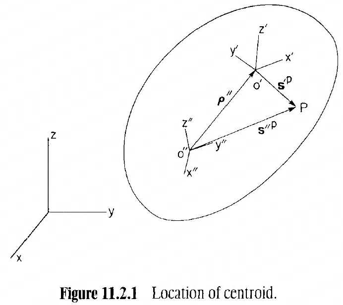
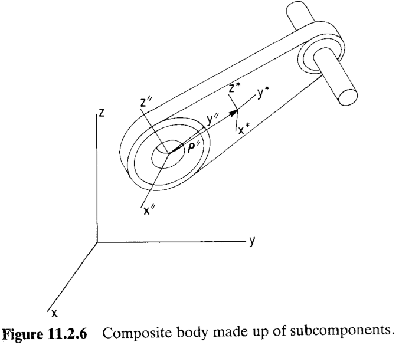
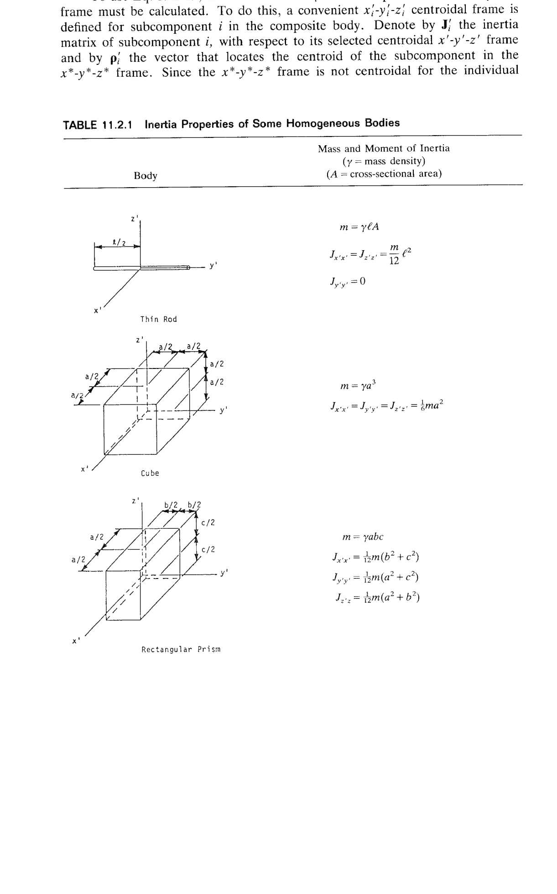
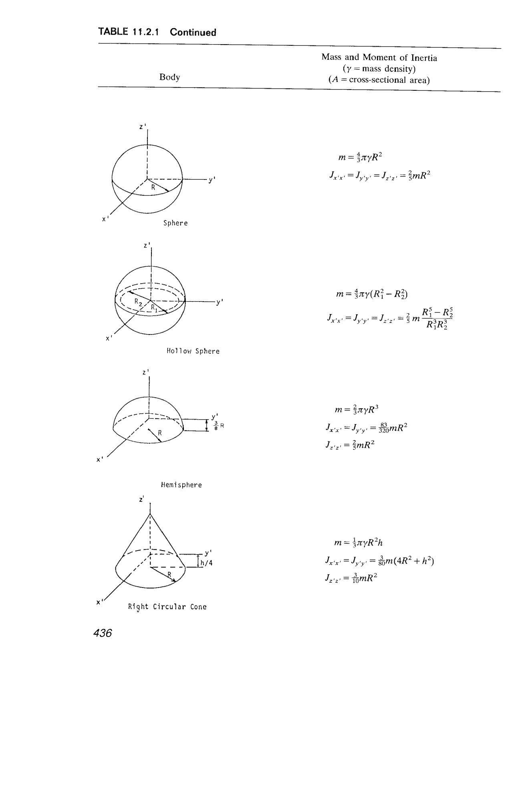
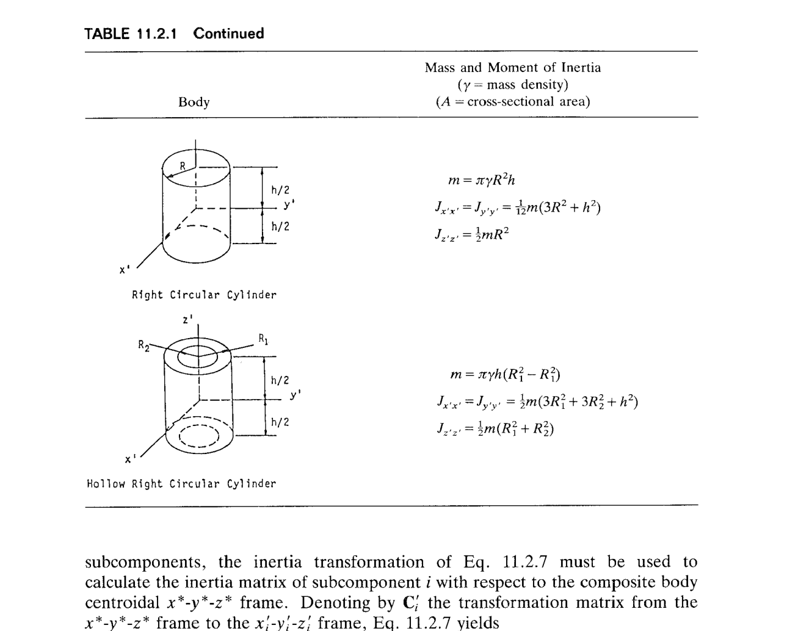
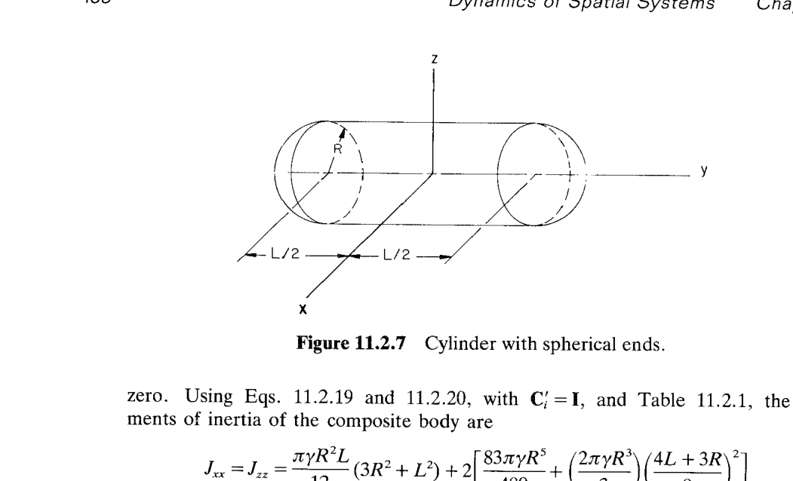
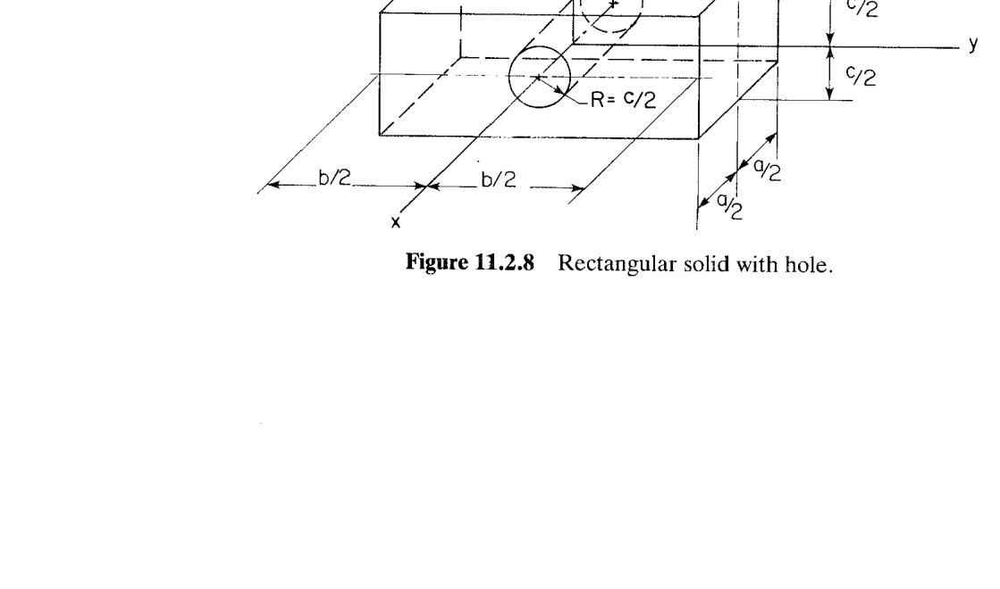

# 11.2 质心 / 惯性矩 / 惯性积 的性质

> 来源：*Computer Aided Kinematics and Dynamics of Mechanical Systems*，第 11 章，§11.2（书页 425–439）。
> 本文以"文字讲解 + 逐式详细推导"组织，公式推导不跳步骤。原书把变分论证与积分变量替换写得很紧，此处把 (Eq. 11.2.5)→(11.2.6) 每一项的成因、平行轴定理条条对应、Example 11.2.3 特征值/特征向量的完整解出等步骤全部展开。

## 引言：本节要解决什么

§11.1 从牛顿定律推出了单体的空间运动方程，其中出现两个"几何-质量"量：**质心（centroid, center of mass）** 位置向量 $\boldsymbol\rho''$（相对于随体非质心系原点 $O''$）以及**惯性矩阵（inertia matrix / inertia tensor）** $\mathbf J'$（相对于质心随体系）。这两个量决定了运动方程的系数——不算清楚它们就没有可用的动力学模型。§11.2 系统回答四个问题：

1. **如何求质心**：给定质量分布，$\boldsymbol\rho''=\frac{1}{m}\int_m\mathbf s''^P\,dm$；对称性可省一半积分（Eq. 11.2.3）。
2. **如何把 $\mathbf J$ 从一系搬到另一系**：包含平移（**平行轴定理，parallel axis theorem**，Eqs. 11.2.8–11.2.9）与转动（$\mathbf J'=\mathbf C\mathbf J''\mathbf C^T$，Eq. 11.2.13）。
3. **主轴（principal axes）与主惯性矩（principal moments of inertia）**：对任何刚体总能找到质心系使 $\mathbf J$ 成对角矩阵；由 $\mathbf J''$ 的正交特征分解直接给出（Eqs. 11.2.14–11.2.17）。
4. **复合体（composite body）**：机器零件几乎都由若干标准形状（圆柱、球、长方体等）拼装或掏空得到；把每块子部件的 $\mathbf J^*_i$ 加起来即可（Eqs. 11.2.18–11.2.20；表 11.2.1 给出标准形状的公式；空洞按**负质量**处理）。

这一节是几何/质量计算，本身**不引入新物理**——但它给出的 $m,\boldsymbol\rho'',\mathbf J'$ 是 §11.3 起系统级方程的输入。

## 11.2.1 非质心坐标系下的质心（Centroid）

工程建模时，由于种种原因会使用非质心坐标系。如下图，刚体质心坐标系为 $x'\text{-}y'\text{-}z'$，非质心坐标系 $x''\text{-}y''\text{-}z''$。

设 $\mathbf C$ 是从非质心坐标系 $x''\text{-}y''\text{-}z''$ 系转到质心坐标系 $x'\text{-}y'\text{-}z'$ 系的旋转变换矩阵。则对于刚体上任意一点 $P$，其在质心坐标系下坐标为 $\mathbf s'$，在非质心坐标系下坐标为 $\mathbf s''$，有：

$$
\mathbf s'^P=\mathbf C(\mathbf s''^P-\boldsymbol\rho'') \tag{11.2.0}
$$

其中 $\boldsymbol\rho''$ 是质心 $O'$ 在非质心坐标系 $x''\text{-}y''\text{-}z''$ 系转中的坐标。

注意到，在质心坐标系 $x'\text{-}y'\text{-}z'$ 下，满足 (11.1.13)：

$$
\int_m \mathbf s'^P\,dm(P)=\mathbf 0 \tag{11.1.13}
$$

将 Eq 11.2.0 代入 Eq 11.1.13 左侧，得到：

$$
\begin{aligned}
\int_m\mathbf s'^P\,dm(P)
&=\int_m \mathbf C\bigl(\mathbf s''^P-\boldsymbol\rho''\bigr)dm(P)\\
&=\mathbf C\int_m\mathbf s''^P\,dm(P)-\mathbf C\boldsymbol\rho''\int_m dm(P)\\
&=\mathbf C\int_m\mathbf s''^P\,dm(P)-m\,\mathbf C\boldsymbol\rho''=\mathbf 0
\end{aligned}
$$

左乘 $\mathbf C^T=\mathbf C^{-1}$（$\mathbf C$ 正交）得

$$
\boxed{\;\boldsymbol\rho''=\dfrac{1}{m}\int_m\mathbf s''^P\,dm(P)\;} \tag{11.2.1}
$$

即**质心 = 质量加权平均位置**。特别值得注意的是，Eq 11.2.1 不包含变换矩阵 $\mathbf C$ ——即上述结论与选择的非质心坐标系无关。

**推论**：若刚体质量均匀，且有**对称轴（axis of symmetry）**——则质心必在轴上。

## 11.2.2 非质心坐标系下的转动惯量

### 一般形式

在质心坐标系下，转动惯量 $\mathbf J'=-\int_m\tilde{\mathbf s}'^P\tilde{\mathbf s}'^P dm$（Eq. 11.1.17）。在非惯性坐标系下：

$$
\mathbf J''\equiv-\int_m\tilde{\mathbf s}''^P\tilde{\mathbf s}''^P\,dm(P) \tag{11.2.4}
$$

将 Eq 11.2.0 代入，注意波浪号算子对加法线性 $\widetilde{\boldsymbol\rho''+\mathbf C^T\mathbf s'^P}=\tilde{\boldsymbol\rho}''+\widetilde{\mathbf C^T\mathbf s'^P}$，并引入 Eq. 9.2.21，即 $\widetilde{\mathbf C^T\mathbf s'}=\mathbf C^T\tilde{\mathbf s}'\mathbf C$，得到：

$$
\begin{aligned}
\mathbf J''
&=-\int_m\bigl(\tilde{\boldsymbol\rho}''+\widetilde{\mathbf C^T\mathbf s'^P}\bigr)\bigl(\tilde{\boldsymbol\rho}''+\widetilde{\mathbf C^T\mathbf s'^P}\bigr)dm(P)\\
&=-m\tilde{\boldsymbol\rho}''\tilde{\boldsymbol\rho}''
-\tilde{\boldsymbol\rho}''\mathbf C^T\!\!\int_m\!\!\tilde{\mathbf s}'^P dm(P)\,\mathbf C-\mathbf C^T\!\!\int_m\!\!\tilde{\mathbf s}'^P dm(P)\,\mathbf C\tilde{\boldsymbol\rho}''
-\mathbf C^T\!\!\int_m\!\!\tilde{\mathbf s}'^P\tilde{\mathbf s}'^P dm(P)\,\mathbf C
\end{aligned}
$$

注意到质心的定义，$\int_m\mathbf s'^P dm=\mathbf 0$，所以中间两项都为0，得到：

$$
\mathbf J''=\mathbf C^T\mathbf J'\mathbf C-m\tilde{\boldsymbol\rho}''\tilde{\boldsymbol\rho}''
$$

进一步利用波浪号算子的恒等式（Eq. 9.1.28），$-\tilde{\mathbf a}\tilde{\mathbf a}=\mathbf a^T\mathbf a\,\mathbf I-\mathbf a\mathbf a^T$，得到惯性张量的**平移 + 转动**标准形式：

$$
\boxed{\;\mathbf J''=\mathbf C^T\mathbf J'\mathbf C+m\bigl(\boldsymbol\rho''^T\boldsymbol\rho''\,\mathbf I-\boldsymbol\rho''\boldsymbol\rho''^T\bigr).\;} \tag{11.2.7}
$$

### 平行轴定理

**特别的，如果只有平移，没有转动**，$\mathbf C=\mathbf I$。设 $\boldsymbol\rho''=[\rho_{x''},\rho_{y''},\rho_{z''}]^T$，则

$$
m\bigl(\boldsymbol\rho''^T\boldsymbol\rho''\mathbf I-\boldsymbol\rho''\boldsymbol\rho''^T\bigr)
=m\begin{bmatrix}
\rho_{y''}^2+\rho_{z''}^2 & -\rho_{x''}\rho_{y''} & -\rho_{x''}\rho_{z''}\\
-\rho_{x''}\rho_{y''} & \rho_{x''}^2+\rho_{z''}^2 & -\rho_{y''}\rho_{z''}\\
-\rho_{x''}\rho_{z''} & -\rho_{y''}\rho_{z''} & \rho_{x''}^2+\rho_{y''}^2
\end{bmatrix}.
$$

则平移后的转动惯量 $\mathbf J''$ 的对角元为：

$$
\boxed{\;
\begin{aligned}
J_{x''x''}&=J_{x'x'}+m(\rho_{y''}^2+\rho_{z''}^2)\\
J_{y''y''}&=J_{y'y'}+m(\rho_{x''}^2+\rho_{z''}^2)\\
J_{z''z''}&=J_{z'z'}+m(\rho_{x''}^2+\rho_{y''}^2)
\end{aligned}\;}
\tag{11.2.8}
$$

非对角元素为：

$$
\boxed{\;
\begin{aligned}
J_{x''y''}&=J_{x'y'}-m\rho_{x''}\rho_{y''}\\
J_{x''z''}&=J_{x'z'}-m\rho_{x''}\rho_{z''}\\
J_{y''z''}&=J_{y'z'}-m\rho_{y''}\rho_{z''}
\end{aligned}\;}
\tag{11.2.9}
$$

这就是张量版本的平行轴定理。

### 对称平面 → 两个惯性积为零

若刚体质量均匀分布，且关于 $x''\text{-}y''$ 平面对称，则容易得到：

$$
J_{z''x''}=-\int_m z''x''\,dm=0,\qquad J_{z''y''}=-\int_m z''y''\,dm=0. \tag{11.2.10}
$$

同理若 $x''\text{-}z''$ 平面对称，则 $J_{x''y''}=J_{z''y''}=0$（Eq. 11.2.11）；若 $y''\text{-}z''$ 平面对称，则 $J_{x''y''}=J_{x''z''}=0$（Eq. 11.2.12）。

**推论**：**若刚体关于两个坐标平面同时对称，则三个惯性积全部为零**。这一性质在机械件中很常见（旋转体、板、方体等）。

## 11.2.3 主轴（Principal Axes）与主惯性矩

即使刚体没有明显对称面，也总能找到一个**质心系**使得 $\mathbf J$ 成为对角矩阵。

假设 $x'\text{-}y'\text{-}z'$ 和 $x''\text{-}y''\text{-}z''$ 是两个朝向不同的质心坐标系（即原点均为质心点），$\mathbf C$ 是从 $x''\text{-}y''\text{-}z''$ 转到 $x'\text{-}y'\text{-}z'$ 的旋转变换矩阵。在 $x'\text{-}y'\text{-}z'$ 下，转动惯量为 $\mathbf J'$；在 $x''\text{-}y''\text{-}z''$，转动惯量为 $\mathbf J''$。

则根据 Eq 11.2.7，由于质心相同，此时两个转动惯量的关系为：

$$
\mathbf J''=\mathbf C^T\mathbf J'\mathbf C \;\;\Longleftrightarrow\;\; \mathbf J'=\mathbf C\mathbf J''\mathbf C^T. \tag{11.2.13}
$$

下面讨论如何找到 $\mathbf C$ 使 $\mathbf J'$ 为对角矩阵。

### $\mathbf J''$ 的半正定性

对任何 $\mathbf a\in\mathbb R^3$：

$$
\mathbf a^T\mathbf J''\mathbf a=-\int_m\mathbf a^T\tilde{\mathbf s}''\tilde{\mathbf s}''\mathbf a\,dm
=\int_m\mathbf a^T\tilde{\mathbf s}''^T\tilde{\mathbf s}''\mathbf a\,dm
=\int_m(\tilde{\mathbf s}''\mathbf a)^T(\tilde{\mathbf s}''\mathbf a)\,dm\ge 0
$$

由于可以得到 $\mathbf J''$ 半正定，所有特征值均非负。

### 谱分解与主轴化

根据上面的结论，设 $3\times3$ 半正定对称矩阵 $\mathbf J''$ 有三个相互正交的单位**特征向量** $\mathbf f'',\mathbf g'',\mathbf h''$，对应非负**特征值** $\zeta_1\ge\zeta_2\ge\zeta_3\ge0$：

$$
\mathbf J''\mathbf f''=\zeta_1\mathbf f'',\quad \mathbf J''\mathbf g''=\zeta_2\mathbf g'',\quad \mathbf J''\mathbf h''=\zeta_3\mathbf h''
$$

由于 $-\mathbf g'',-\mathbf h''$ 也是特征向量，可调整符号让 $[\mathbf f'',\mathbf g'',\mathbf h'']$ 构成**右手系**。此三列即质心 $x'$ 系的坐标轴在 $x''$ 系中的坐标；由 Eq. 9.2.13：

$$
\mathbf C^T=[\mathbf f'',\mathbf g'',\mathbf h''].
$$

代回 (11.2.13)：

$$
\begin{aligned}
\mathbf J'&=\mathbf C\mathbf J''\mathbf C^T
=[\mathbf f'',\mathbf g'',\mathbf h'']^T\mathbf J''[\mathbf f'',\mathbf g'',\mathbf h'']\\
&=[\mathbf f'',\mathbf g'',\mathbf h'']^T[\mathbf J''\mathbf f'',\ \mathbf J''\mathbf g'',\ \mathbf J''\mathbf h'']\\
&=[\mathbf f'',\mathbf g'',\mathbf h'']^T[\zeta_1\mathbf f'',\ \zeta_2\mathbf g'',\ \zeta_3\mathbf h'']\\
&=[\mathbf f'',\mathbf g'',\mathbf h'']^T[\mathbf f'',\mathbf g'',\mathbf h'']\operatorname{diag}(\zeta_1,\zeta_2,\zeta_3)\\
&=\operatorname{diag}(\zeta_1,\zeta_2,\zeta_3). \tag{11.2.17}
\end{aligned}
$$

（最后一步用了 $[\mathbf f'',\mathbf g'',\mathbf h'']$ 正交 ⇒ $[\mathbf f'',\mathbf g'',\mathbf h'']^T[\mathbf f'',\mathbf g'',\mathbf h'']=\mathbf I$。）

对于这样的 $x'\text{-}y'\text{-}z'$ 坐标系，其坐标轴被称为**主轴（principal axes）**，对角元素 $\zeta_i$ 叫**主惯性矩（principal moments of inertia）**；**主惯性积（principal products of inertia）为零**。

## 11.2.4 复合体（Composite Bodies）的惯性性质

### 思路

工程零件常由**若干标准形状子部件（subcomponents）** 拼装（曲柄 = 中间圆盘 + 两端圆柱等），甚至含**空洞（voids）**（钻孔、掏槽）。目标：**从每块子部件的 $m_i,\boldsymbol\rho_i,\mathbf J_i$ 组装出整体的 $m,\boldsymbol\rho'',\mathbf J^*$**——把连续积分变成有限求和，可解析、可编程。

### 复合体的质心（Eq. 11.2.18）

选便于测量的 $x''$ 系（可能不是任何子部件的质心系）。整体积分拆成子部件积分：

$$
\boldsymbol\rho''=\frac{1}{m}\int_m\mathbf s''^P dm(P)
=\frac{1}{m}\sum_{i=1}^{k}\int_{m_i}\mathbf s''^P dm(P)
=\frac{1}{m}\sum_{i=1}^{k}m_i\boldsymbol\rho''_i,
\qquad m=\sum_{i=1}^{k}m_i. \tag{11.2.18}
$$

（第二步：**每个子部件对 $x''$ 系的质心积分等于其质量乘其质心在 $x''$ 系里的位置**——因这正是 (11.2.1) 应用于该子部件的形式。）

### 复合体的惯性矩阵（Eq. 11.2.19）

记复合体的质心系为 $x^*\text{-}y^*\text{-}z^*$（用星号以避免与子部件的质心系 $x'_i\text{-}y'_i\text{-}z'_i$ 混淆）。由 (11.1.17)

$$
\mathbf J^*=-\int_m\tilde{\mathbf s}^{*P}\tilde{\mathbf s}^{*P}dm(P)
=\sum_{i=1}^{k}\Bigl(-\int_{m_i}\tilde{\mathbf s}^{*P}\tilde{\mathbf s}^{*P}dm(P)\Bigr)
=\sum_{i=1}^{k}\mathbf J^*_i, \tag{11.2.19}
$$

其中 $\mathbf J^*_i$ 是**子部件 $i$ 在复合体质心系 $x^*$ 中的惯性矩阵**（**注意不是子部件自身质心系里的**）。

### 每个子部件的 $\mathbf J^*_i$ 由 Eq. 11.2.7 得（Eq. 11.2.20）

对第 $i$ 块，用 (11.2.7)：设 $\mathbf C'_i$ 是从 $x^*$ 系到子部件质心系 $x'_i$ 的变换矩阵，$\boldsymbol\rho'_i$ 为子部件质心在 $x^*$ 系中的位置向量，则

$$
\boxed{\;\mathbf J^*_i=\mathbf C'^T_i\mathbf J'_i\mathbf C'_i+m_i\bigl(\boldsymbol\rho'^T_i\boldsymbol\rho'_i\,\mathbf I-\boldsymbol\rho'_i\boldsymbol\rho'^T_i\bigr).\;} \tag{11.2.20}
$$

**用法**：
1. **确定 $\boldsymbol\rho'_i$**：从 (11.2.18) 算出复合体质心 $\boldsymbol\rho''$（相对 $x''$ 系），再把 $x^*$ 系原点平移到该处；然后子部件 $i$ 的质心相对 $x^*$ 系的位置就是 $\boldsymbol\rho'_i=\boldsymbol\rho''_i-\boldsymbol\rho''$。
2. **确定 $\mathbf C'_i$**：如果 $x^*$ 与 $x'_i$ 轴向平行则 $\mathbf C'_i=\mathbf I$，(11.2.20) 退化为平行轴定理；若不平行，先按几何写出 $\mathbf C'_i$（$x'_i$ 系三根单位轴在 $x^*$ 系中的坐标）。
3. **查/算 $\mathbf J'_i$**：从表 11.2.1 中直接取，或按标准形状公式计算。

### 空洞（voids）的处理

**若子部件为空洞**，把它当作**负质量的实体**：赋 $-\mathbf J^*_i$（其中 $\mathbf J^*_i$ 是若空洞被实心填满、同密度物质占据后应有的惯性矩阵）加到 (11.2.19) 中即可。质心公式 (11.2.18) 同理，对空洞用 $-m_i$。

### 标准形状：Table 11.2.1

**关键公式摘录**（均为**质心系**中的对角惯性矩，惯性积为零；$\gamma=$ 质量密度、$A=$ 截面积）：

| 形状 | 质量 $m$ | $J_{x'x'}$ | $J_{y'y'}$ | $J_{z'z'}$ |
|---|---|---|---|---|
| 细杆（沿 $y'$，长 $\ell$） | $\gamma\ell A$ | $\tfrac{m}{12}\ell^2$ | $0$ | $\tfrac{m}{12}\ell^2$ |
| 立方体（边 $a$） | $\gamma a^3$ | $\tfrac{1}{6}ma^2$ | $\tfrac{1}{6}ma^2$ | $\tfrac{1}{6}ma^2$ |
| 长方体（$a,b,c$，分别沿 $x',y',z'$） | $\gamma abc$ | $\tfrac{m}{12}(b^2+c^2)$ | $\tfrac{m}{12}(a^2+c^2)$ | $\tfrac{m}{12}(a^2+b^2)$ |
| 实心球（半径 $R$） | $\tfrac{4}{3}\pi\gamma R^3$ | $\tfrac{2}{5}mR^2$ | $\tfrac{2}{5}mR^2$ | $\tfrac{2}{5}mR^2$ |
| 空心球（外 $R_1$、内 $R_2$）* | $\tfrac{4}{3}\pi\gamma(R_1^3-R_2^3)$ | $\tfrac{2}{5}m\dfrac{R_1^5-R_2^5}{R_1^3-R_2^3}$ | 同左 | 同左 |
| 半球（半径 $R$，扁面朝 $-z'$，质心在 $z'=3R/8$） | $\tfrac{2}{3}\pi\gamma R^3$ | $\tfrac{83}{320}mR^2$ | $\tfrac{83}{320}mR^2$ | $\tfrac{2}{5}mR^2$ |
| 正圆锥（半径 $R$、高 $h$，轴 $z'$、质心 $z'=h/4$） | $\tfrac{1}{3}\pi\gamma R^2 h$ | $\tfrac{3}{80}m(4R^2+h^2)$ | $\tfrac{3}{80}m(4R^2+h^2)$ | $\tfrac{3}{10}mR^2$ |
| 正圆柱（半径 $R$、长 $h$，轴 $z'$） | $\pi\gamma R^2 h$ | $\tfrac{1}{12}m(3R^2+h^2)$ | 同左 | $\tfrac{1}{2}mR^2$ |
| 空心圆柱（$R_1,R_2,h$） | $\pi\gamma h(R_1^2-R_2^2)$ | $\tfrac{1}{12}m(3R_1^2+3R_2^2+h^2)$ | 同左 | $\tfrac{1}{2}m(R_1^2+R_2^2)$ |

> \* **原书表格空心球一行有印刷错误**：书上把 $m$ 的括号写成 $(R_1^2-R_2^2)$、把 $J$ 的分母写成 $R_1^3R_2^3$（无减号）。正确形式应为 $m=\tfrac{4}{3}\pi\gamma(R_1^3-R_2^3)$、$J=\tfrac{2}{5}m\dfrac{R_1^5-R_2^5}{R_1^3-R_2^3}$（可直接由 $m=\int_0^{R_1}-\int_0^{R_2}$ 与 $J=\tfrac{8}{15}\pi\gamma(R_1^5-R_2^5)$ 相除验证）。本笔记按正确形式使用。

### 例 11.2.4：两端带半球盖的圆柱

> 图 11.2.7：均匀圆柱（半径 $R$、长 $L$，沿 $y$ 轴）两端各拼一个半球（球心处即圆柱端面圆心）。$x$-$y$-$z$ 三平面均对称 ⇒ 质心在原点、所有惯性积为零，只需算三个 $J_{xx},J_{yy},J_{zz}$。

**核心**：三块子部件——中央圆柱（记 1），两个半球（记 2、3）；对 $y$ 轴，两个半球质心距原点 $L/2+3R/8=(4L+3R)/8$（半球质心距扁面 $3R/8$）。所有 $\mathbf C'_i=\mathbf I$（每个子部件质心系都平行于 $x$-$y$-$z$）。

**$J_{xx}=J_{zz}$**（对 $y$-轴的对称+扁面在 $\pm y$）：

- 圆柱贡献：由表 11.2.1（圆柱沿 $y'$，与图中沿 $y$ 一致）$J^{cyl}_{xx}=\tfrac{m_1}{12}(3R^2+L^2)$，$m_1=\pi\gamma R^2 L$，故
  $$
  J^{cyl}_{xx}=\dfrac{\pi\gamma R^2 L}{12}(3R^2+L^2).
  $$
- 半球贡献：每个半球 $m_h=\tfrac{2}{3}\pi\gamma R^3$，本身质心系里 $J^{hemi}_{x'x'}=\tfrac{83}{320}m_h R^2=\tfrac{83\pi\gamma R^5}{480}$；用 (11.2.20)（$\mathbf C=\mathbf I$、$\rho^y=(4L+3R)/8$、其他 $\rho=0$），平行轴增量 $m_h\bigl((4L+3R)/8\bigr)^2$。两个半球对称贡献 $\times 2$：
  $$
  2\Bigl[\dfrac{83\pi\gamma R^5}{480}+\Bigl(\dfrac{2\pi\gamma R^3}{3}\Bigr)\Bigl(\dfrac{4L+3R}{8}\Bigr)^{\!2}\Bigr].
  $$

合计

$$
\boxed{\;J_{xx}=J_{zz}=\dfrac{\pi\gamma R^2 L}{12}(3R^2+L^2)+2\Bigl[\dfrac{83\pi\gamma R^5}{480}+\Bigl(\dfrac{2\pi\gamma R^3}{3}\Bigr)\Bigl(\dfrac{4L+3R}{8}\Bigr)^{\!2}\Bigr].\;}
$$

**$J_{yy}$**（对 $y$ 轴自旋）：

- 圆柱：$J^{cyl}_{yy}=\tfrac{1}{2}m_1 R^2=\tfrac{\pi\gamma R^4 L}{2}$。
- 半球：$J^{hemi}_{y'y'}=\tfrac{2}{5}m_h R^2=\tfrac{4\pi\gamma R^5}{15}$；**因 $y$ 轴经过半球质心，无平行轴附加项**。两个半球贡献 $\times 2$。

$$
\boxed{\;J_{yy}=\dfrac{\pi\gamma R^4 L}{2}+2\Bigl[\dfrac{4\pi\gamma R^5}{15}\Bigr].\;}
$$

### 例 11.2.5：长方体挖圆柱孔

> 图 11.2.8：长方体 $a\times b\times c$（沿 $x$、$y$、$z$），沿 $x$ 轴挖穿一个半径 $R=c/2$ 的圆孔。三坐标面全对称 ⇒ 质心在原点、惯性积为零。

设 $\mathbf J_1$ 为整块长方体（无孔），$\mathbf J_2$ 为将占据孔的圆柱（同密度 $\gamma$）。**空洞按负质量处理**：$\mathbf J=\mathbf J_1-\mathbf J_2$。

**长方体（$a,b,c$）**：$m_{\text{bar}}=\gamma abc$，
$$
J_{1,xx}=\dfrac{m_{\text{bar}}}{12}(b^2+c^2)=\dfrac{\gamma abc}{12}(b^2+c^2),\quad
J_{1,yy}=\dfrac{\gamma abc}{12}(a^2+c^2),\quad
J_{1,zz}=\dfrac{\gamma abc}{12}(a^2+b^2).
$$

**孔（圆柱，轴沿 $x$，半径 $R=c/2$，长 $a$）**：$m_{\text{hole}}=\pi\gamma R^2 a=\pi\gamma c^2 a/4$。查表 11.2.1（**注意本孔的对称轴沿 $x$、不是表中的 $z'$**：把公式里 $z'$ 换成 $x$ 后使用）：
- $J_{2,xx}=\tfrac{1}{2}m_{\text{hole}} R^2=\tfrac{1}{2}\cdot\tfrac{\pi\gamma c^2 a}{4}\cdot\tfrac{c^2}{4}=\dfrac{\pi\gamma c^4 a}{32}$；
- $J_{2,yy}=J_{2,zz}=\tfrac{m_{\text{hole}}}{12}(3R^2+a^2)=\dfrac{\pi\gamma c^2 a}{48}\Bigl(\tfrac{3c^2}{4}+a^2\Bigr)$。

**孔的质心在长方体质心处**⇒ 无平行轴附加项。相减：

$$
\boxed{\;\begin{aligned}
J_{xx}&=\dfrac{\gamma abc}{12}(b^2+c^2)-\dfrac{\pi\gamma c^4 a}{32}\\
J_{yy}&=\dfrac{\gamma abc}{12}(a^2+c^2)-\dfrac{\pi\gamma c^2 a}{48}\Bigl(\dfrac{3c^2}{4}+a^2\Bigr)\\
J_{zz}&=\dfrac{\gamma abc}{12}(a^2+b^2)-\dfrac{\pi\gamma c^2 a}{48}\Bigl(\dfrac{3c^2}{4}+a^2\Bigr)
\end{aligned}\;}
$$

## 小结

本节把 §11.1 的运动方程所需的**几何 + 质量**输入完全形式化：

- **质心**（Eq. 11.2.1）：单个连续积分；对称面 ⇒ 质心在面上（Eq. 11.2.3）。
- **惯性矩阵变换**（Eqs. 11.2.6/11.2.7）：包含转动 $\mathbf C$ 与平移 $\boldsymbol\rho''$；平行系退化即**平行轴定理**（Eqs. 11.2.8/11.2.9）；两坐标面对称 ⇒ 三惯性积全零。
- **主轴/主惯性矩**（Eqs. 11.2.13–11.2.17）：任何刚体在质心系中总可对角化，特征向量给主轴、特征值给主惯性矩。
- **复合体**（Eqs. 11.2.18–11.2.20）：整体 = 子部件之和；表 11.2.1 提供标准形状公式；**空洞按负质量处理**。

书末段的告诫值得放在心上：手工按这些公式做一个真实机械（汽车骨架、起落架、机器人臂）会**枯燥且极易出错**。这节的价值在于——它是**计算机代码（solid modeler + CAE）** 系统性求 $m,\boldsymbol\rho,\mathbf J$ 的**数学基础**；工程师只需检验输入几何与材料属性正确，输出即可作为 §11.3 起系统级动力学方程的直接输入。
