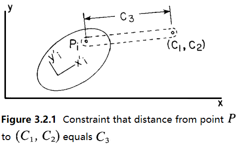
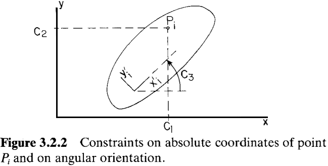
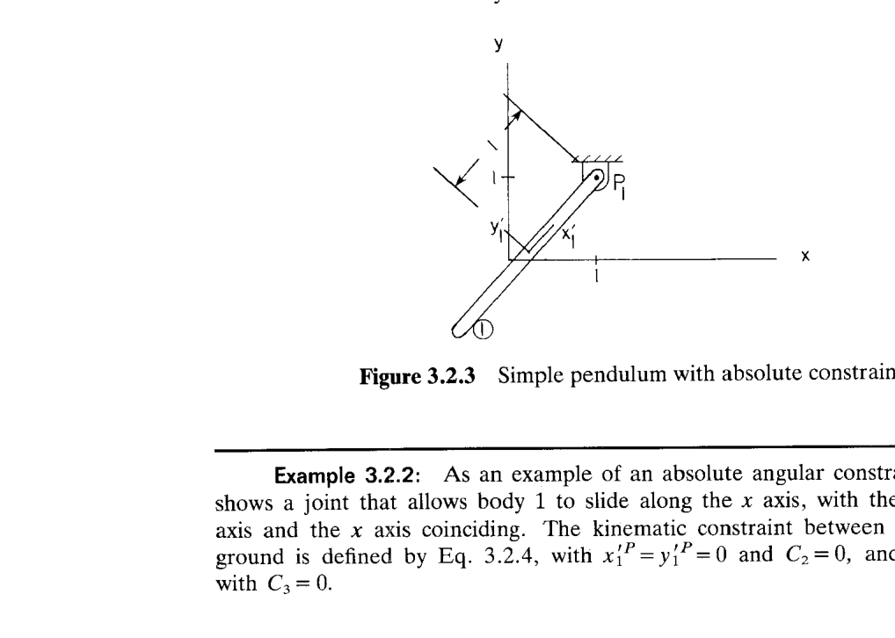
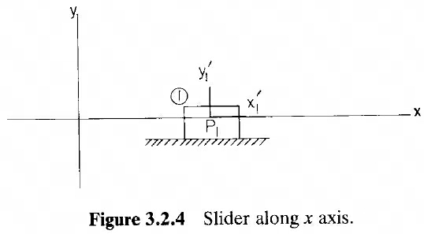

# 3.2 刚体和地面的约束（Constraints between a body and ground: Absolute Constraints）

> 来源：*Computer Aided Kinematics and Dynamics of Mechanical Systems, Vol. 1*，第 3 章，3.2 节（书页 57–60）。

---

## 引言：本节要解决什么

本节给出刚体 $i$ 与地面（即固定的全局 $x$-$y$ 参考系）之间**最基本的四种约束**的基本信息，包括**约束方程**、**雅可比 $\Phi_{\mathbf{q}_i}$**、**速度方程右端项 $\nu$**、**加速度方程右端项 $\gamma$**。

- 绝对距离约束 $\Phi^{ad(i)}$

| 量 | 表达式 |
|----|--------|
| 约束方程 | $(\mathbf{r}_i^P-\mathbf{C})^T(\mathbf{r}_i^P-\mathbf{C})-C_3^2=0$ |
| 约束数 | $1$ |
| $\Phi_{\mathbf{q}_i}^{ad(i)}$ | $\bigl[\,2(x_i^P-C_1),\;2(y_i^P-C_2),\;2\bigl[-(x_i^P-C_1)(x_i'^P\sin\phi_i+y_i'^P\cos\phi_i)+(y_i^P-C_2)(x_i'^P\cos\phi_i-y_i'^P\sin\phi_i)\bigr]\,\bigr]$ |
| $\nu^{ad(i)}$ | $0$ |
| $\gamma^{ad(i)}$ | $-2\bigl[\,\dot{\mathbf{r}}_i^{PT}\dot{\mathbf{r}}_i^P-\mathbf{s}_i'^{PT}\mathbf{A}_i^T(\mathbf{r}_i^P-\mathbf{C})\,\dot\phi_i^{\,2}\bigr]$ |

- 绝对位置约束，$x$ 方向 $\Phi^{ax(i)}$

| 量 | 表达式 |
|----|--------|
| 约束方程 | $x_i+x_i'^P\cos\phi_i-y_i'^P\sin\phi_i-C_1=0$ |
| 约束数 | $1$ |
| $\Phi_{\mathbf{q}_i}^{ax(i)}$ | $[\,1,\;0,\;-x_i'^P\sin\phi_i-y_i'^P\cos\phi_i\,]$ |
| $\nu^{ax(i)}$ | $0$ |
| $\gamma^{ax(i)}$ | $(x_i'^P\cos\phi_i-y_i'^P\sin\phi_i)\,\dot\phi_i^{\,2}$ |

- 绝对位置约束，$y$ 方向 $\Phi^{ay(i)}$

| 量 | 表达式 |
|----|--------|
| 约束方程 | $y_i+x_i'^P\sin\phi_i+y_i'^P\cos\phi_i-C_2=0$ |
| 约束数 | $1$ |
| $\Phi_{\mathbf{q}_i}^{ay(i)}$ | $[\,0,\;1,\;x_i'^P\cos\phi_i-y_i'^P\sin\phi_i\,]$ |
| $\nu^{ay(i)}$ | $0$ |
| $\gamma^{ay(i)}$ | $(x_i'^P\sin\phi_i+y_i'^P\cos\phi_i)\,\dot\phi_i^{\,2}$ |

- 绝对角度约束 $\Phi^{a\phi(i)}$

| 量 | 表达式 |
|----|--------|
| 约束方程 | $\phi_i-C_3=0$ |
| 约束数 | $1$ |
| $\Phi_{\mathbf{q}_i}^{a\phi(i)}$ | $[\,0,\;0,\;1\,]$ |
| $\nu^{a\phi(i)}$ | $0$ |
| $\gamma^{a\phi(i)}$ | $0$ |

---

## 零、共同前置量

本章节推导中需要用到的变量，来自第 2 章。包括：

- 刚体坐标系到全局坐标系的旋转变换矩阵 $\mathbf{A}_i$：

$$
\mathbf{A}_i=\begin{bmatrix}\cos\phi_i & -\sin\phi_i\\ \sin\phi_i & \cos\phi_i\end{bmatrix}
$$

- 旋转变换矩阵 $\mathbf{A}_i$ 对角度 $\phi$ 的偏导 $\mathbf{B}_i$（来自 Sec. 2.6）：

$$
\frac{d\mathbf{A}_i}{d\phi_i}=\mathbf{B}_i=\begin{bmatrix}-\sin\phi_i & -\cos\phi_i\\ \cos\phi_i & -\sin\phi_i\end{bmatrix},
\qquad \frac{d\mathbf{B}_i}{d\phi_i}=-\mathbf{A}_i.
$$

- 刚体 $i$ 上一点 $P$ 在刚体坐标系中的位置 $\mathbf{s}_i'^P=[x_i'^P,y_i'^P]^T$，显然其为常量。

- 刚体 $i$ 上一点 $P$ 在全局坐标系中的位置 $\mathbf{r}_i^P$

$$
\mathbf{r}_i^P \;=\; \mathbf{r}_i + \mathbf{A}_i\,\mathbf{s}_i'^P
\;=\;\begin{bmatrix} x_i + x_i'^P\cos\phi_i - y_i'^P\sin\phi_i \\ y_i + x_i'^P\sin\phi_i + y_i'^P\cos\phi_i \end{bmatrix}
$$

---

## 一、绝对距离约束

### 物理场景

如 Fig. 3.2.1，在二维空间 $x-y$ 中，刚体 $i$ 上取一点 $P_i$，在惯性坐标系里有固定一点 $\mathbf{C}=[C_1,C_2]^T$，若 $P_i$ 到 $\mathbf{C}$ 的距离恒为 $C_3>0$，则称之为**绝对距离约束**。此约束会**消除一个自由度**。

### 约束方程：

距离的平方等于 $C_3^2$（避免平方根，方便求导）：

$$
\begin{aligned}
\Phi^{ad(i)} &\equiv (\mathbf{r}_i^P - \mathbf{C})^T(\mathbf{r}_i^P - \mathbf{C}) - C_3^2 \\
&= (x_i + x_i'^P\cos\phi_i - y_i'^P\sin\phi_i - C_1)^2 \\
&\quad + (y_i + x_i'^P\sin\phi_i + y_i'^P\cos\phi_i - C_2)^2 - C_3^2 \;=\; 0.
\end{aligned}
\tag{3.2.1}
$$

### 雅可比 $\Phi_{\mathbf{q}_i}^{ad(i)}$：

为书写简洁，记式 3.2.1 括号内的两项为

$$
x_i^P \equiv x_i + x_i'^P\cos\phi_i - y_i'^P\sin\phi_i,\qquad
y_i^P \equiv y_i + x_i'^P\sin\phi_i + y_i'^P\cos\phi_i,
$$

于是 $\Phi^{ad(i)} = (x_i^P-C_1)^2 + (y_i^P-C_2)^2 - C_3^2$。

根据雅可比的定义：

$$
\Phi_{\mathbf{q}_i}^{ad(i)} =
\left[\dfrac{\partial \Phi^{ad(i)}}{\partial x_i},\;\; \dfrac{\partial \Phi^{ad(i)}}{\partial y_i},\;\; \dfrac{\partial \Phi^{ad(i)}}{\partial \phi_i}\right]
=
\Bigl[\,2(x_i^P-C_1),\;\; 2(y_i^P-C_2),\;\; 2\bigl[-(x_i^P-C_1)(x_i'^P\sin\phi_i+y_i'^P\cos\phi_i)+(y_i^P-C_2)(x_i'^P\cos\phi_i-y_i'^P\sin\phi_i)\bigr]\,\Bigr]
\;
$$

### 速度方程右端项：

$\Phi^{ad(i)}$ 不显含 $t$（约束是**定常**的），所以

$$
\nu^{ad(i)} \;=\; -\Phi_t \;=\; 0
$$

### 加速度方程右端项：

对 $\Phi^{ad(i)}\equiv 0$ 二次求导，略过过程（不大重要），得到：

$$
\ddot{\Phi}^{ad(i)}
= 2\dot{\mathbf{r}}_i^{PT}\dot{\mathbf{r}}_i^P
+ 2(\mathbf{r}_i^P-\mathbf{C})^T\ddot{\mathbf{r}}_i
+ 2\,\mathbf{s}_i'^{PT}\mathbf{B}_i^T(\mathbf{r}_i^P-\mathbf{C})\,\ddot\phi_i
- 2(\mathbf{r}_i^P-\mathbf{C})^T\mathbf{A}_i\mathbf{s}_i'^P\,\dot\phi_i^{\,2}.
$$

其中，$\mathbf{A}$ 和 $\mathbf{B}$ 定义见本章引言。根据加速度方程的定义，除了二阶项以外的部分，就是 $\gamma^{ad(i)}$，因此：

$$
\gamma^{ad(i)}
= -2\bigl[\,\dot{\mathbf{r}}_i^{PT}\dot{\mathbf{r}}_i^P - \mathbf{s}_i'^{PT}\mathbf{A}_i^T(\mathbf{r}_i^P-\mathbf{C})\,\dot\phi_i^{\,2}\,\bigr]
$$

---

## 二、绝对位置约束（$x$ / $y$ 单方向）

### 约束

刚体 $i$ 上的点 $P_i$ 只能沿平行于 $y$ 轴的槽滑动（$x$ 坐标固定为 $C_1$），或只能沿平行于 $x$ 轴的槽滑动（$y$ 坐标固定为 $C_2$）。这样的约束会消除一个自由度。

### 约束方程

由 $\mathbf{r}_i^P=[x_i^P,y_i^P]^T$ 的展开式直接写出：

$$
\Phi^{ax(i)} \equiv x_i^P - C_1 = x_i + x_i'^P\cos\phi_i - y_i'^P\sin\phi_i - C_1 = 0\tag{3.2.3}
$$

$$
\Phi^{ay(i)} \equiv y_i^P - C_2 = y_i + x_i'^P\sin\phi_i + y_i'^P\cos\phi_i - C_2 = 0\tag{3.2.4}
$$

### 雅可比

$$
\begin{aligned}
\Phi_{\mathbf{q}_i}^{ax(i)} &=
 [\,\frac{\partial \Phi^{ax(i)}}{\partial x_i},\; \frac{\partial \Phi^{ax(i)}}{\partial y_i},\; \frac{\partial \Phi^{ax(i)}}{\partial \phi_i}] =
 [\,1,\; 0,\; -x_i'^P\sin\phi_i - y_i'^P\cos\phi_i\,],\\
\Phi_{\mathbf{q}_i}^{ay(i)} &= 
 [\,\frac{\partial \Phi^{ay(i)}}{\partial x_i},\; \frac{\partial \Phi^{ay(i)}}{\partial y_i},\; \frac{\partial \Phi^{ay(i)}}{\partial \phi_i}] =
[\,0,\; 1,\;\phantom{-}x_i'^P\cos\phi_i - y_i'^P\sin\phi_i\,].
\end{aligned}
$$

### 速度右端项

两约束都不显含 $t$，故 $\nu^{ax(i)}=\nu^{ay(i)}=0$。

### 加速度右端项

和绝对距离约束一样，对$\Phi^{ax(i)}$ 两次求导：

$$
\ddot{\Phi}^{ax(i)} = \ddot x_i + (-x_i'^P\sin\phi_i - y_i'^P\cos\phi_i)\,\ddot\phi_i + (-x_i'^P\cos\phi_i + y_i'^P\sin\phi_i)\,\dot\phi_i^{\,2} = 0.
$$

得到：

$$
\gamma^{ax(i)} = (x_i'^P\cos\phi_i - y_i'^P\sin\phi_i)\,\dot\phi_i^{\,2}
$$

类似的：

$$
\gamma^{ay(i)} = (x_i'^P\sin\phi_i + y_i'^P\cos\phi_i)\,\dot\phi_i^{\,2}
$$

---

## 三、绝对角度约束

### 思路与方程

如 Fig. 3.2.2 中，规定刚体 $i$ 的转角为 $C_3$：

$$
\Phi^{a\phi(i)} \equiv \phi_i - C_3 = 0.
\tag{3.2.6}
$$

### 雅可比、$\nu$、$\gamma$

对 $\mathbf{q}_i=[x_i,y_i,\phi_i]^T$ 求偏导：

$$
\Phi_{\mathbf{q}_i}^{a\phi(i)} = [\,0,\; 0,\; 1\,].
\tag{3.2.7}
$$

不含 $t$：$\nu^{a\phi(i)}=0$。二阶求导 $\ddot{\Phi}^{a\phi(i)}=\ddot\phi_i=0$，即 $\Phi_{\mathbf{q}_i}\ddot{\mathbf{q}}_i=\ddot\phi_i$，故

$$
\gamma^{a\phi(i)} = 0.
$$

## 四、四种约束的右端项总结
对于速度约束的右端项 $\nu$：

$$
\nu^{ad(i)} = \nu^{ax(i)} = \nu^{ay(i)} = \nu^{a\phi(i)} = 0,
$$

对于加速度约束的右端项 $\gamma$：

$$
\gamma^{a\phi(i)} = 0,\quad
\gamma^{ax(i)} = (x_i'^P\cos\phi_i - y_i'^P\sin\phi_i)\dot\phi_i^{\,2},\quad
\gamma^{ay(i)} = (x_i'^P\sin\phi_i + y_i'^P\cos\phi_i)\dot\phi_i^{\,2}.
$$

---

## 例 3.2.1：单摆的绝对约束表述

> **设定**：Fig. 3.2.3。体 1（单摆杆，长度 2 单位）的随体系 $x_1'$-$y_1'$ 原点取在**杆的几何中心**，$x_1'$ 轴沿杆指向下方端点。销钉 $P_1$ 位于 $x_1'^P=1$、$y_1'^P=0$（即杆的上端），并被物理上固定在全局系点 $(C_1,C_2)=(1,1)$。求约束方程、雅可比、$\nu$、$\gamma$。

### 约束方程

把销钉钉在 $(1,1)$ 就是"点 $P_1$ 的 $x$、$y$ 坐标各被固定"，直接调用式 3.2.3–3.2.4，代 $x_1'^P=1,y_1'^P=0,C_1=1,C_2=1$：

$$
\begin{aligned}
\Phi^{ax(1)} &= x_1 + \cos\phi_1 - 1 = 0,\\
\Phi^{ay(1)} &= y_1 + \sin\phi_1 - 1 = 0.
\end{aligned}
$$

两条约束、三个坐标，$\text{DOF}=3-2=1$——正是单摆应有的 1 自由度（摆角 $\phi_1$）。

**几何检查**：从 $x_1=1-\cos\phi_1,\; y_1=1-\sin\phi_1$ 得

$$
(x_1-1)^2+(y_1-1)^2=\cos^2\phi_1+\sin^2\phi_1=1,
$$

即体 1 的几何中心 $\mathbf{r}_1=[x_1,y_1]^T$ 落在以 $(1,1)$ 为心、半径 1 的圆上——正是杆中心到销钉 $P_1$ 的距离。物理正确。

### 雅可比与右端项

调用式 3.2.5：

$$
\begin{aligned}
\Phi_{\mathbf{q}_1}^{ax(1)} &= [\,1,\;0,\;-\sin\phi_1\,],\\
\Phi_{\mathbf{q}_1}^{ay(1)} &= [\,0,\;1,\;\phantom{-}\cos\phi_1\,].
\end{aligned}
$$

$\nu^{ax(1)}=\nu^{ay(1)}=0$（无时间依赖，稳态几何）。$\gamma$ 由上节公式：

$$
\gamma^{ax(1)} = \cos\phi_1\,\dot\phi_1^{\,2},\qquad
\gamma^{ay(1)} = \sin\phi_1\,\dot\phi_1^{\,2}.
$$

**与 Example 3.1.1 的等价**：3.1.1 节里用的是 $\Phi^{ad(1)}=(x_1)^2+(y_1)^2 - (\ell/2)^2=0$ 等（一根杆中心到 $O$ 距离固定），本例改用"钉住 $P_1$"的两个位置约束等价刻画同一物理系统——书中原话 "the constraint equations for the simple pendulum of Example 3.1.1 could have been written in this way"，正是强调建模选择的多样性：**同一机构可以有多组等效的约束方程**，工程师可选最方便的一组。

---

## 例 3.2.2：沿 $x$ 轴滑动的滑块

> **设定**：Fig. 3.2.4。体 1 只能沿全局 $x$ 轴平移，且随体 $x_1'$ 轴始终与全局 $x$ 轴重合。参考点 $P_1$ 取在随体系原点（即 $x_1'^P=y_1'^P=0$）。

### 约束方程

"$P_1$ 始终在 $x$ 轴上"= 其 $y$ 坐标恒为 0，调用式 3.2.4，代 $x_1'^P=y_1'^P=0,\;C_2=0$：

$$
\Phi^{ay(1)} = y_1 + 0\cdot\sin\phi_1 + 0\cdot\cos\phi_1 - 0 = y_1 = 0.
$$

"随体 $x_1'$ 轴与全局 $x$ 轴重合"= 转角 $\phi_1$ 恒为 0，调用式 3.2.6，代 $C_3=0$：

$$
\Phi^{a\phi(1)} = \phi_1 - 0 = \phi_1 = 0.
$$

两条约束、三个坐标，$\text{DOF}=1$——正是滑块沿 $x$ 方向的 1 自由度平动。

### 雅可比与右端项

$$
\Phi_{\mathbf{q}_1}^{ay(1)} = [\,0,\;1,\;0\,],\qquad
\Phi_{\mathbf{q}_1}^{a\phi(1)} = [\,0,\;0,\;1\,].
$$

（因 $x_1'^P=y_1'^P=0$，$\phi_1$-分量退化为 0。）$\nu=\gamma=\mathbf{0}$。整个约束子系统的雅可比

$$
\begin{bmatrix}\Phi^{ay(1)}_{\mathbf{q}_1}\\ \Phi^{a\phi(1)}_{\mathbf{q}_1}\end{bmatrix}
=\begin{bmatrix}0 & 1 & 0\\ 0 & 0 & 1\end{bmatrix}
$$

只锁死 $y_1$ 和 $\phi_1$，保留 $x_1$ 自由——正是"沿 $x$ 轴滑动"的运动子空间。
