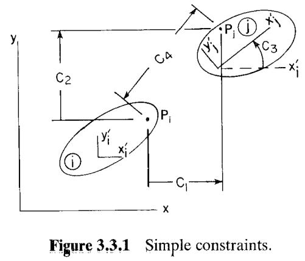
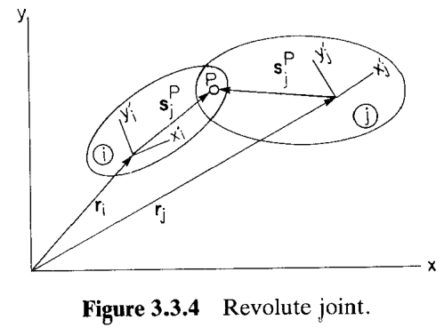
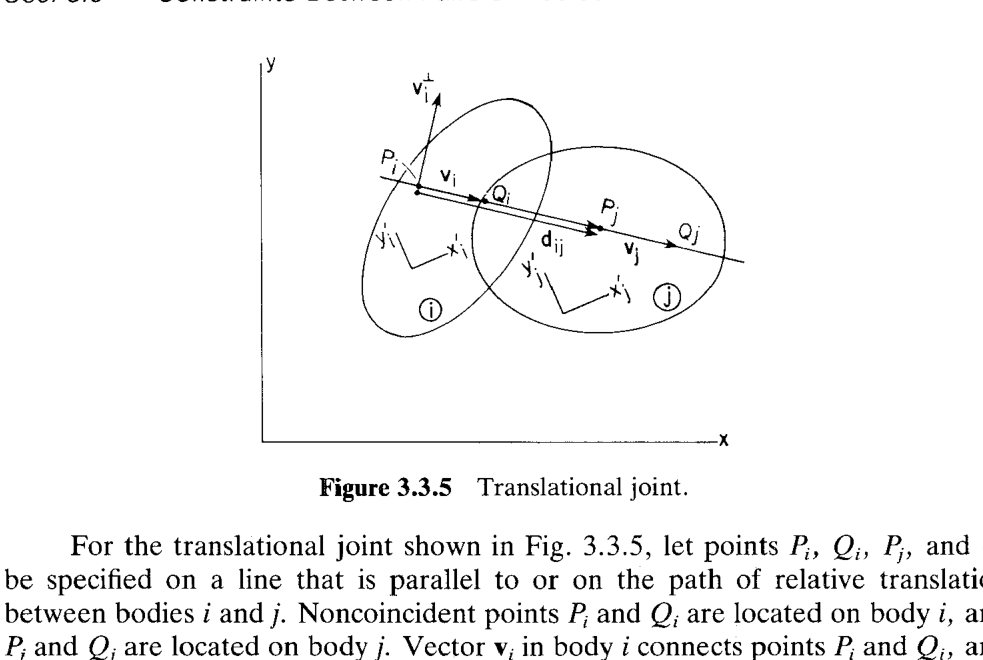
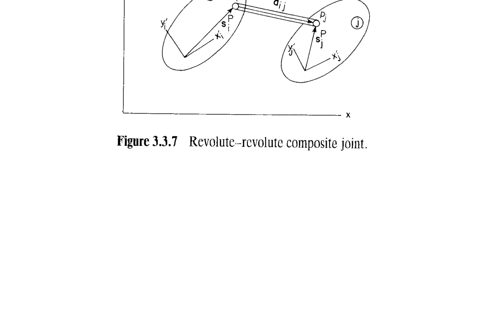
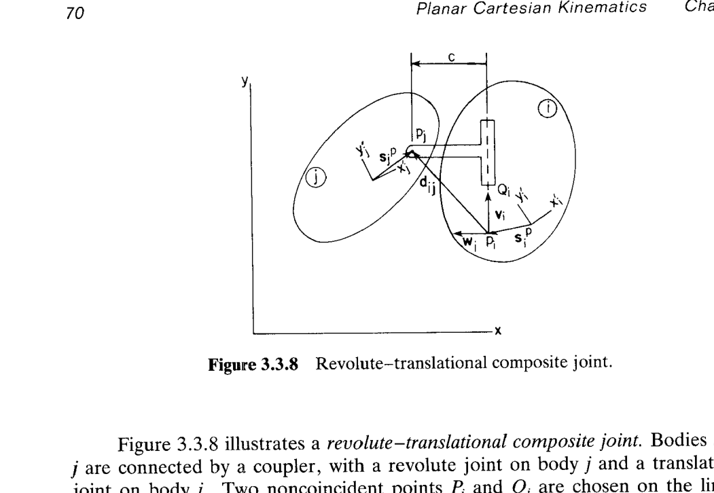

# 3.3 刚体-刚体约束（相对约束 Relative Constraints）

> 来源：*Computer Aided Kinematics and Dynamics of Mechanical Systems, Vol. 1*，第 3 章，3.3 节（书页 61–70）。

---

## 引言：本节要解决什么

3.2 节给出的绝对约束（absolute constraint）只把单个刚体绑到全局系。真实机构中，**绝大多数关节（joint）连接的是两个刚体**：一根曲柄和一根连杆、一个活塞和一个缸。本节系统化地建立"刚体-刚体"约束库，供后续所有机构建模复用。

---

## 3.3.1 相对坐标约束（Relative Coordinate Constraints）

本节要介绍的 4 种相对约束可见下图所示：$C_1$ 是相对 $x$ 的差，$C_2$ 是相对 $y$ 的差，$C_3$ 是相对转角，$C_4$ 是两点距离。
3.2 节的绝对约束将刚体 $i$ 上一点 $P_i$ 的全局坐标 $x_i^P, y_i^P$（或刚体的转角 $\phi_i$）钉在给定常数上；这里只需把"常数"换成"刚体 $j$ 上另一点 $P_j$ 的对应量"，就得到相对约束。图 3.3.1 把 4 种情形叠在一张图里：$C_1$ 是相对 $x$ 的差，$C_2$ 是相对 $y$ 的差，$C_3$ 是相对转角，$C_4$ 是两点距离。

回忆点 $P$ 在全局坐标系中的坐标（Eq. 2.4.8）：

$$
\mathbf{r}_i^P = \mathbf{r}_i + \mathbf{A}_i\mathbf{s}_i^{\prime P}.
$$

写成分量形式：

$$
\begin{bmatrix} x_i^P \\ y_i^P \end{bmatrix}
= \begin{bmatrix} x_i \\ y_i \end{bmatrix}
+ \begin{bmatrix} \cos\phi_i & -\sin\phi_i \\ \sin\phi_i & \phantom{-}\cos\phi_i \end{bmatrix}
  \begin{bmatrix} x_i^{\prime P} \\ y_i^{\prime P} \end{bmatrix}.
$$

展开得：

$$
\begin{aligned}
x_i^P &= x_i + x_i^{\prime P}\cos\phi_i - y_i^{\prime P}\sin\phi_i, \\
y_i^P &= y_i + x_i^{\prime P}\sin\phi_i + y_i^{\prime P}\cos\phi_i.
\end{aligned}
$$

后续 4 种约束都由此展开。

---

## 相对 $x$ 坐标约束

**约束方程：** 要求 $P_j$ 与 $P_i$ 的 $x$ 分量之差等于常数 $C_1$：

$$
\Phi^{rx(i,j)} \equiv x_j^P - x_i^P - C_1 = 0
$$

代入 $P_j$ 与 $P_i$ 的坐标展开式得到：

$$
\Phi^{rx(i,j)} = x_j + x_j^{\prime P}\cos\phi_j - y_j^{\prime P}\sin\phi_j - x_i - x_i^{\prime P}\cos\phi_i + y_i^{\prime P}\sin\phi_i - C_1 = 0 \tag{3.3.1}
$$

**雅可比（Jacobian）：** 直接逐分量求偏导。
对刚体 $i$，广义坐标为 $\mathbf{q}_i = [x_i, y_i, \phi_i]^T$，逐分量求偏导为：

$$
\Phi_{\mathbf{q}_i}^{rx(i,j)} = [-1,\ 0,\ x_i^{\prime P}\sin\phi_i + y_i^{\prime P}\cos\phi_i]
$$

对刚体 $j$，广义坐标为 $\mathbf{q}_j = [x_j, y_j, \phi_j]^T$，逐分量求偏导为：

$$
\Phi_{\mathbf{q}_j}^{rx(i,j)} = [\ 1,\ 0,\ -x_j^{\prime P}\sin\phi_j - y_j^{\prime P}\cos\phi_j]
$$

合并得到：
$$
\Phi_{\mathbf{q}}=[\ \Phi_{\mathbf{q}_i}^{rx(i,j)},\ \Phi_{\mathbf{q}_j}^{rx(i,j)}]=[-1,\ 0,\ x_i^{\prime P}\sin\phi_i + y_i^{\prime P}\cos\phi_i, \ 1,\ 0,\ -x_j^{\prime P}\sin\phi_j - y_j^{\prime P}\cos\phi_j]
$$

后续章节我们会看到如何将上面的式子嵌入到完整的 Jacobian 中。

**速度方程右端 $\nu$。** 由 $\Phi^{rx(i,j)}$ 不显式含 $t$，故：
$$
\nu^{rx(i,j)} = -\Phi_t = 0
$$

**加速度方程右端 $\gamma$。** 由于约束 $\Phi$ 不包含 $t$，因此由 Eq. 3.1.10 可以简化为 $\gamma^{rx(i,j)} = -(\Phi_{\mathbf{q}}\dot{\mathbf{q}})_{\mathbf{q}}\dot{\mathbf{q}}$，其中 $\mathbf{q}=[\ \mathbf{q}_i,\ \mathbf{q}_j]$。直接代入就可以得到：

$$
\gamma^{rx(i,j)}
= -(x_i^{\prime P}\cos\phi_i - y_i^{\prime P}\sin\phi_i)\dot\phi_i^2
+ (x_j^{\prime P}\cos\phi_j - y_j^{\prime P}\sin\phi_j)\dot\phi_j^2
$$

---

## 相对 $y$ 坐标约束

**约束方程：** 要求 $P_j$ 与 $P_i$ 的 $y$ 分量之差等于常数 $C_2$：

$$
\Phi^{ry(i,j)} \equiv y_j^P - y_i^P - C_2=0
$$

展开得到：

$$
\Phi^{ry(i,j)} = y_j + x_j^{\prime P}\sin\phi_j + y_j^{\prime P}\cos\phi_j - y_i - x_i^{\prime P}\sin\phi_i - y_i^{\prime P}\cos\phi_i - C_2 = 0 \tag{3.3.3}
$$

**雅可比**：
$$
\begin{aligned}
\Phi_{\mathbf{q}_i}^{ry(i,j)} &= [\,0,\ -1,\ -x_i^{\prime P}\cos\phi_i + y_i^{\prime P}\sin\phi_i\,] \\
\Phi_{\mathbf{q}_j}^{ry(i,j)} &= [\,0,\ \ 1,\ \ x_j^{\prime P}\cos\phi_j - y_j^{\prime P}\sin\phi_j\,]
\end{aligned}
\tag{3.3.4}
$$

**速度方程右端 $\nu$：** 
$$\nu^{ry(i,j)} = 0$$

**加速度方程右端 $\gamma$：** 

$$
\gamma^{ry(i,j)}=-(x_i^{\prime P}\sin\phi_i + y_i^{\prime P}\cos\phi_i)\dot\phi_i^2+(x_j^{\prime P}\sin\phi_j + y_j^{\prime P}\cos\phi_j)\dot\phi_j^2
$$

---

## 相对 $\phi$ 约束

**约束方程：** 要求刚体 $j$ 与刚体 $i$ 的朝向角度 $\phi$ 的差等于常数 $C_3$：

$$
\Phi^{r\phi(i,j)} \equiv \phi_j - \phi_i - C_3 = 0. \tag{3.3.5}
$$

**雅可比**：
$$
\Phi_{\mathbf{q}_i}^{r\phi(i,j)} = [0, 0, -1], \qquad
\Phi_{\mathbf{q}_j}^{r\phi(i,j)} = [0, 0, 1]. \tag{3.3.6}
$$

**速度方程右端 $\nu$：** 
$$
\nu^{r\phi(i,j)} = 0
$$

**加速度方程右端 $\gamma$：** 
$$
\gamma^{r\phi(i,j)} = 0
$$

---

## 相对距离约束

**约束方程：** 要求点 $P_i$、$P_j$ 之间的欧氏距离等于给定常数 $C_4 > 0$：

$$
\Phi^{rd(i,j)} \equiv (\mathbf{r}_i^P - \mathbf{r}_j^P)^T(\mathbf{r}_i^P - \mathbf{r}_j^P) - C_4^2 = 0.
$$

展开得到：
$$
\begin{aligned}
\Phi^{rd(i,j)}
&= (x_i + x_i^{\prime P}\cos\phi_i - y_i^{\prime P}\sin\phi_i - x_j - x_j^{\prime P}\cos\phi_j + y_j^{\prime P}\sin\phi_j)^2 \\
&\quad + (y_i + x_i^{\prime P}\sin\phi_i + y_i^{\prime P}\cos\phi_i - y_j - x_j^{\prime P}\sin\phi_j - y_j^{\prime P}\cos\phi_j)^2 \\
&\quad - C_4^2 = 0.
\end{aligned}\tag{3.3.7}
$$

**雅可比。** 推导过程不太重要，这里略过：

$$
\begin{aligned}
\Phi_{\mathbf{q}_i}^{rd(i,j)}
&= 2\begin{bmatrix}
x_i^P - x_j^P ,&
y_i^P - y_j^P ,&
\mathbf{s}_i^{\prime PT}\mathbf{B}_i^T(\mathbf{r}_i^P - \mathbf{r}_j^P)
\end{bmatrix}, \\[4pt]
\Phi_{\mathbf{q}_j}^{rd(i,j)}
&= 2\begin{bmatrix}
-(x_i^P - x_j^P) ,&
-(y_i^P - y_j^P) ,&
-\mathbf{s}_j^{\prime PT}\mathbf{B}_j^T(\mathbf{r}_i^P - \mathbf{r}_j^P)
\end{bmatrix}.
\end{aligned}
\tag{3.3.8}
$$

**速度方程右端 $\nu$：** 
$$\nu^{rd(i,j)} = 0$$

**加速度方程右端 $\gamma$：** 

$$
\gamma^{rd(i,j)} = -2\bigl\{(\dot{\mathbf{r}}_i^P - \dot{\mathbf{r}}_j^P)^T(\dot{\mathbf{r}}_i^P - \dot{\mathbf{r}}_j^P) - (\mathbf{s}_i^{\prime PT}\mathbf{A}_i^T\dot\phi_i^2 - \mathbf{s}_j^{\prime PT}\mathbf{A}_j^T\dot\phi_j^2)(\mathbf{r}_i^P - \mathbf{r}_j^P)\bigr\}
$$

**关于 $C_4 > 0$。** 与 3.2.1 节的绝对距离一样：$C_4 = 0$ 会让雅可比 Eq. 3.3.8 中 $\mathbf{r}_i^P - \mathbf{r}_j^P$ 对应的列（每块 1×3 的前两列，即 $\partial x,\ \partial y$ 分量）全为零，使得 Jacobi 矩阵退化。

---

## 转动关节（Revolute Joint）

**物理定义。** 如上图，刚体 $i$、$j$ 共有一个铰点 $P$，两者的相对运动只剩下绕铰点转动。转动关节**消除系统的 2 个自由度**。

**约束方程。** 由点 $P_i$、$P_j$ 重合，得到下式，其中 $\mathbf{s}_i^{\prime P}$ 是 $P$ 点在刚体 $i$ 的局部坐标系 $x_i'\text{-}y_i'$ 中的坐标，$\mathbf{s}_j^{\prime P}$ 是 $P$ 点在刚体 $j$ 的局部坐标系 $x_j'\text{-}y_j'$ 中的坐标：
$$
\boldsymbol{\Phi}^{r(i,j)} = \mathbf{r}_i + \mathbf{s}_i^P - \mathbf{r}_j - \mathbf{s}_j^P
= \mathbf{r}_i + \mathbf{A}_i\mathbf{s}_i^{\prime P} - \mathbf{r}_j - \mathbf{A}_j\mathbf{s}_j^{\prime P} = \mathbf{0}. \tag{3.3.10}
$$

展开得到：
$$
\boldsymbol{\Phi}^{r(i,j)} =
\begin{bmatrix}
x_i + x_i^{\prime P}\cos\phi_i - y_i^{\prime P}\sin\phi_i - x_j - x_j^{\prime P}\cos\phi_j + y_j^{\prime P}\sin\phi_j \\
y_i + x_i^{\prime P}\sin\phi_i + y_i^{\prime P}\cos\phi_i - y_j - x_j^{\prime P}\sin\phi_j - y_j^{\prime P}\cos\phi_j
\end{bmatrix} = \mathbf{0}. \tag{3.3.11}
$$

**雅可比。** 求偏导，注意 $\boldsymbol{\Phi}_{\mathbf{q}_i}^{r(i,j)}$ 和 $\boldsymbol{\Phi}_{\mathbf{q}_j}^{r(i,j)}$ 都是 $2\times3$ 矩阵：
$$
\begin{aligned}
\boldsymbol{\Phi}_{\mathbf{q}_i}^{r(i,j)} &= \left[\dfrac{\partial\boldsymbol{\Phi}^{r(i,j)}}{\partial \mathbf{r}_i},\ \dfrac{\partial\boldsymbol{\Phi}^{r(i,j)}}{\partial \phi_i}\right] = [\mathbf{I},\ \mathbf{B}_i\mathbf{s}_i^{\prime P}], \\[4pt]
\boldsymbol{\Phi}_{\mathbf{q}_j}^{r(i,j)} &= \left[\dfrac{\partial\boldsymbol{\Phi}^{r(i,j)}}{\partial \mathbf{r}_j},\ \dfrac{\partial\boldsymbol{\Phi}^{r(i,j)}}{\partial \phi_j}\right] = [-\mathbf{I},\ -\mathbf{B}_j\mathbf{s}_j^{\prime P}].
\end{aligned}
\tag{3.3.12}
$$

**速度方程右端 $\nu$：** 
$$
\boldsymbol{\nu}^{r(i,j)} = \mathbf{0}.
$$

**加速度方程右端 $\gamma$：** 由于约束 $\Phi$ 不包含 $t$，因此由 Eq. 3.1.10 可以简化为 $\gamma^{rx(i,j)} = -(\Phi_{\mathbf{q}}\dot{\mathbf{q}})_{\mathbf{q}}\dot{\mathbf{q}}$。代入上面已经计算得到的 $\Phi_{\mathbf{q}}$，容易得到：

$$
\boldsymbol{\gamma}^{r(i,j)} = \mathbf{A}_i\mathbf{s}_i^{\prime P}\dot\phi_i^2 - \mathbf{A}_j\mathbf{s}_j^{\prime P}\dot\phi_j^2
$$

---

## 移动关节（Translational Joint）

**物理定义。** 如上图，刚体 $j$ 上有一条槽，刚体 $i$ 上有一条与之共轴的直块，使得两者只能沿共同中心线相对平移。移动关节**消除 2 个自由度**。

**约束方程。** 沿着平移轴轨道，在刚体 $i$ 上取两个不重合点 $P_i$、$Q_i$，然后在刚体 $j$ 上取两个不重合点 $P_j$、$Q_j$。（$P_i$, $Q_i$, $P_j$, $Q_j$ specified on a line that is parallel to or on the path of relative translation between bodies i and j.）得到以下三个向量：

$$
\mathbf{v}_i = \mathbf{r}_i^P - \mathbf{r}_i^Q = \mathbf{A}_i\mathbf{v}_i'
$$
$$
\mathbf{v}_j = \mathbf{r}_j^P - \mathbf{r}_j^Q = \mathbf{A}_j\mathbf{v}_j'
$$
$$
\mathbf{d}_{ij} = \mathbf{r}_j^P - \mathbf{r}_i^P
$$

显然这三个向量应当共线，由于是在二维平面上，这里引入第二章定义的逆时针正交旋转矩阵：
$$
\mathbf{R}=\begin{bmatrix} 0 & -1 \\ 1 & 0 \end{bmatrix}
$$

利用共线性质就可以得到：
$$
\boldsymbol{\Phi}^{t(i,j)}
= \begin{bmatrix} (\mathbf{R}\mathbf{v}_i)^T\mathbf{d}_{ij} \\ (\mathbf{R}\mathbf{v}_i)^T\mathbf{v}_j \end{bmatrix} = \mathbf{0}.
$$

展开得到约束方程：

$$
\boldsymbol{\Phi}^{t(i,j)}
= \begin{bmatrix}
\mathbf{v}_i^{\prime T}\mathbf{B}_i^T(\mathbf{r}_j - \mathbf{r}_i) + \mathbf{v}_i^{\prime T}\mathbf{B}_i^T\mathbf{A}_j\mathbf{s}_j^{\prime P} - \mathbf{v}_i^{\prime T}\mathbf{R}^T\mathbf{s}_i^{\prime P} \\
\mathbf{v}_i^{\prime T}\mathbf{B}_i^T\mathbf{A}_j\mathbf{v}_j'
\end{bmatrix} = \mathbf{0}.
\tag{3.3.13}
$$

**雅可比。** 求导得到：

$$
\begin{aligned}
\boldsymbol{\Phi}_{\mathbf{q}_i}^{t(i,j)} &=
\begin{bmatrix}
-\mathbf{v}_i^{\prime T}\mathbf{B}_i^T & -\mathbf{v}_i^{\prime T}\mathbf{A}_i^T(\mathbf{r}_j - \mathbf{r}_i) - \mathbf{v}_i^{\prime T}\mathbf{A}_{ij}\mathbf{s}_j^{\prime P} \\
\mathbf{0} & -\mathbf{v}_i^{\prime T}\mathbf{A}_{ij}\mathbf{v}_j'
\end{bmatrix}, \\
\boldsymbol{\Phi}_{\mathbf{q}_j}^{t(i,j)} &=
\begin{bmatrix}
\mathbf{v}_i^{\prime T}\mathbf{B}_i^T & \mathbf{v}_i^{\prime T}\mathbf{A}_{ij}\mathbf{s}_j^{\prime P} \\
\mathbf{0} & \mathbf{v}_i^{\prime T}\mathbf{A}_{ij}\mathbf{v}_j'
\end{bmatrix}.
\end{aligned}
\tag{3.3.14}
$$

**速度方程右端 $\nu$：** 
$$
\boldsymbol{\nu}^{t(i,j)} = \mathbf{0}.
$$

**加速度方程右端 $\gamma$：** 

$$
\boldsymbol{\gamma}^{t(i,j)} = -
\begin{bmatrix}
\mathbf{v}_i^{\prime T}\bigl[\mathbf{B}_i^T\mathbf{A}_j\mathbf{s}_j^{\prime P}(\dot\phi_j - \dot\phi_i)^2
- \mathbf{B}_i^T(\mathbf{r}_j - \mathbf{r}_i)\dot\phi_i^2
- 2\mathbf{A}_i^T(\dot{\mathbf{r}}_j - \dot{\mathbf{r}}_i)\dot\phi_i\bigr] \\
0
\end{bmatrix}.
$$

---

## 3.3.3 复合关节（Composite Joints）

### 思路

许多机构里，某个刚体唯一的作用是把两个基本关节"串"在一起——例如一根中间连杆，两端各接一个转动关节。若严格建模，需要引入这根连杆的 3 个坐标 $[x, y, \phi]$ 和它两端的 4 个约束方程（$2\times 2$），一共"+3 坐标, +4 约束, 净消 1 自由度"。

**观察**：这根连杆的 3 个坐标既不参与外部驱动、也不参与外部力（在动力学里叫**无质量连杆** massless link），所以完全可以**消掉**：直接对连杆两端点写一条约束，等价地表达那 1 个自由度削减。这就是**复合关节**（composite joint）——写 1 条方程代替"+3 坐标, +4 约束"的显式建模。

以下两种最常用：
- **转动–转动复合**（revolute–revolute，简称 RR）——两端都是转动关节，即 Eq. 3.3.7 相对距离约束在 $C_4 = C$ 时的特例；
- **转动–移动复合**（revolute–translational，简称 RT）——一端转动、另一端移动，新推一条约束。

---

## 转动–转动复合关节（Revolute–Revolute）

一根长度为 $C > 0$ 的连杆两端各有一个转动关节，与刚体 $i$、$j$ 分别铰接于 $P_i$、$P_j$。连杆刚性 $\Longleftrightarrow$ $|\mathbf{d}_{ij}| \equiv C$：

$$
\boxed{
\Phi^{rr(i,j)} \equiv (x_i^P - x_j^P)^2 + (y_i^P - y_j^P)^2 - C^2 = 0.
}\tag{3.3.15}
$$

实际上这**就是**相对距离约束（$C_4 = C$）。因此可以直接使用相对距离约束的结论：
- 雅可比直接引用 Eq. 3.3.8（把 $C_4$ 换成 $C$）；
- $\nu^{rr(i,j)} = 0$；
- $\gamma^{rr(i,j)} = \gamma^{rd(i,j)}$（同 Eq. 3.3.7 的 $\gamma$，见 3.3.1 (4)）。

---

## 转动–移动复合关节（Revolute–Translational）

**几何设置**（Fig. 3.3.8）。刚体 $i$ 上有一条移动滑轨（由 $P_i$、$Q_i$ 两点确定方向），刚体 $j$ 上有一个转动铰点 $P_j$；连杆连接两者：一端在刚体 $j$ 上是转动关节，另一端沿刚体 $i$ 的滑轨可移动。**有向距离** $C$ 表示"转动铰点到滑轨的有向距离"（在滑轨左侧为正，见图中标注）。

**自由度分析。** 若把 $j$ 固定，连杆可绕 $P_j$ 转，同时刚体 $i$ 可沿 $\mathbf{v}_i$ 平移；也就是说刚体 $i$ 相对 $j$ 有 **2 个残余自由度**——转动与平移。转动–移动关节应只消除 **1 个自由度**（把"$P_j$ 到滑轨的距离"锁在 $C$），因此这里只需 **1 条标量约束方程**。

**推导。** 构造从滑轨指向其左侧的单位向量 $\mathbf{w}_i$：
$$
\mathbf{w}_i = \frac{1}{v_i}\mathbf{v}_i^\perp = \frac{1}{v_i}\mathbf{A}_i\mathbf{R}\mathbf{v}_i',
\qquad v_i = |\mathbf{v}_i| = |\mathbf{v}_i'|. \tag{3.3.16}
$$

（$v_i$ 是 $P_i$、$Q_i$ 间的常量距离，与构型无关。）"$P_j$ 到滑轨的有向距离等于 $C$" $\Longleftrightarrow$ $\mathbf{w}_i^T\mathbf{d}_{ij} = C$：

$$
\begin{aligned}
\Phi^{rt(i,j)}
&\equiv \mathbf{w}_i^T\mathbf{d}_{ij} - C \\
&= \tfrac{1}{v_i}\mathbf{v}_i^{\prime T}\mathbf{R}^T\mathbf{A}_i^T(\mathbf{r}_j + \mathbf{A}_j\mathbf{s}_j^{\prime P} - \mathbf{r}_i - \mathbf{A}_i\mathbf{s}_i^{\prime P}) - C \\
&= \tfrac{1}{v_i}\bigl[\mathbf{v}_i^{\prime T}\mathbf{B}_i^T(\mathbf{r}_j - \mathbf{r}_i) + \mathbf{v}_i^{\prime T}\mathbf{B}_i^T\mathbf{A}_j\mathbf{s}_j^{\prime P} - \mathbf{v}_i^{\prime T}\mathbf{R}^T\mathbf{s}_i^{\prime P}\bigr] - C = 0.
\end{aligned}\tag{3.3.17}
$$

化简用到 $\mathbf{B}_i^T = \mathbf{R}^T\mathbf{A}_i^T$ 与 $\mathbf{A}_i^T\mathbf{A}_i = \mathbf{I}$，与移动关节 Eq. 3.3.13 第一行结构完全一致——差别只有 $1/v_i$ 归一和末尾常量 $-C$。

**"蕴含几何"验证。** 若 $\mathbf{d}_{ij} \neq \mathbf{0}$，$\mathbf{w}_i^T\mathbf{d}_{ij}$ 就是 $\mathbf{d}_{ij}$ 沿单位法向 $\mathbf{w}_i$ 的投影；等于 $C$ 说明 $P_j$ 在与滑轨保持有向距离 $C$ 的直线上——正是几何要求。（因为 $\mathbf{w}_i$ 是**单位**向量，Eq. 3.3.16 里的 $1/v_i$ 归一必不可少；没有它，Eq. 3.3.17 中的 $C$ 就没有"长度"的量纲意义。）

**雅可比。** 由 Eq. 2.6.8，与 Eq. 3.3.13 第一行同样推导（把 $\mathbf{v}_i'$ 换成 $\mathbf{v}_i'/v_i$），并注意 $-C$ 项对 $\mathbf{q}$ 导数为 0：

$$
\boxed{
\begin{aligned}
\Phi_{\mathbf{q}_i}^{rt(i,j)} &= \tfrac{1}{v_i}\bigl[-\mathbf{v}_i^{\prime T}\mathbf{B}_i^T,\ -\mathbf{v}_i^{\prime T}\mathbf{A}_i^T(\mathbf{r}_j - \mathbf{r}_i) - \mathbf{v}_i^{\prime T}\mathbf{A}_{ij}\mathbf{s}_j^{\prime P}\bigr], \\
\Phi_{\mathbf{q}_j}^{rt(i,j)} &= \tfrac{1}{v_i}\bigl[\mathbf{v}_i^{\prime T}\mathbf{B}_i^T,\ \mathbf{v}_i^{\prime T}\mathbf{A}_{ij}\mathbf{s}_j^{\prime P}\bigr].
\end{aligned}
}\tag{3.3.18}
$$

**速度、加速度右端。** 无显含 $t$，$\nu^{rt(i,j)} = 0$。$\gamma$ 沿用移动关节第一行的推导（除以 $v_i$，注意 $\mathbf{s}_j^{\prime P}$ 项来自刚体 $j$ 上的**转动关节**点，与移动关节里 $\mathbf{s}_j^{\prime P}$ 的角色相同）：

$$
\begin{aligned}
\gamma^{rt(i,j)}
&= -[G_{\mathbf{r}_i}^{rt}\dot{\mathbf{r}}_i + G_{\phi_i}^{rt}\dot\phi_i + G_{\mathbf{r}_j}^{rt}\dot{\mathbf{r}}_j + G_{\phi_j}^{rt}\dot\phi_j] \\
G^{rt} &\equiv \Phi_{\mathbf{q}}^{rt(i,j)}\dot{\mathbf{q}}
= \tfrac{1}{v_i}\bigl[\mathbf{v}_i^{\prime T}\mathbf{B}_i^T(\dot{\mathbf{r}}_j - \dot{\mathbf{r}}_i) - \mathbf{v}_i^{\prime T}\mathbf{A}_i^T(\mathbf{r}_j - \mathbf{r}_i)\dot\phi_i + \mathbf{v}_i^{\prime T}\mathbf{A}_{ij}\mathbf{s}_j^{\prime P}(\dot\phi_j - \dot\phi_i)\bigr].
\end{aligned}
$$

再对 $\mathbf{q}$ 求梯度乘 $\dot{\mathbf{q}}$（用 Eqs. 2.4.12, 2.6.8 化简同类项），得

$$
\boxed{
\gamma^{rt(i,j)} = \tfrac{1}{v_i}\mathbf{v}_i^{\prime T}\bigl[2\mathbf{A}_i^T(\dot{\mathbf{r}}_j - \dot{\mathbf{r}}_i)\dot\phi_i + \mathbf{B}_i^T(\mathbf{r}_j - \mathbf{r}_i)\dot\phi_i^2 - \mathbf{B}_i^T\mathbf{A}_j\mathbf{s}_j^{\prime P}(\dot\phi_j - \dot\phi_i)^2\bigr].
}
$$

