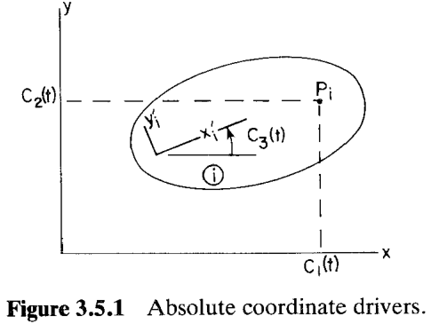
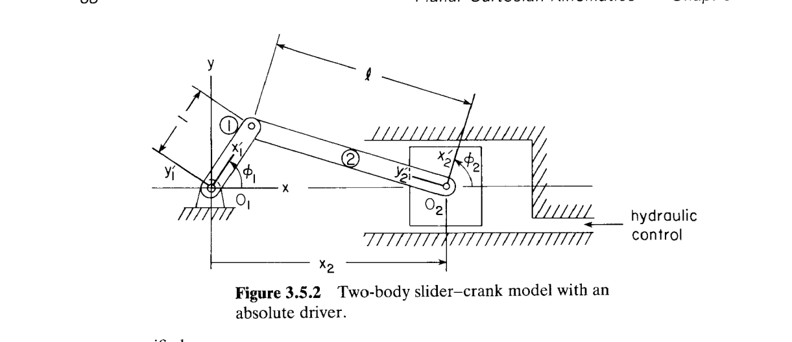
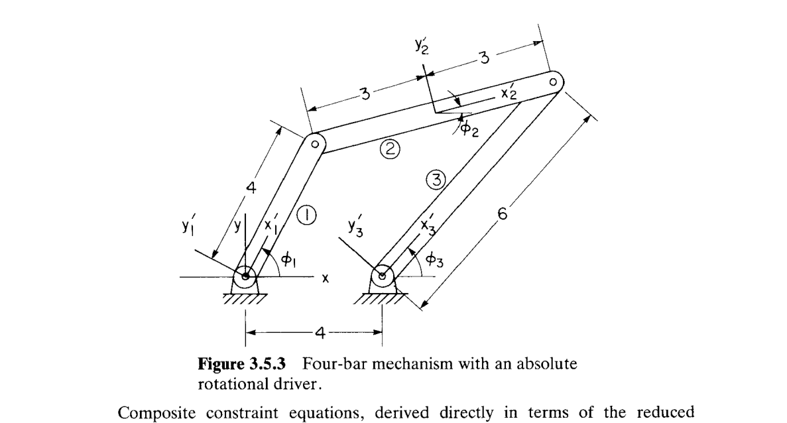
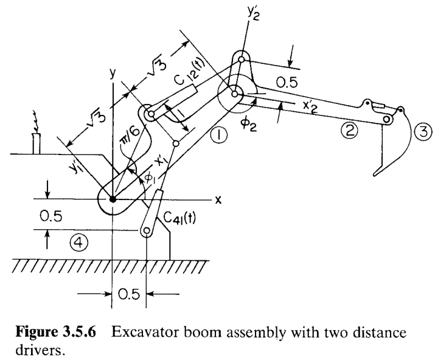
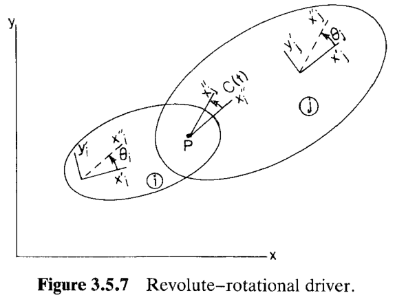
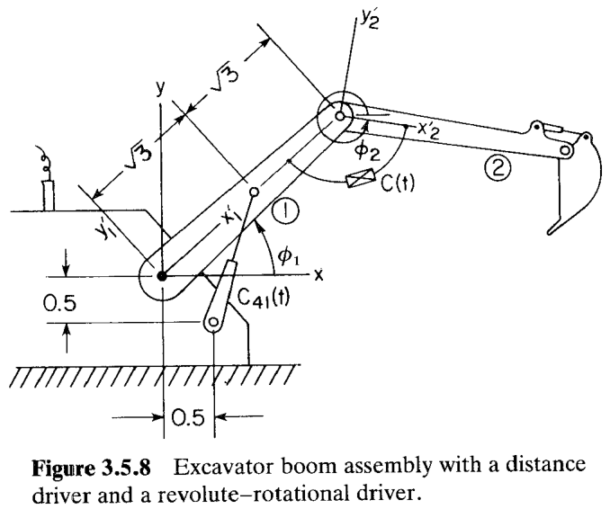
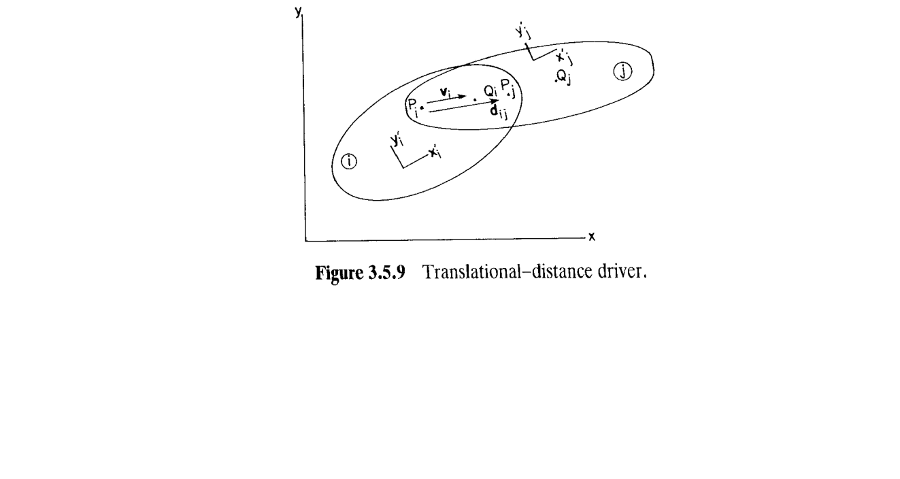

# 3.5 驱动约束 (Driving Constraints)

> 来源：*Computer Aided Kinematics and Dynamics of Mechanical Systems, Vol. 1*，第 3 章，3.5 节（书页 86–97）。

---

## 引言：本节要解决什么

本节介绍了几种常见的**驱动约束（driving constraint）** 的形式，并推导了其基本信息，包括**约束方程**、**雅可比 $\Phi_{\mathbf{q}_i}$**、**速度方程右端项 $\nu$**、**加速度方程右端项 $\gamma$**。

本节相比原书，章节结构有调整，例题只展示了部分，且放置到了最后。

---

## 一、绝对驱动 (Absolute Drivers)

### 约束方程

3.2 节中介绍了 4 种基本约束，本节中关注（只跳过了绝对距离约束）：
- 绝对位置约束，$x$ 方向， $\Phi^{ax(i)}$
- 绝对位置约束，$y$ 方向， $\Phi^{ay(i)}$
- 绝对角度约束，$\Phi^{a\phi(i)}$

他们的约束表达式为：

$$
\Phi^{ax(i)} = x_i^P - C_1 = 0,\quad \Phi^{ay(i)} = y_i^P - C_2 = 0,\quad \Phi^{a\phi(i)} = \phi_i - C_3 = 0
$$

若把常数 $C_k$ 换成时间函数 $C_k(t)$，则该坐标 / 角度按预定轨迹随时间移动，就得到了一个执行器的驱动输入。这就是**绝对驱动**：

$$
\begin{aligned}
\Phi^{axd(i)} &= x_i^P - C_1(t) = 0 & \text{(3.5.1)}\\
\Phi^{ayd(i)} &= y_i^P - C_2(t) = 0 & \text{(3.5.2)}\\
\Phi^{a\phi d(i)} &= \phi_i - C_3(t) = 0 & \text{(3.5.3)}
\end{aligned}
$$

几何示意见图 3.5.1：$C_1(t)$ 和 $C_2(t)$ 分别是被驱动点 $P_i$ 沿 $x$ 和 $y$ 方向的时间轨迹，$C_3(t)$ 是刚体 $i$ 的转角轨迹。

### 雅克比

因为 $C_k(t)$ 和 $C$ 一样，对 $\mathbf{q}$ 求偏导时被视作常数，因此偏导为 0。所以绝对驱动约束的雅克比和绝对约束的雅克比**完全一样**。

可以参考 3.2 节引言表格，这里就不重复列出了。

## 二、相对驱动 (Relative Drivers)

### 约束方程

类似于绝对驱动，我们也可以得到相对驱动的约束方程：

- 相对坐标驱动

$$
\begin{aligned}
\Phi^{rxd(i,j)} &= x_j^P - x_i^P - C_1(t) = 0 & \text{(3.5.5)}\\
\Phi^{ryd(i,j)} &= y_j^P - y_i^P - C_2(t) = 0 & \text{(3.5.6)}\\
\Phi^{r\phi d(i,j)} &= \phi_j - \phi_i - C_3(t) = 0 & \text{(3.5.7)}
\end{aligned}
$$

- 相对距离驱动

$$
\Phi^{rdd(i,j)} = (x_j^P - x_i^P)^2 + (y_j^P - y_i^P)^2 - (C_4(t))^2 = 0
$$

> 注意和相对距离约束一样，要求 $C_4(t) > 0$，不允许 $C_4 = 0$，否则退化为 $P_i = P_j$，等价于两条标量方程（$x_j^P - x_i^P = 0$ 且 $y_j^P - y_i^P = 0$）。一个驱动突然变成两个约束，方程数错乱、雅可比在该处退化。

### 雅克比

和绝对驱动的情况一样，相对驱动的**雅可比**与相对运动约束一致。

---

## 三、速度、加速度方程的右端项

前面所有驱动都可以放到一个统一模板里：给定一个**运动学约束** $\boldsymbol{\Phi}(\mathbf{q}) = \mathbf{0}$，其对应的**驱动版本**是如下形态：

$$
\boldsymbol{\Phi}^d(\mathbf{q}, t) = \boldsymbol{\Phi}(\mathbf{q}) - \mathbf{C}(t) = \mathbf{0} \tag{3.5.19}
$$

**速度方程右端**：对 (3.5.19) 求时间导数：

$$
\boldsymbol{\Phi}^d_\mathbf{q}\dot{\mathbf{q}}=\boldsymbol{\Phi}_\mathbf{q}\dot{\mathbf{q}} - \dot{\mathbf{C}}(t) = 0
$$

因此得到速度方程右端项：

$$
\boxed{\ \boldsymbol{\nu}^d = \dot{\mathbf{C}}(t)\ } \tag{3.5.20}
$$

**推加速度方程右端**：对上式再求一次导数，并利用推导运动约束加速度右端项 $\boldsymbol{\gamma}$ 时的结论：

$$
\boldsymbol{\Phi}^d_\mathbf{q}\ddot{\mathbf{q}} 
= (\boldsymbol{\Phi}_\mathbf{q}\dot{\mathbf{q}} - \dot{\mathbf{C}}(t))_t=\boldsymbol{\Phi}_\mathbf{q}\ddot{\mathbf{q}}+\boldsymbol{\gamma} + \ddot{\mathbf{C}}(t)
$$

因此得到加速度方程右端项：

$$
\boxed{\ \boldsymbol{\gamma}^d = \boldsymbol{\gamma} + \ddot{\mathbf{C}}(t)\ } \tag{3.5.21}
$$

### Table 3.5.1 汇总

下表把每种驱动约束的右端项列出：

| $\Phi$ | Eq. | $\nu$ | $\gamma$ |
|---|---|---|---|
| $\Phi^{axd(i)}$ | 3.5.1 | $\dot C_1(t)$ | $\gamma^{ax(i)} + \ddot C_1(t)$ |
| $\Phi^{ayd(i)}$ | 3.5.2 | $\dot C_2(t)$ | $\gamma^{ay(i)} + \ddot C_2(t)$ |
| $\Phi^{a\phi d(i)}$ | 3.5.3 | $\dot C_3(t)$ | $\ddot C_3(t)$ |
| $\Phi^{rxd(i,j)}$ | 3.5.5 | $\dot C_1(t)$ | $\gamma^{rx(i,j)} + \ddot C_1(t)$ |
| $\Phi^{ryd(i,j)}$ | 3.5.6 | $\dot C_2(t)$ | $\gamma^{ry(i,j)} + \ddot C_2(t)$ |
| $\Phi^{r\phi d(i,j)}$ | 3.5.7 | $\dot C_3(t)$ | $\ddot C_3(t)$ |
| $\Phi^{rdd(i,j)}$ | 3.5.8 | $2 C_4(t)\dot C_4(t)$ | $\gamma^{rd(i,j)} + 2 C_4(t)\ddot C_4(t) + 2(\dot C_4(t))^2$ |

---

## 四、例题

### 例 3.5.1：两体曲柄-滑块，液压驱动

> 图 3.5.2 中，滑块（body 2）的水平位置由液压伺服直接控制。曲柄（body 1）绕原点 $O_1$ 转，铰接到滑块的一个内槽端。

系统如上图，广义坐标为（其余坐标——$x_1=0$、$y_1 = 0$、$y_2=0$ 均为常量）：

$$
\mathbf{q} = [x_2,\ \phi_1,\ \phi_2]^T
$$

应用 Example 3.1.2 的运动约束，并引入**驱动约束**（其中 $\ell > 1$，$\omega$ 为常数）：

$$
x_2 = \sqrt{\ell^2 - 1} + \tfrac{1}{2}\sin\omega t = C(t) \tag{3.5.4}
$$

得到**约束方程**：

$$
\boldsymbol{\Phi}(\mathbf{q}) = 
\begin{bmatrix}
-x_2 + \cos\phi_1 + \ell\sin\phi_2\\
\sin\phi_1 - \ell\cos\phi_2\\
x_2 - \sqrt{\ell^2 - 1} - \tfrac{1}{2}\sin\omega t
\end{bmatrix} = \mathbf{0}
$$

**速度方程**——对 $\boldsymbol{\Phi}$ 逐行求偏导，容易得到：

$$
\underbrace{\begin{bmatrix}
-1 & -\sin\phi_1 & \ell\cos\phi_2\\
0 & \cos\phi_1 & \ell\sin\phi_2\\
1 & 0 & 0
\end{bmatrix}}_{\boldsymbol{\Phi}_\mathbf{q}}
\begin{bmatrix} \dot x_2\\ \dot\phi_1\\ \dot\phi_2 \end{bmatrix}
= 
\begin{bmatrix} 0\\ 0\\ \tfrac{1}{2}\omega\cos\omega t \end{bmatrix}
$$

将第 3 行给出 $\dot x_2 = \tfrac{1}{2}\omega\cos\omega t$。代入第 1 行，**逐步解出速度 $\dot\phi_1$**：

$$
\ \dot\phi_1 = -\frac{\omega\sin\phi_2\cos\omega t}{2\cos(\phi_1 - \phi_2)}\ \tag{3.5.1a}
$$

---

### 例 3.5.2：四杆机构，绝对转角驱动

> 图 3.5.3 中，输入曲柄 $\phi_1$ 由马达直接控制：$\phi_1 = \omega t$；这是**绝对转角驱动**。

**广义坐标**：$\mathbf{q} = [\phi_1,\ x_2,\ y_2,\ \phi_2,\ \phi_3]^T$；曲柄长 4，耦合体 (coupler，body 2) 长 6（原点在中点），摇杆长 6，机架 4；两地面铰在 $(0,0)$ 与 $(4,0)$。

**复合约束的每一行**：

- 铰在曲柄末端 $=$ 耦合体后端 $(x_2 - 3\cos\phi_2,\ y_2 - 3\sin\phi_2)$：
  $x_2 - 4\cos\phi_1 - 3\cos\phi_2 = 0$ 与 $y_2 - 4\sin\phi_1 - 3\sin\phi_2 = 0$。
- 铰在摇杆末端 $(4 + 6\cos\phi_3,\ 6\sin\phi_3) =$ 耦合体前端 $(x_2 + 3\cos\phi_2,\ y_2 + 3\sin\phi_2)$。把 $x_2$、$y_2$ 用上两式换掉：

$$
4\cos\phi_1 + 3\cos\phi_2 + 3\cos\phi_2 - 4 - 6\cos\phi_3 = 0 \iff 4 - 4\cos\phi_1 - 6\cos\phi_2 + 6\cos\phi_3 = 0
$$

$$
4\sin\phi_1 + 3\sin\phi_2 + 3\sin\phi_2 - 6\sin\phi_3 = 0 \iff 4\sin\phi_1 + 6\sin\phi_2 - 6\sin\phi_3 = 0
$$

- **驱动约束**：$\phi_1 - \omega t = 0$。

合起来：

$$
\boldsymbol{\Phi}(\mathbf{q}) = 
\begin{bmatrix}
x_2 - 4\cos\phi_1 - 3\cos\phi_2\\
y_2 - 4\sin\phi_1 - 3\sin\phi_2\\
4 - 4\cos\phi_1 - 6\cos\phi_2 + 6\cos\phi_3\\
4\sin\phi_1 + 6\sin\phi_2 - 6\sin\phi_3\\
\phi_1 - \omega t
\end{bmatrix} = \mathbf{0}
$$

**速度方程**（对 $\mathbf{q} = [\phi_1, x_2, y_2, \phi_2, \phi_3]^T$ 逐行微分）：

$$
\begin{bmatrix}
4\sin\phi_1 & 1 & 0 & 3\sin\phi_2 & 0\\
-4\cos\phi_1 & 0 & 1 & -3\cos\phi_2 & 0\\
4\sin\phi_1 & 0 & 0 & 6\sin\phi_2 & -6\sin\phi_3\\
4\cos\phi_1 & 0 & 0 & 6\cos\phi_2 & -6\cos\phi_3\\
1 & 0 & 0 & 0 & 0
\end{bmatrix}
\begin{bmatrix} \dot\phi_1\\ \dot x_2\\ \dot y_2\\ \dot\phi_2\\ \dot\phi_3\end{bmatrix}
=
\begin{bmatrix} 0\\ 0\\ 0\\ 0\\ \omega \end{bmatrix}
$$

**逐步求解**。

**第 5 行直接给出** $\dot\phi_1 = \omega$。

**第 3、4 行**用 $\dot\phi_1 = \omega$ 消去 $\phi_1$：

$$
\begin{aligned}
6\sin\phi_2\,\dot\phi_2 - 6\sin\phi_3\,\dot\phi_3 &= -4\omega\sin\phi_1\\
6\cos\phi_2\,\dot\phi_2 - 6\cos\phi_3\,\dot\phi_3 &= -4\omega\cos\phi_1
\end{aligned}
$$

用 Cramer 法则求 $\dot\phi_2$、$\dot\phi_3$。设

$$
D = \det\!\begin{bmatrix} 6\sin\phi_2 & -6\sin\phi_3\\ 6\cos\phi_2 & -6\cos\phi_3\end{bmatrix}
= -36\sin\phi_2\cos\phi_3 + 36\sin\phi_3\cos\phi_2 = -36\sin(\phi_2 - \phi_3)
$$

（用了 $\sin(a - b) = \sin a\cos b - \cos a\sin b$）。

$$
\dot\phi_2 = \frac{1}{D}\det\!\begin{bmatrix} -4\omega\sin\phi_1 & -6\sin\phi_3\\ -4\omega\cos\phi_1 & -6\cos\phi_3\end{bmatrix}
= \frac{24\omega(\sin\phi_1\cos\phi_3 - \sin\phi_3\cos\phi_1)}{D}
= \frac{24\omega\sin(\phi_1 - \phi_3)}{-36\sin(\phi_2 - \phi_3)}
$$

$$
\boxed{\ \dot\phi_2 = \frac{2\omega\sin(\phi_3 - \phi_1)}{3\sin(\phi_2 - \phi_3)}\ }
$$

（用 $\sin(\phi_1 - \phi_3) = -\sin(\phi_3 - \phi_1)$，与负号并合）。

$$
\dot\phi_3 = \frac{1}{D}\det\!\begin{bmatrix} 6\sin\phi_2 & -4\omega\sin\phi_1\\ 6\cos\phi_2 & -4\omega\cos\phi_1\end{bmatrix}
= \frac{-24\omega\sin\phi_2\cos\phi_1 + 24\omega\sin\phi_1\cos\phi_2}{D}
= \frac{24\omega\sin(\phi_1 - \phi_2)}{-36\sin(\phi_2 - \phi_3)}
$$

$$
\boxed{\ \dot\phi_3 = -\frac{2\omega\sin(\phi_1 - \phi_2)}{3\sin(\phi_2 - \phi_3)}\ }
$$

> **勘误提示**：书中把 $\dot\phi_3$ 写成 $-\dfrac{2\omega\sin(\phi_1 - \phi_2)}{\sin(\phi_2 - \phi_3)}$，**丢了分母上的 $3$**。可用数值验证：取 $\phi_1 = 0$，$\phi_2 = \pi/4$，$\phi_3 = \pi/2$，代入原速度方程第 3 行 $4\sin\phi_1\cdot\omega + 6\sin\phi_2\,\dot\phi_2 - 6\sin\phi_3\,\dot\phi_3 = 0$ 直接求出 $\dot\phi_3 = -\tfrac{2}{3}\omega$，与本节 $2/3$ 系数一致。

**最后回代**第 1、2 行解 $\dot x_2$、$\dot y_2$：

$$
\dot x_2 = -4\omega\sin\phi_1 - 3\sin\phi_2\,\dot\phi_2
= -4\omega\sin\phi_1 - 3\sin\phi_2\cdot\frac{2\omega\sin(\phi_3 - \phi_1)}{3\sin(\phi_2 - \phi_3)}
$$

$$
\boxed{\ \dot x_2 = -4\omega\sin\phi_1 - 2\omega\sin\phi_2\,\frac{\sin(\phi_3 - \phi_1)}{\sin(\phi_2 - \phi_3)}\ }
$$

$$
\dot y_2 = 4\omega\cos\phi_1 + 3\cos\phi_2\,\dot\phi_2
= 4\omega\cos\phi_1 + 2\omega\cos\phi_2\,\frac{\sin(\phi_3 - \phi_1)}{\sin(\phi_2 - \phi_3)}
$$

---

### 例 3.5.3：双液压缸挖掘机臂

> 图 3.5.6：挖掘机的**臂总成**（不含铲斗执行器）有两个液压驱动：$C_{41}(t)$ 在地面 (4) 与臂 (1) 之间，$C_{12}(t)$ 在臂 (1) 与延伸段 (2) 之间。

**几何与常量**：
- 刚体 1 的原点在地面铰接点 $O = (0, 0)$；驱动输入函数
  $$C_{41}(t) = \tfrac{1}{5}t + 1.8,\quad C_{12}(t) = \tfrac{1}{10}t + 1.9$$
- 广义坐标 $\mathbf{q} = [\phi_1,\ x_2,\ y_2,\ \phi_2]^T$。

**复合约束**共 4 条：

1. 刚体 1 前端与刚体 2 原点重合：

   $$x_2 - 2\sqrt3\cos\phi_1 = 0,\qquad y_2 - 2\sqrt3\sin\phi_1 = 0$$

2. 驱动 $C_{41}$，一端绑定在地面挂点 $(0.5, -0.5)$，一端绑定在刚体 1 上的点 $(\sqrt3\cos\phi_1,\ \sqrt3\sin\phi_1)$ 上：

   $$(\sqrt3\cos\phi_1 - 0.5)^2 + (\sqrt3\sin\phi_1 + 0.5)^2 - (C_{41}(t))^2 = 0$$

3. 驱动 $C_{12}$，一端绑定在刚体 1 上点 $(2\cos(\phi_1 + \tfrac{\pi}{6}),\ 2\sin(\phi_1 + \tfrac{\pi}{6}))$（由 $\mathbf{A}_1(\sqrt3, 1)^T = 2\mathbf{A}_1(\cos\tfrac{\pi}{6}, \sin\tfrac{\pi}{6})^T$），一端绑定刚体 2 上点 $(x_2, y_2) + \mathbf{A}_2(0, 0.5)^T = (x_2 - 0.5\sin\phi_2,\ y_2 + 0.5\cos\phi_2)$。定义

   $$
   u = 2\cos(\phi_1 + \tfrac{\pi}{6}) - (x_2 - 0.5\sin\phi_2),\quad
   v = 2\sin(\phi_1 + \tfrac{\pi}{6}) - (y_2 + 0.5\cos\phi_2)
   $$

   驱动约束就是 $u^2 + v^2 - (C_{12}(t))^2 = 0$。

汇总：

$$
\boldsymbol{\Phi}(\mathbf{q}) = 
\begin{bmatrix}
x_2 - 2\sqrt3\cos\phi_1\\
y_2 - 2\sqrt3\sin\phi_1\\
(\sqrt3\cos\phi_1 - 0.5)^2 + (\sqrt3\sin\phi_1 + 0.5)^2 - (C_{41}(t))^2\\
u^2 + v^2 - (C_{12}(t))^2
\end{bmatrix} = \mathbf{0} \tag{3.5.9}
$$

**速度方程**——逐行求偏导，即得**书中 Eq. 3.5.10**：

$$
\begin{bmatrix}
2\sqrt3\sin\phi_1 & 1 & 0 & 0\\[2pt]
-2\sqrt3\cos\phi_1 & 0 & 1 & 0\\[2pt]
\begin{aligned}
&-2\sqrt3(\sqrt3\cos\phi_1 - 0.5)\sin\phi_1\\
&+ 2\sqrt3(\sqrt3\sin\phi_1 + 0.5)\cos\phi_1
\end{aligned} & 0 & 0 & 0\\[8pt]
\begin{aligned}
&-4u\sin(\phi_1 + \tfrac{\pi}{6})\\
&+ 4v\cos(\phi_1 + \tfrac{\pi}{6})
\end{aligned} & -2u & -2v &
\begin{aligned}
u\cos\phi_2\\ + v\sin\phi_2
\end{aligned}
\end{bmatrix}
\begin{bmatrix} \dot\phi_1\\ \dot x_2\\ \dot y_2\\ \dot\phi_2 \end{bmatrix}
=
\begin{bmatrix}
0\\ 0\\[6pt] \dfrac{2((1/5)t + 1.8)}{5}\\[6pt] \dfrac{(1/10)t + 1.9}{5}
\end{bmatrix} \tag{3.5.10}
$$

**求解结构**：第 3 行**只**含 $\dot\phi_1$，可直接解：设 $K := 2\sqrt3\bigl[(\sqrt3\sin\phi_1 + 0.5)\cos\phi_1 - (\sqrt3\cos\phi_1 - 0.5)\sin\phi_1\bigr]$，则

$$
\dot\phi_1 = \frac{2(t+9)/25}{K}
= \frac{t + 9}{-25\sqrt3\bigl[(\sqrt3\cos\phi_1 - 0.5)\sin\phi_1 - (\sqrt3\sin\phi_1 + 0.5)\cos\phi_1\bigr]}
$$

（将 $2\sqrt3$ 提到分母外并把括号翻号），这正是书中 $\dot\phi_1$ 的表达式。有了 $\dot\phi_1$，第 1、2 行给出 $\dot x_2 = -2\sqrt3\sin\phi_1\,\dot\phi_1$、$\dot y_2 = 2\sqrt3\cos\phi_1\,\dot\phi_1$；再用第 4 行解 $\dot\phi_2$：整理

$$
(u\cos\phi_2 + v\sin\phi_2)\dot\phi_2 = C - A + 4\sqrt3\,u\sin\phi_1\,\dot\phi_1 - 4\sqrt3\,v\cos\phi_1\,\dot\phi_1
$$

其中

$$
\begin{aligned}
A &= -4\{2\cos(\phi_1 + \tfrac{\pi}{6}) - x_2 + 0.5\sin\phi_2\}\sin(\phi_1 + \tfrac{\pi}{6}) + 4\{2\sin(\phi_1 + \tfrac{\pi}{6}) - y_2 - 0.5\cos\phi_2\}\cos(\phi_1 + \tfrac{\pi}{6})\\
B &= \{2\cos(\phi_1 + \tfrac{\pi}{6}) - x_2 + 0.5\sin\phi_2\}\cos\phi_2 + \{2\sin(\phi_1 + \tfrac{\pi}{6}) - y_2 - 0.5\cos\phi_2\}\sin\phi_2\\
C &= \frac{t+19}{50}
\end{aligned}
$$

（$A$ = 第 4 行 $\dot\phi_1$ 前系数中把 $\dot x_2$、$\dot y_2$ 代掉后的合并；$B$ = 第 4 行 $\dot\phi_2$ 前系数即 $u\cos\phi_2 + v\sin\phi_2$；$C$ = 右端除以 $2$ 得到），最终

$$
\boxed{\ \dot\phi_2 = \frac{1}{B}\{C - A + 4\sqrt3\,u\sin\phi_1\,\dot\phi_1 - 4\sqrt3\,v\cos\phi_1\,\dot\phi_1\}\ }
$$

**物理意义**：$C_{41}$ 直接决定 $\phi_1$（因为体 4 与体 1 之间的距离只与 $\phi_1$ 有关，其他坐标都是被动跟随的）；$C_{12}$ 随后决定 $\phi_2$。这是一种"层级"驱动结构，任一个 $C$ 出错都会立即传播。

---

### 转动关节-转角驱动 (revolute-rotational driver, Eq. 3.5.11)

**动机**：机器人肘关节、旋转液压马达等，直接控制**两体在转动关节处的相对角度**——比"绝对转角"更具物理意义（因为往往难以拿到惯性系角度）。

$$
\Phi^{rrd(i,j)} = (\phi_j + \theta_j) - (\phi_i + \theta_i) - C(t) = 0 \tag{3.5.11}
$$

其中 $\theta_i$、$\theta_j$ 是执行器在体 $i$、$j$ 上的**安装角**（由物理安装决定的固定量），$C(t)$ 是"$x_j''$-轴相对 $x_i''$-轴"的时间函数（逆时针为正）。$x_i''$ 是从 $x_i'$ 转过 $\theta_i$ 得到的辅助轴——所以 $\phi_i + \theta_i$ 就是 $x_i''$ 相对全局 $x$ 的绝对角度。

**雅可比同 Eq. 3.3.6**（相对转角约束的雅可比）：$\Phi^{rrd}_{\phi_i} = -1$，$\Phi^{rrd}_{\phi_j} = +1$，其他为 $0$。

---

### 例 3.5.4：挖掘机改用转角驱动

> 图 3.5.8：把 Example 3.5.3 中的 $C_{12}(t)$ 距离驱动换成转角驱动 $C(t) = \tfrac{t}{10}$。

安装角 $\theta_1 = \theta_2 = 0$（简化），驱动 (3.5.11) 变成

$$
\phi_2 - \phi_1 - \tfrac{t}{10} = 0
$$

即 Eq. (3.5.9) 的**第 4 行**被替换。速度方程的第 4 行相应变为

$$
[-1,\ 0,\ 0,\ 1]\,[\dot\phi_1,\ \dot x_2,\ \dot y_2,\ \dot\phi_2]^T = \tfrac{1}{10}
$$

即 $\dot\phi_2 - \dot\phi_1 = 0.1$。前 3 行未变，$\dot\phi_1$ 仍由第 3 行独立解出，然后

$$
\dot\phi_2 = \dot\phi_1 + \tfrac{1}{10}
= \frac{t + 9}{-25\sqrt3\{(\sqrt3\cos\phi_1 - 0.5)\sin\phi_1 - (\sqrt3\sin\phi_1 + 0.5)\cos\phi_1\}} + \frac{1}{10}
$$

与书中结论一致。改换驱动种类后**结构大幅简化**——原本需要联立解出的 $\dot\phi_2$ 现在只需在 $\dot\phi_1$ 基础上加常数。

---

### 平移-距离驱动 (translational-distance driver, Eq. 3.5.12)

**动机**：机器人直角关节、数控机床进给轴——**沿移动关节 (translational joint) 的相对平移距离**由执行器直接控制。

**几何**：体 $i$ 与 $j$ 由移动关节连接。$\mathbf{v}_i$ 是体 $i$ 上沿滑动方向的向量（$\mathbf{v}_i = \mathbf{A}_i\mathbf{v}_i'$，$\mathbf{v}_i'$ 是体固定的），$v_i = \lVert\mathbf{v}_i'\rVert$ 为常数。$\mathbf{d}_{ij} = \mathbf{r}_j + \mathbf{A}_j\mathbf{s}_j'^P - \mathbf{r}_i - \mathbf{A}_i\mathbf{s}_i'^P$ 是从点 $P_i$ 到点 $P_j$ 的向量。$C(t)$（可为零）是这段"沿方向 $\mathbf{v}_i$ 的有向距离"的时间函数。

**约束形式**（图注中的紧凑写法）：

$$
\frac{\mathbf{v}_i^T\mathbf{d}_{ij}}{v_i} - C(t) = 0
$$

即"$\mathbf{d}_{ij}$ 在 $\mathbf{v}_i$ 上的投影（有符号长度）等于 $C(t)$"。两侧乘 $v_i$（正常数），得等价形式 $\mathbf{v}_i^T\mathbf{d}_{ij} - v_i C(t) = 0$。**展开** $\mathbf{v}_i^T$、$\mathbf{d}_{ij}$（用 $\mathbf{A}_i^T\mathbf{A}_i = \mathbf{I}$、$\mathbf{A}_{ij} := \mathbf{A}_i^T\mathbf{A}_j$）：

$$
\begin{aligned}
\mathbf{v}_i^T\mathbf{d}_{ij} - v_i C
&= (\mathbf{A}_i\mathbf{v}_i')^T\bigl(\mathbf{r}_j + \mathbf{A}_j\mathbf{s}_j'^P - \mathbf{r}_i - \mathbf{A}_i\mathbf{s}_i'^P\bigr) - v_i C\\
&= \mathbf{v}_i'^T\mathbf{A}_i^T(\mathbf{r}_j - \mathbf{r}_i) + \mathbf{v}_i'^T\underbrace{\mathbf{A}_i^T\mathbf{A}_j}_{=\mathbf{A}_{ij}}\mathbf{s}_j'^P - \mathbf{v}_i'^T\underbrace{\mathbf{A}_i^T\mathbf{A}_i}_{=\mathbf{I}}\mathbf{s}_i'^P - v_i C
\end{aligned}
$$

**结果**：

$$
\boxed{\ \Phi^{tdd(i,j)} = \mathbf{v}_i'^T\mathbf{A}_i^T(\mathbf{r}_j - \mathbf{r}_i) + \mathbf{v}_i'^T\mathbf{A}_{ij}\mathbf{s}_j'^P - \mathbf{v}_i'^T\mathbf{s}_i'^P - v_i C(t) = 0\ } \tag{3.5.12}
$$

**注意**：因为移动关节强制 $\mathbf{A}_{ij}$ 为**常量**（两体只沿轴滑动，不相对转动），所以 $\phi_j$ 与 $\phi_i$ 差常量、$\mathbf{A}_j = \mathbf{A}_i\mathbf{A}_{ij}$ 中 $\phi_i$ 一变、$\phi_j$ 同步变。在推 Jacobian 时把 $\mathbf{A}_{ij}$ 视为常数——这就是书中所说"the fact that $\mathbf{A}_{ij}$ is constant is used"。

**雅可比推导**（Eq. 3.5.13）：把 (3.5.12) 分别对 $\mathbf{q}_i = (\mathbf{r}_i, \phi_i)$、$\mathbf{q}_j = (\mathbf{r}_j, \phi_j)$ 求偏导。

关于 $\mathbf{r}_i$：只有 $-\mathbf{v}_i'^T\mathbf{A}_i^T\mathbf{r}_i$ 项参与，$\dfrac{\partial}{\partial\mathbf{r}_i} = -\mathbf{v}_i'^T\mathbf{A}_i^T$（行向量 $1\times 2$）。

关于 $\phi_i$：$\mathbf{v}_i'^T\mathbf{A}_i^T(\mathbf{r}_j - \mathbf{r}_i)$ 项贡献 $\mathbf{v}_i'^T\dfrac{d\mathbf{A}_i^T}{d\phi_i}(\mathbf{r}_j - \mathbf{r}_i) = \mathbf{v}_i'^T\mathbf{B}_i^T(\mathbf{r}_j - \mathbf{r}_i)$（用 $\mathbf{B}_i = d\mathbf{A}_i/d\phi_i$，故 $d\mathbf{A}_i^T/d\phi_i = \mathbf{B}_i^T$）。$\mathbf{v}_i'^T\mathbf{A}_{ij}\mathbf{s}_j'^P$ 项因 $\mathbf{A}_{ij}$ 常数而对 $\phi_i$ 求导为 $0$。$-\mathbf{v}_i'^T\mathbf{s}_i'^P$ 项也不含 $\phi_i$。

关于 $\mathbf{r}_j$：只有 $\mathbf{v}_i'^T\mathbf{A}_i^T\mathbf{r}_j$ 项，$\dfrac{\partial}{\partial\mathbf{r}_j} = \mathbf{v}_i'^T\mathbf{A}_i^T$。

关于 $\phi_j$：所有 $\phi_j$ 只以 $\mathbf{A}_j = \mathbf{A}_i\mathbf{A}_{ij}$ 的形式出现，而 $\mathbf{A}_{ij}$ 常数意味着 $\mathbf{A}_j$ 由 $\phi_i$ 唯一决定，$\phi_j$ 在约束中**不独立**——形式上 $\dfrac{\partial}{\partial\phi_j} = 0$。

汇总：

$$
\boxed{\ 
\Phi^{tdd(i,j)}_{\mathbf{q}_i} = \bigl[\,-\mathbf{v}_i'^T\mathbf{A}_i^T,\ \mathbf{v}_i'^T\mathbf{B}_i^T(\mathbf{r}_j - \mathbf{r}_i)\,\bigr],\qquad
\Phi^{tdd(i,j)}_{\mathbf{q}_j} = \bigl[\,\mathbf{v}_i'^T\mathbf{A}_i^T,\ 0\,\bigr]
\ } \tag{3.5.13}
$$
