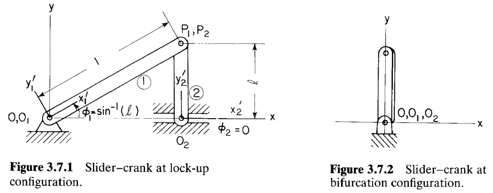
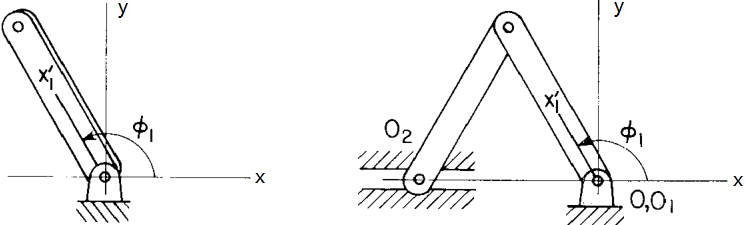
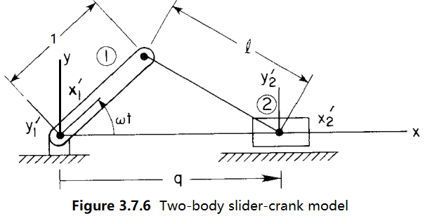

# 3.7 奇异构型（Singular Configurations）

> 来源：*Computer Aided Kinematics and Dynamics of Mechanical Systems, Vol. 1*，第 3 章，3.7 节（书页 104 底–111 顶）。

---

## 引言：本节要解决什么

本节介绍了锁死、分岔、冗余这三种奇异构型，并着重针对锁死与分岔，介绍了此时系统的直观表现，和数值表现，以及如何通过求解速度方程，来区分锁死和分岔（锁死时速度趋于无穷，分岔时可以解出正常的速度）。至于冗余这种情况，在后续的 4.6 节会再详细展开。

---

## 一、锁死与分岔：两种问题构型的直观表现

- **锁死构型（lock-up configuration）**：机构到达某构型后，**驱动方向上无法继续运动**（如曲柄被顶死）。数学上表现为：越过该点后约束方程**无解**，速度 $\dot{\mathbf{q}}$、加速度 $\ddot{\mathbf{q}}$ 趋于无穷。
- **分岔（bifurcation）**：到达某构型后，**存在不止一条**可继续的运动路径（机构可以"二选一"地往不同方向走）。

下面举一个例子：

### 例 3.7.1：曲柄滑块的锁死与分岔

> 取例 3.1.2 的初等曲柄滑块模型。曲柄长记为 $1$，连杆（coupler）长 $\ell$，物体 2（滑块）沿 $x$ 轴平动，$\phi_2=0$。

图 3.7.1 对应**锁死。** 曲柄在正 $\phi_1$ 方向被驱动。随运动推进，系统到达 $\sin\phi_1=\ell$ 的构型。此处连杆与曲柄"撑直/对齐"，**物理上曲柄无法再沿正 $\phi_1$ 方向转动**——这就是锁死。

图 3.7.2 对应**分岔。** 当 $\phi_1=\pi/2,\ \phi_2=0$，曲柄沿正向继续驱动时有**两种**后续运动：

- 物体 2 停在 $O$ 处，物体 1、2 锁在一起像一个绕 $O$ 的单摆（pendulum）摆动 [下图左]；
- 物体 2 越过 $O$ 点，沿负 $x$ 轴运动 [下图右]。

---

## 二. 锁死与分岔：两种问题构型的解析表现

### 1. 例 3.7.3

对上面的例子进行简化，如下图，整个系统**只剩 $x_2\equiv q$ 一个广义坐标**。假定曲柄以恒定角速度 $\omega$ 驱动，$\phi_1=\omega t$。

#### 约束方程

滑块端点在 $(q,\ 0)$，连杆长度为 $\ell$，根据几何信息得到约束方程：

$$\Phi(q,t) = (q-\cos\omega t)^2 + \sin^2\omega t - \ell^2 = 0 \tag{3.7.1}$$

#### 求解位置

和一般性的约束方程不同，上面的式子是一个普通的一元二次方程，求解得到：

$$
q = \cos\omega t \mp \sqrt{\cos^2\omega t + (\ell^2-1)} \tag{3.7.2}
$$

#### 解析分析

根据根号内判别式 $D=\cos^2\omega t+(\ell^2-1)$ 的数值，可分为以下情况：

- **$\ell>1$**：此时根号内恒正，**对所有 $t$ 都有实解**，系统无奇异。
- **$\ell<1$**：在 $\cos^2\omega t \ge 1-\ell^2$ 时有实数解；曲柄转到 $\cos^2\omega t = 1-\ell^2$ 处时无法继续向前，**锁死（lock-up）**。
- **$\ell=1$**：当 $\cos\omega t=0$ 时 $D=0$，此时 $q$ 可以向正号方向运动，也可以向负号方向运动，相当于两种运动轨迹在此汇合。**分岔（bifurcation）**。

---

## 三、利用速度，区分锁死与分岔

根据上一节的隐函数定理，若雅可比 $\boldsymbol{\Phi}_\mathbf{q}(\mathbf{q}^*,t^*)$ 非奇异，则 $|t-t^*|<\delta$ 内一定有唯一光滑解 $\mathbf{q}(t)$。反过来，**锁死或分岔意味着在 $t^*$ 任意邻近处存在性或唯一性丧失**，故

$$\boxed{\boldsymbol{\Phi}_\mathbf{q}(\mathbf{q}^*,t^*)\ \text{必在锁死、分岔构型处奇异}}$$

下面进一步区分这两种病态。

### 1. 分岔：速度方程在奇异点有解

追踪速度方程的推导过程，容易看出对于奇异构型，速度方程 $\boldsymbol{\Phi}_\mathbf{q}\dot{\mathbf{q}} = -\boldsymbol{\Phi}_t$ 仍然成立。此时考察一个让时间冻结、只满足"一阶约束"的**虚位移（virtual displacement）** $\delta\mathbf{q}$（概念在第 6 章详述）。则 $\delta\mathbf{q}$ 满足

$$\boldsymbol{\Phi}_\mathbf{q}\,\delta\mathbf{q} = \mathbf{0} \tag{3.7.9}$$

由于 $\boldsymbol{\Phi}_\mathbf{q}$ 在 $t^*$ 奇异，所以上面的式子**存在非零解 $\delta\mathbf{q}\neq\mathbf{0}$**，则：

$$\boldsymbol{\Phi}_\mathbf{q}(\dot{\mathbf{q}} \pm \delta\mathbf{q}) = \boldsymbol{\Phi}_\mathbf{q}\dot{\mathbf{q}} \pm \boldsymbol{\Phi}_\mathbf{q}\delta\mathbf{q} = -\boldsymbol{\Phi}_t \tag{3.7.10}$$

也就是说 $\dot{\mathbf{q}}+\delta\mathbf{q}$ 与 $\dot{\mathbf{q}}-\delta\mathbf{q}$ **都是合法速度**——$t^*$ 后出现**两个不同速度**，这正刻画**分岔点**。

### 2. 锁死：速度在奇异点趋于无穷

相对的，锁死时，速度在奇异点就不存在这样一段虚位移，使得其为合法速度。这里不加严密证明的说，就是指速度趋于无穷。

可以参考例 3.7.3，根据速度公式，$\Phi_q\dot q + \Phi_t = 0$。先算 $\Phi_q$：

$$\Phi_q = \frac{\partial}{\partial q}\Big[(q-\cos\omega t)^2+\sin^2\omega t-\ell^2\Big] = 2(q-\cos\omega t)$$

再算右端项，展开后合并同类项可以得到：

$$
\Phi_t = \frac{\partial}{\partial t}\Big[(q-\cos\omega t)^2+\sin^2\omega t-\ell^2\Big]= 2\omega q\sin\omega t
$$

解出速度

$$\dot q = \frac{-2\omega q\sin\omega t}{2(q-\cos\omega t)} = \frac{-\omega q\sin\omega t}{q-\cos\omega t}$$

对比前面的锁死构型分析，可以看到锁死点 **$\ell<1$**，$\cos^2\omega t = 1-\ell^2$ 处，可以解得 $q=\cos\omega t\neq 0$，此时 $\dot q\to\infty$。这正是**锁死情况的一般判据**：

$$\boxed{\text{锁死}\ \Longleftrightarrow\ \Phi_q=0\ \text{且}\ \Phi_t\neq 0\ \Rightarrow\ \dot q\to\infty}$$

### 3. 分岔与锁死的数值判据

- **分岔判据：** $t^*$ 处 $|\boldsymbol{\Phi}_\mathbf{q}|=0$（可以通过监测在 $t^*$ 前后 $|\boldsymbol{\Phi}_\mathbf{q}|$ 是否发生变号来估计），且速度 $\dot{\mathbf{q}}$ 不是无穷。
- **锁死判据：** $t^*$ 处 $|\boldsymbol{\Phi}_\mathbf{q}|=0$，且 $\dot{\mathbf{q}}\to\infty$ 当 $t\to t^*$，运动无法继续——这就是锁死。

---

## 四、第三类奇异构型：冗余约束

在前两种情况（锁死或分岔）中，奇异点是**孤立奇异点（isolated singular point）**。除 $t^*$ 外，系统表现良好。

还有一类奇异：**冗余约束（redundant constraint）**。这类奇异构型的奇异点**不是孤立的**，而是**对所有 $\mathbf{q}$ 持续秩亏**。

冗余约束的**数值识别与消除**方法见 4.6 节。
