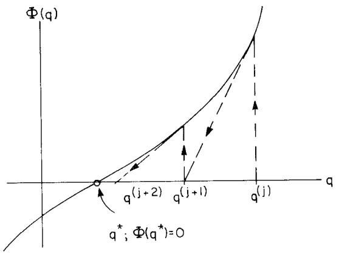
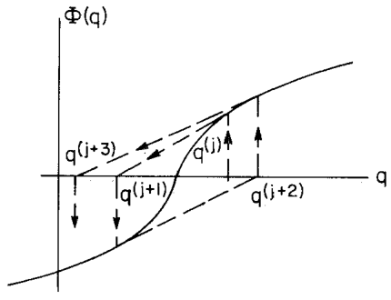
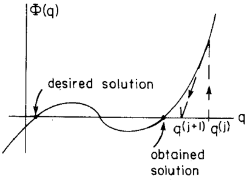
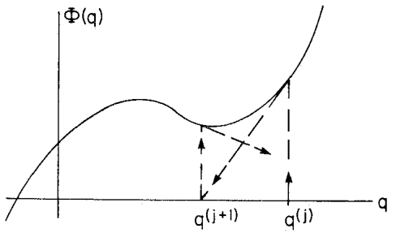

# 4.5 非线性方程的牛顿-拉夫森方法（Newton–Raphson Method for Nonlinear Equations）

> 来源：*Computer Aided Kinematics and Dynamics of Mechanical Systems*，第 4 章，4.5 节（书页 143 –146）。

## 引言：本节要解决什么

本节使用**牛顿-拉夫森（Newton–Raphson）方法**来求解非线性方程组 $\boldsymbol{\Phi}(\mathbf{q})=\mathbf{0}$ 的原理和过程。

---

## 一、单变量的 Newton–Raphson

### 1. 公式推导

考虑标量变量 $q$ 的单个非线性方程

$$
\Phi(q)=0
$$

设 $q=q^{*}$ 是它的解，$q^{(i)}$ 是 $q^{*}$ 的一个近似。把 $\Phi(q)$ 在点 $q=q^{(i)}$ 处作**泰勒展开（Taylor expansion）**：

$$
\Phi(q)=\Phi(q^{(i)})+\Phi_q(q^{(i)})\,(q-q^{(i)})+O\!\left(\bigl(q-q^{(i)}\bigr)^{2}\right)
$$

其中 $\Phi_q\equiv \dfrac{d\Phi}{dq}$ 是 $\Phi$ 对 $q$ 的导数。

把上式中的 $q$ 取为 $q^{(i+1)}$，并**丢弃高阶项**：

$$
\Phi(q^{(i+1)})\approx \Phi(q^{(i)})+\Phi_q(q^{(i)})\,\bigl(q^{(i+1)}-q^{(i)}\bigr)=0
$$

若 $\Phi_q(q^{(i)})\neq 0$，得到新的迭代近似值：

$$
\boxed{\ q^{(i+1)}=q^{(i)}-\frac{\Phi(q^{(i)})}{\Phi_q(q^{(i)})}\ }
\tag{4.5.5}
$$

### 2. 收敛性质：二阶收敛

牛顿-拉夫森产生的通常会趋于 $\Phi(q)=0$ 的解。但**若 $q^{(0)}$ 离 $q^{*}$ 不够近，序列可能发散**（因为此时高阶项不可忽略）。若算法收敛且雅可比非奇异，则它是**二阶收敛（quadratically convergent）** 的，即存在常数 $c$ 使

$$
\bigl\lvert q^{(k+1)}-q^{*}\bigr\rvert < c\,\bigl\lvert q^{(k)}-q^{*}\bigr\rvert^{2}
\tag{4.5.6}
$$

每迭代一次，误差大约**按上一次误差的平方**缩小——一旦进入收敛域，精度提升极快。但同样的：若 $\lvert q^{(0)}-q^{*}\rvert$ 大于 1，误差同样可能**按平方放大**而发散。

---

## 二、单变量 Newton–Raphson 的几何解释

牛顿-拉夫森的每一步，其几何含义，就是在 $(q^{(i)},\Phi(q^{(i)}))$ 处，作 $\Phi(q)$ 的切线，切线斜率正是 $\Phi_q(q^{(i)})$。然后取切线与 $q$ 轴的交点作为 $q^{(i+1)}$。

### 1. 收敛情形

如下图，曲线在迭代区间内单调且凹性一致时，从 $q^{(j)}$ 出发，切线交点 $q^{(j+1)}$、$q^{(j+2)}$ 逐步逼近真解 $q^{*}$，快速收敛。

### 2. 失败情形一：拐点（inflection point）

如下图，当解恰是曲线的拐点时（凹性发生了变化），切线交点在解两侧来回**振荡**（$q^{(j)}\to q^{(j+1)}\to q^{(j+2)}\to q^{(j+3)}$），方法**发散**。

### 3. 失败情形二：多根（multiple roots）

如下图，当方程有多个解时，最终收敛到哪个解**取决于初始估计**——图中本想要左侧"desired solution"，但从该 $q^{(j)}$ 出发却收敛到右侧"obtained solution"。

### 4. 失败情形三：靠近局部极值点

如下图，当初始估计落在局部极小/极大附近时，该处 $\Phi_q\approx 0$，切线近水平，交点被"甩"到很远，算法**无法收敛**。

### 5. 总结

**必须用一个合理的解估计来启动迭代过程。这一点对运动学位置分析尤其关键——上一时刻的解通常就是下一时刻很好的初值。**

---

## 三、$n$ 元的 Newton–Raphson

### 1. 公式推导

现有 $n$ 个未知数、$n$ 个非线性代数方程：

$$
\begin{aligned}
\Phi_1(\mathbf{q})&\equiv \Phi_1(q_1,q_2,\dots,q_n)=0\\
\Phi_2(\mathbf{q})&\equiv \Phi_2(q_1,q_2,\dots,q_n)=0\\
&\;\;\vdots\\
\Phi_n(\mathbf{q})&\equiv \Phi_n(q_1,q_2,\dots,q_n)=0
\end{aligned}
\tag{4.5.7}
$$

解向量记为 $\mathbf{q}^{*}\equiv[q_1^{*},q_2^{*},\dots,q_n^{*}]^{T}$。和单变量时相同，在解的估计 $\mathbf{q}^{(i)}$ 处作**一阶泰勒展开**，并丢弃高阶项：

$$
\boldsymbol{\Phi}(\mathbf{q}^{(i)})+\boldsymbol{\Phi}_\mathbf{q}(\mathbf{q}^{(i)})\,\bigl[\mathbf{q}^{(i+1)}-\mathbf{q}^{(i)}\bigr]=\mathbf{0}
$$

其中 $\boldsymbol{\Phi}_\mathbf{q}$ 是 $n\times n$ 的**雅可比矩阵**（定义见 2.5 节）。

记 $\Delta\mathbf{q}^{(i)}\equiv \mathbf{q}^{(i+1)}-\mathbf{q}^{(i)}$，则得到：

$$
\boxed{\ \boldsymbol{\Phi}_\mathbf{q}(\mathbf{q}^{(i)})\,\Delta\mathbf{q}^{(i)}=-\boldsymbol{\Phi}(\mathbf{q}^{(i)})\ }
\tag{4.5.8}
$$

可以使用 4.4 节介绍的高斯消元法或 L-U 分解法求解上面的线性方程组，解出 $\Delta\mathbf{q}^{(i)}$，然后更新：

$$
\mathbf{q}^{(i+1)}=\mathbf{q}^{(i)}+\Delta\mathbf{q}^{(i)}.
$$

### 2. 收敛性质

收敛情况同样是二阶收敛、同样对初值敏感。
