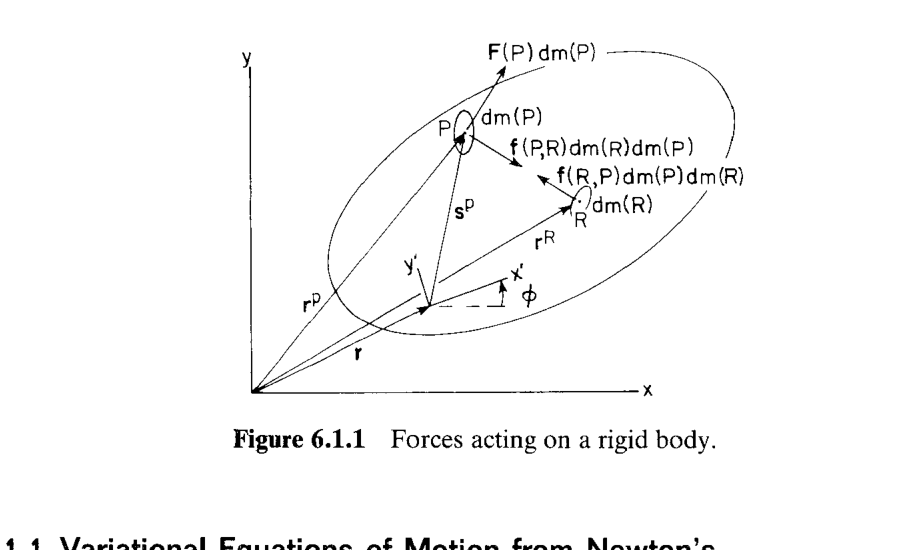
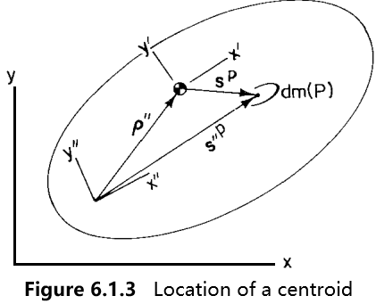
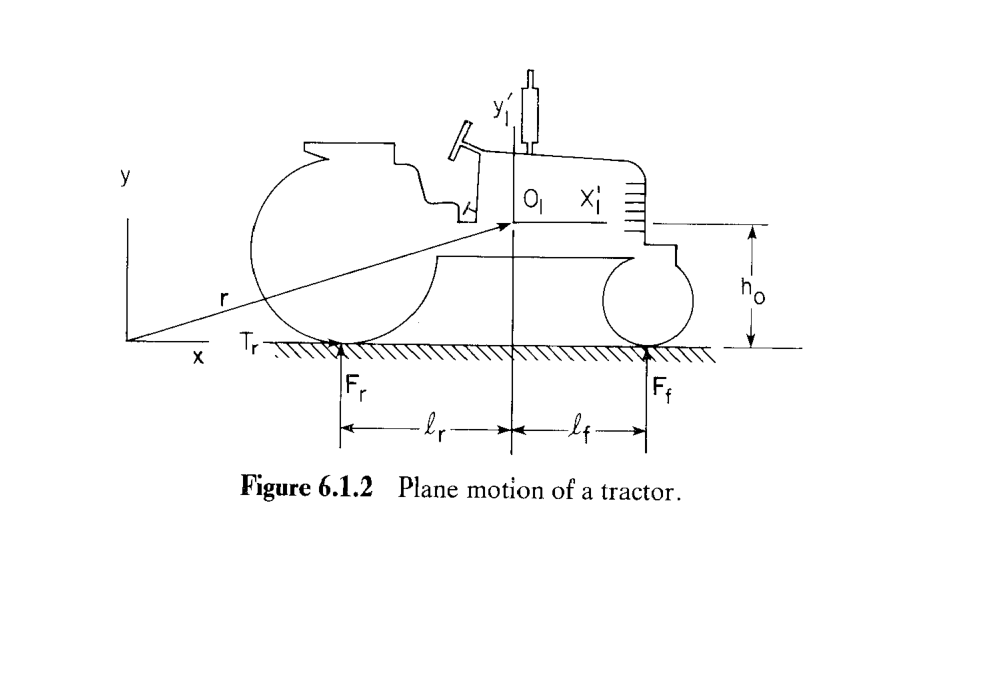
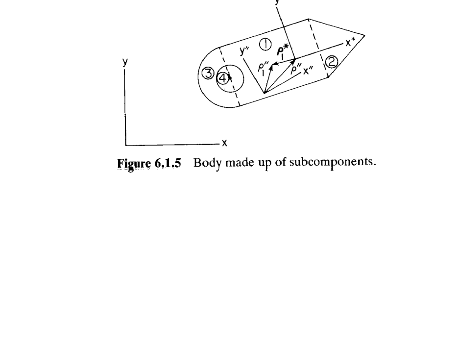
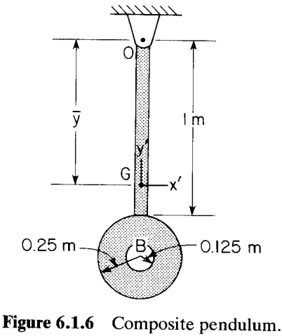

# 6.1 平面刚体运动方程（Equations of Motion of a Planar Rigid Body）

> 来源：*Computer Aided Kinematics and Dynamics of Mechanical Systems*，第 6 章，6.1 节（书页 199–213）。

## 引言：本节要解决什么

本节是全书从运动学跨入动力学的第一步。

1. 本节通过引入变分，从变分运动方程开始，完整推导了二维平面下的牛顿-欧拉方程。这是本节的主要内容。
2. 本节引入了质心、转动惯量的概念。
3. **【Ronin 重要注解 6.1】**：从本节开始，进入动力学以后，系统的约束方程中实际上已经**不再考虑驱动约束**。但需要注意的是，所有推导得到的结论，都同样适用于有驱动约束的情况。

---

## 一、变分运动方程（Variational Equations of Motion）

### 1. 微元牛顿第二定律

在动力学分析中，给出刚体的作用力，需要求出刚体的运动轨迹。因此需要给出刚体运动与其受力之间的表达式。

我们先从刚体上的一个微元开始，如上图所示：

**微元的位置信息**
- 刚体构型由位置向量 $\mathbf{r}$ 与旋转 $\phi$ 给定。
- 刚体上有一点 $P$ ，其在刚体局部坐标系下的位置为$\mathbf{s}'^P$，微元 $P$ 质量为 $dm(P)$。
- $\ddot{\mathbf{r}}^P$ 是点 $P$ 在惯性系中的加速度

**微元的受力情况**
- **外力**：刚体受到的外力可以用力场表示，其中微元 $P$ 受外力为 $\mathbf{F}(P)\,dm(P)$。
  - $\mathbf{F}(P)$ 是作用在 $P$ 的单位质量外力，量纲为 力/质量 $=\mathrm{N/kg}$。
- **内力**：微元 $P$ 还受到刚体内部其余所有微元 $R$ 的内力 $\mathbf{f}(P,R)dm(P)dm(R)$。
  - $\mathbf{f}(P,R)$ 是微元 $R$ 对 $P$ 的单位质量内力密度，量纲为 力/质量$^2$ $= \mathrm{N/kg^2}$。

根据牛顿第二定律，微元 $P$ 的运动和其受力关系如下：
$$\ddot{\mathbf{r}}^P\,dm(P)=\mathbf{F}(P)\,dm(P)+\left[\int_m \mathbf{f}(P,R)\,dm(R)\right]dm(P) \tag{6.1.1}$$

### 2. 虚功定理

#### 转到虚功表达式

注意到 $功=力\times距离$，下面通过虚位移，将上式转移到虚功的口径下来进行简化。

设 $\delta\mathbf{r}^P$ 为点 $P$ 的**虚位移**。变分 $\delta$ 算子即时间冻结的微分算子，**服从微积分全部法则**。对 Eq. 6.1.1 两边左乘 $\delta\mathbf{r}^{PT}$ 并对全体质量积分，得到力对刚体做的虚功为：

$$\int_m \delta\mathbf{r}^{PT}\ddot{\mathbf{r}}^P\,dm(P)=\int_m \delta\mathbf{r}^{PT}\mathbf{F}(P)\,dm(P)+\iint_{mm}\delta\mathbf{r}^{PT}\mathbf{f}(P,R)\,dm(R)\,dm(P) \tag{6.1.2}$$

由于只是在 Eq 6.1.1 两边做乘法，因此**此式对任意 $\delta\mathbf{r}^P$ 成立**。

#### 刚体虚位移需要满足的约束

在刚体中，虚位移还需要满足一定条件。根据**刚体距离约束**：体内任意两点间距离平方为常数，即：

$$(\mathbf{r}^P-\mathbf{r}^R)^T(\mathbf{r}^P-\mathbf{r}^R)=c$$

对其取变分：

$$\delta(\mathbf{r}^P-\mathbf{r}^R)^T(\mathbf{r}^P-\mathbf{r}^R)+(\mathbf{r}^P-\mathbf{r}^R)^T\delta(\mathbf{r}^P-\mathbf{r}^R)=0$$

由于 $\delta(\mathbf{r}^P-\mathbf{r}^R)^T(\mathbf{r}^P-\mathbf{r}^R)$ 是标量，所以乘法的前后两项可交换顺序，即等于 $(\mathbf{r}^P-\mathbf{r}^R)^T\delta(\mathbf{r}^P-\mathbf{r}^R)$，化简上式得到：

$$\delta(\mathbf{r}^P-\mathbf{r}^R)^T(\mathbf{r}^P-\mathbf{r}^R)=0$$

即，**对于刚体中任意两点 $P, R$，其虚位移 $\delta(\mathbf{r}^P-\mathbf{r}^R)$ 要满足约束，垂直于连线 $(\mathbf{r}^P-\mathbf{r}^R)$**。

#### 虚功定理

对于 Eq 6.1.2 中右侧第二项，注意到牛顿第三定律给出 $\mathbf{f}(P,R)\,dm(R)\,dm(P)=-\mathbf{f}(R,P)\,dm(P)\,dm(R)$，且 $P,R$ 是哑变量可互换名称，因此有：

$$
\begin{aligned}
\iint_{mm}\delta\mathbf{r}^{PT}\mathbf{f}(P,R)\,dm(R)\,dm(P)
&= \frac{1}{2}\iint_{mm}\delta\mathbf{r}^{PT}\mathbf{f}(P,R)\,dm(R)\,dm(P)
 - \frac{1}{2}\iint_{mm}\delta\mathbf{r}^{PT}\mathbf{f}(R,P)\,dm(P)\,dm(R)\\
&= \frac{1}{2}\iint_{mm}\delta\mathbf{r}^{PT}\mathbf{f}(P,R)\,dm(R)\,dm(P)
 - \frac{1}{2}\iint_{mm}\delta\mathbf{r}^{RT}\mathbf{f}(P,R)\,dm(R)\,dm(P)\\
&= \frac{1}{2}\iint_{mm}\delta(\mathbf{r}^P-\mathbf{r}^R)^T\mathbf{f}(P,R)\,dm(R)\,dm(P)
\end{aligned}
$$

注意到，内力是沿连线方向的，即 $\mathbf{f}(P,R)\parallel(\mathbf{r}^P-\mathbf{r}^R)$，因此根据刚体内的虚位移约束，则内力必然也正交于 $\delta(\mathbf{r}^P-\mathbf{r}^R)$，因此得到**虚功定理：刚体内力的虚功为零。**

$$\boxed{\iint_{mm}\delta\mathbf{r}^{PT}\mathbf{f}(P,R)\,dm(R)\,dm(P)=0} \tag{6.1.3}$$

#### 满足约束的刚体虚位移

下面讨论用一种更优雅的方式来表达刚体约束。**点 $P$ 位置** 由 Eq. 2.4.8 可以得到。在二维平面下：

$$\mathbf{r}^P=\mathbf{r}+\mathbf{A}\mathbf{s}'^P,\qquad \mathbf{A}=\begin{bmatrix}\cos\phi & -\sin\phi\\ \sin\phi & \cos\phi\end{bmatrix} \tag{6.1.5}$$

对上式取变分，可以得到：

$$\delta\mathbf{r}^P=\delta\mathbf{r}+\delta\phi\,\mathbf{B}\mathbf{s}'^P,\qquad \mathbf{B}=\frac{\partial\mathbf{A}}{\partial\phi}=\begin{bmatrix}-\sin\phi & -\cos\phi\\ \cos\phi & -\sin\phi\end{bmatrix} \tag{6.1.7}$$

容易验证，由于$\mathbf{B}^T\mathbf{A}=0$，所以：

$$
\begin{aligned}
\delta(\mathbf{r}^P-\mathbf{r}^R)^T(\mathbf{r}^P-\mathbf{r}^R)
&= [(\delta\mathbf{r}+\delta\phi\,\mathbf{B}\mathbf{s}'^P)-(\delta\mathbf{r}+\delta\phi\,\mathbf{B}\mathbf{s}'^R)]^T[(\mathbf{r}+\mathbf{A}\mathbf{s}'^P)-(\mathbf{r}+\mathbf{A}\mathbf{s}'^R)]\\
&= \delta\phi\,(\mathbf{s}'^P-\mathbf{s}'^R)^T\mathbf{B}^T\mathbf{A}(\mathbf{s}'^P-\mathbf{s}'^R)\\
&= 0
\end{aligned}
$$

**（Ronin注：重要的中间结论6.1）：即对任意 $\delta\mathbf{r}$、$\delta\phi$，由 Eq. 6.1.7 给出的 $\delta\mathbf{r}^P$ 均可满足刚体约束，进而满足虚功原理。**

### 3. 变分运动方程

对 Eq. 6.1.5 求一阶、二阶时间导数。注意在二维空间下 $\dot{\mathbf{B}}=\dot\phi\,\dfrac{\partial\mathbf{B}}{\partial\phi}=-\dot\phi\,\mathbf{A}$：

$$\dot{\mathbf{r}}^P=\dot{\mathbf{r}}+\dot\phi\,\mathbf{B}\mathbf{s}'^P \tag{6.1.9}$$

$$\ddot{\mathbf{r}}^P=\ddot{\mathbf{r}}+\ddot\phi\,\mathbf{B}\mathbf{s}'^P+\dot\phi\,\dot{\mathbf{B}}\mathbf{s}'^P=\ddot{\mathbf{r}}+\ddot\phi\,\mathbf{B}\mathbf{s}'^P-\dot\phi^2\mathbf{A}\mathbf{s}'^P \tag{6.1.10}$$

现在万事具备，将 Eq 6.1.2 中的 $\delta\mathbf{r}^{P}$ 和 $\ddot{\mathbf{r}}$ 分别用 Eq 6.1.7 和 Eq 6.1.10 代替，并根据 Eq 6.1.3 将内力项舍去，得到：

**左端**：

$$
\begin{aligned}
\int_m \delta\mathbf{r}^{PT}\ddot{\mathbf{r}}^P\,dm(P)
&= \int_m\big(\delta\mathbf{r}+\delta\phi\,\mathbf{B}\mathbf{s}'^P\big)^T\big(\ddot{\mathbf{r}}+\ddot\phi\,\mathbf{B}\mathbf{s}'^P-\dot\phi^2\mathbf{A}\mathbf{s}'^P\big)\,dm(P)\\
&= \delta\mathbf{r}^T\ddot{\mathbf{r}}\int_m dm(P)+\Big[\delta\mathbf{r}^T(\ddot\phi\mathbf{B}-\dot\phi^2\mathbf{A})+\delta\phi\,\ddot{\mathbf{r}}^T\mathbf{B}\Big]\int_m \mathbf{s}'^P\,dm(P)\\
&\quad +\delta\phi\int_m \mathbf{s}'^{PT}\mathbf{B}^T(\ddot\phi\mathbf{B}-\dot\phi^2\mathbf{A})\mathbf{s}'^P\,dm(P)
\end{aligned}
$$

**右端**：

$$
\begin{aligned}
\int_m \delta\mathbf{r}^{PT}\mathbf{F}(P)\,dm(P)
&= \int_m\big(\delta\mathbf{r}+\delta\phi\,\mathbf{B}\mathbf{s}'^P\big)^T\mathbf{F}(P)\,dm(P)\\
&= \delta\mathbf{r}^T\int_m\mathbf{F}(P)\,dm(P)+\delta\phi\int_m\mathbf{s}'^{PT}\mathbf{B}^T\mathbf{F}(P)\,dm(P)
\end{aligned}
$$

**合并得到变分运动方程，其对任意 $\delta\mathbf{r}$、$\delta\phi$ 成立**：

$$\delta\mathbf{r}^T\ddot{\mathbf{r}}\!\int_m\! dm+\Big[\delta\mathbf{r}^T(\ddot\phi\mathbf{B}-\dot\phi^2\mathbf{A})+\delta\phi\,\ddot{\mathbf{r}}^T\mathbf{B}\Big]\!\int_m\!\mathbf{s}'^P dm+\delta\phi\!\int_m\!\mathbf{s}'^{PT}\mathbf{B}^T(\ddot\phi\mathbf{B}-\dot\phi^2\mathbf{A})\mathbf{s}'^P dm\\
=\delta\mathbf{r}^T\!\int_m\!\mathbf{F}\,dm+\delta\phi\!\int_m\!\mathbf{s}'^{PT}\mathbf{B}^T\mathbf{F}\,dm \tag{6.1.11}$$

---

## 二、牛顿-欧拉方程

### 1. 在质心坐标系下，简化变分运动方程

如果把刚体局部坐标系原点取在**质心**，则由质心定义：

$$\int_m \mathbf{s}'^P\,dm(P)=\mathbf{0}$$

于是，Eq. 6.1.11 中左端第二项归零，方程简化为

$$\delta\mathbf{r}^T m\ddot{\mathbf{r}}+\delta\phi\int_m \mathbf{s}'^{PT}\mathbf{B}^T(\ddot\phi\mathbf{B}-\dot\phi^2\mathbf{A})\mathbf{s}'^P\,dm=\delta\mathbf{r}^T\int_m\mathbf{F}\,dm+\delta\phi\int_m\mathbf{s}'^{PT}\mathbf{B}^T\mathbf{F}\,dm \tag{6.1.11b}$$

### 2. 引入极转动惯量，进一步简化变分运动方程

对上式中的第二项，展开被积函数：

$$\mathbf{s}'^{PT}\mathbf{B}^T(\ddot\phi\mathbf{B}-\dot\phi^2\mathbf{A})\mathbf{s}'^P=\ddot\phi\,\mathbf{s}'^{PT}\mathbf{B}^T\mathbf{B}\,\mathbf{s}'^P-\dot\phi^2\,\mathbf{s}'^{PT}\mathbf{B}^T\mathbf{A}\,\mathbf{s}'^P$$

根据 Eq 6.1.5 和 Eq 6.1.7 中关于 $\mathbf{A}$ 和 $\mathbf{B}$ 的定义，容易得到：

$$
\mathbf{B}^T\mathbf{B}=\mathbf{I},\qquad \mathbf{B}^T\mathbf{A}=\begin{bmatrix}0&1\\-1&0\end{bmatrix}
$$

将其代入得到：

$$
\begin{aligned}
\mathbf{s}'^{PT}\mathbf{B}^T(\ddot\phi\mathbf{B}-\dot\phi^2\mathbf{A})\mathbf{s}'^P
&= \ddot\phi\,\mathbf{s}'^{PT}\mathbf{s}'^P-\dot\phi^2\,\mathbf{s}'^{PT}\begin{bmatrix}0&1\\-1&0\end{bmatrix}\,\mathbf{s}'^P\\
&= \ddot\phi\,\mathbf{s}'^{PT}\mathbf{s}'^P-\dot\phi^2\,(s_x'^P s_y'^P-s_y'^P s_x'^P)\\
&= \ddot\phi\,\mathbf{s}'^{PT}\mathbf{s}'^P
\end{aligned}
$$

此时，定义质心坐标系下的**极转动惯量 $J$**（polar moment of inertia）：

$$J'\equiv\int_m \mathbf{s}'^{PT}\mathbf{s}'^P\,dm(P)=\int_m\big(s_x'^{P\,2}+s_y'^{P\,2}\big)\,dm(P) \tag{6.1.15}$$

于是变分运动方程进一步简化为：

$$\delta\mathbf{r}^T m\ddot{\mathbf{r}}+\delta\phi\,\ddot\phi\,J'=\delta\mathbf{r}^T\int_m\mathbf{F}\,dm+\delta\phi\int_m\mathbf{s}'^{PT}\mathbf{B}^T\mathbf{F}\,dm \tag{6.1.11c}$$

### 3. 引入合力、合力矩，简化为牛顿-欧拉方程
定义**合力**与**合力矩**：

$$\mathbf{F}=\int_m\mathbf{F}(P)\,dm(P) \tag{6.1.16}$$

$$n=\int_m\mathbf{s}'^{PT}\mathbf{B}^T\mathbf{F}(P)\,dm(P) \tag{6.1.17a}$$

代入到 Eq. 6.1.11c，得到：

$$\boxed{\delta\mathbf{r}^T\big[m\ddot{\mathbf{r}}-\mathbf{F}\big]+\delta\phi\big[J'\ddot\phi-n\big]=0} \tag{6.1.18}$$

注意到上一小节中提到，该式对任意 $\delta\mathbf{r}$、$\delta\phi$ 成立，必有各系数分别为零，故得到二维平面下的**牛顿-欧拉方程**：

$$\boxed{m\ddot{\mathbf{r}}=\mathbf{F},\qquad J'\ddot\phi=n} \tag{6.1.19}$$

**重要限制**：Eq. 6.1.19 成立要求 $\mathbf{F}$、$n$ 包含作用在刚体上的**全部**力效应（含外加力与约束力，对于**非惯性坐标系下还应包含惯性力**），且刚体坐标原点须取在质心，合力矩的参考点也为质心。

### 4. Ronin 注：坐标系一致的二维牛顿-欧拉方程

Eq 6.1.19 中，大部分变量都是在全局坐标系下取得，唯独 $J'$ 是在刚体质心坐标系得到的，非常奇怪。实际上，也可以全部转换到全局坐标系下，这样也更好理解。

定义**全局坐标系下的转动惯量 $J_c$**，其中下标 $c$ 表示转动惯量的基点是质心 $c$，则有：

$$
J_c\equiv\int_m (\mathbf{s}^P-\mathbf{s}^C)^T\,(\mathbf{s}^P-\mathbf{s}^C)\,dm(P)
$$

**下面证明 $J_c=J'$。** 注意到刚体坐标原点在质心，即质心的全局位置为 $\mathbf{s}^C=\mathbf{r}$，容易得到：

$$\mathbf{s}^P-\mathbf{s}^C=\mathbf{A}\mathbf{s}'^P$$

把它代入 $J_c$ 的定义。并注意到旋转矩阵的正交性，$\mathbf{A}^T\mathbf{A}=\mathbf{I}$，得到：

$$
\begin{aligned}
J_c
&= \int_m\big(\mathbf{A}\mathbf{s}'^P\big)^T\big(\mathbf{A}\mathbf{s}'^P\big)\,dm(P)\\
&= \int_m \mathbf{s}'^{PT}\mathbf{A}^T\mathbf{A}\,\mathbf{s}'^P\,dm(P)\\
&= \int_m \mathbf{s}'^{PT}\mathbf{s}'^P\,dm(P)\\
&=J'
\end{aligned}
$$

因此，可以得到坐标系一致的二维牛顿-欧拉方程：

$$\boxed{m\ddot{\mathbf{r}}=\mathbf{F},\qquad J_c\,\ddot\phi=n} \tag{6.1.19b}$$

此时，要求 $\mathbf{F}$、$n$ 包含作用在刚体上的**全部**力效应（含外加力与约束力，对于**非惯性坐标系下还应包含惯性力**），合力矩的参考点、转动惯量的参考点均为质心。

---

## 三、非质心坐标系下，质心与极转动惯量的值

在工程中，建模时，刚体坐标系常先随手取在某非质心点 $O''$（$x''\text{-}y''$ 系），此时也需要求出质心位置 $\boldsymbol{\rho}''$ 与相对该点的 $J''$。

### 1. 质心位置

由于比较直观，这里略过证明，得到质心位置 $\boldsymbol{\rho}''$ 为：

$$\boxed{\boldsymbol{\rho}''=\frac{1}{m}\int_m\mathbf{s}''^P\,dm(P)} \tag{6.1.20}$$

### 2. 极转动惯量：平行轴定理（parallel axis theorem）

首先定义相对非质心点 $O''$ 的极转动惯量（polar moment of inertia）：

$$J''=\int_m\mathbf{s}''^{PT}\mathbf{s}''^P\,dm(P) \tag{6.1.21}$$

按定义代入容易得到：

$$\boxed{J''=J'+m\lvert\boldsymbol{\rho}''\rvert^2} \tag{6.1.22}$$

这正是二维平面下的**平行轴定理**。

### Table 6.1.1 常见均质平面体的 $m$ 与 $J'$（$\gamma=$ 单位面积质量）

| 形状（Body） | 质量 $m$ | 质心极转动惯量 $J'$ | 备注 |
|------|---------|----------------------|------|
| 细杆 Thin Rod | $\gamma\ell h$ | $\dfrac{m}{12}\ell^2$ | $h$ 为厚度 |
| 矩形 Rectangle | $\gamma ab$ | $\dfrac{1}{12}m(a^2+b^2)$ | 边长 $a\times b$ |
| 等腰三角形 Isosceles Triangle | $\dfrac{1}{2}\gamma bh$ | $m\!\left(\dfrac{b^2}{24}+\dfrac{h^2}{18}\right)$ | 底 $b$、高 $h$；质心在高的 $h/3$ |
| 圆 Circle | $\gamma\pi R^2$ | $\dfrac{1}{2}mR^2$ | |
| 半圆 Semicircle | $\dfrac{1}{2}\gamma\pi R^2$ | $mR^2\!\left(\dfrac{1}{2}-\dfrac{16}{9\pi^2}\right)$ | 质心距直径边 $\dfrac{4R}{3\pi}$ |
| 细环 Thin Ring | $2\pi R\gamma d$ | $mR^2$ | $d$ 为环宽 |

---

## 四、微分运动方程的应用

### 例 6.1.1：拖拉机的平面运动方程

> Fig. 6.1.2：拖拉机无悬挂，建模为单刚体，质量 $m$、质心极转动惯量 $J'$。后轮产生驱动力 $T_r$，前、后轮地面反力 $F_f$、$F_r$。刚体坐标系 $x_1'\text{-}y_1'$ 原点在质心 $O_1$。

#### 思路

Eq. 6.1.19 的直接应用：拖拉机无运动学约束（自由刚体），只要算出全部力的合力 $\mathbf{F}$ 与绕质心合力矩 $n$ 代入即可。难点仅在把"轮胎入土"反力写成位置/俯仰角的函数。

#### 轮胎力模型

轮胎陷土支撑力按线性弹簧、仅受压时有力：

$$F=f(d)=\begin{cases}kd,&d\ge0\\0,&d<0\end{cases}$$

$k$ 为弹簧常数，$d$ 为轮胎变形（入土深度）。

#### 小俯仰角变形与支撑力

设质心竖直位移 $y_1$、俯仰角 $\phi_1$，前后轮到质心水平距离 $\ell_f$、$\ell_r$，$h_0$ 为水平无变形时质心高度。小俯仰角下

$$d_f=h_0-(y_1+\ell_f\phi_1),\qquad d_r=h_0-(y_1-\ell_r\phi_1)$$

代入 $F=kd$（设始终受压）：

$$F_f=k\big(h_0-(y_1+\ell_f\phi_1)\big),\qquad F_r=k\big(h_0-(y_1-\ell_r\phi_1)\big)$$

#### 运动方程

无运动学约束、施加力已全部计入，用 Eq. 6.1.19。水平合力为 $T_r$，竖直合力为两轮支撑力之和减重力 $mg$，绕质心力矩由两轮力臂与驱动力高度 $h_0$ 提供：

$$m\begin{bmatrix}\ddot{x}_1\\\ddot{y}_1\end{bmatrix}=\begin{bmatrix}T_r\\ k(h_0-y_1-\ell_f\phi_1)+k(h_0-y_1+\ell_r\phi_1)-mg\end{bmatrix}$$

$$J'\ddot\phi_1=\ell_f\,k(h_0-y_1-\ell_f\phi_1)-\ell_r\,k(h_0-y_1+\ell_r\phi_1)+T_r h_0$$

**观察**：这是一组**线性**常微分方程，线性性来自"小俯仰角"近似。书中提醒：多数机械动力学方程其实是非线性的，此处线性只是近似的结果。

---

## 五、组合体的惯性性质（Inertial Properties of Composite Bodies）

### 思路

机器零件常由细杆、圆、环、矩形、三角形等**标准形状**子部件（含空洞）拼成（Fig. 6.1.5）。用各子部件易算的惯性量（Table 6.1.1）叠加，得整个**组合体**的质心与极转动惯量。两条工具够用：质心定义 Eq. 6.1.20 与平行轴定理 Eq. 6.1.22；关键在"整体积分 = 各子部件积分之和"。

### 组合体质心 (Eq. 6.1.23)

在组合体上取方便的 $x''\text{-}y''$ 系，把 Eq. 6.1.20 的整体积分拆成对各子部件质量 $m_i$ 的积分之和：

$$\boldsymbol{\rho}''=\frac{1}{m}\sum_{i=1}^{k}\int_{m_i}\mathbf{s}''^P\,dm_i(P)=\frac{1}{m}\sum_{i=1}^{k}m_i\boldsymbol{\rho}''_i \tag{6.1.23}$$

其中 $m=\sum_i m_i$，$\boldsymbol{\rho}''_i$ 为第 $i$ 个子部件质心在 $x''\text{-}y''$ 系中位置。

### 组合体极转动惯量 (Eq. 6.1.24、6.1.25)

记 $x^*\text{-}y^*$ 为**组合体**质心系（用 $*$ 与各子部件自身质心系 $x_i'\text{-}y_i'$ 区分）。把 Eq. 6.1.15 的整体积分拆成子部件之和：

$$J^*=\int_m\mathbf{s}^{*PT}\mathbf{s}^{*P}\,dm=\sum_{i=1}^{k}\left[\int_{m_i}\mathbf{s}_i^{*PT}\mathbf{s}_i^{*P}\,dm_i\right]=\sum_{i=1}^{k}J_i^* \tag{6.1.24}$$

但 Table 6.1.1 给的是子部件相对**自身质心** $x_i'\text{-}y_i'$ 的 $J_i'$，而 $x^*\text{-}y^*$ 对子部件 $i$ 是非质心系，需用平行轴定理换算：

$$J_i^*=J_i'+m_i\lvert\boldsymbol{\rho}_i^*\rvert^2 \tag{6.1.25}$$

$\boldsymbol{\rho}_i^*$ 为子部件 $i$ 质心在组合体质心系 $x^*\text{-}y^*$ 中位置（Fig. 6.1.5）。

### 空洞处理

若有空洞，可在 Eq. 6.1.24 中把空洞当作一个子部件：先按"填满该处同密度材料"计算，再以**负值** $-J_i^*$（质量取负 $-m_i$）计入。

### 例 6.1.2：组合摆的质心与极转动惯量

> Fig. 6.1.6：摆由细杆 + 带孔圆盘组成。杆质量 $2.8\ \text{kg}$、长 $1\ \text{m}$；圆盘密度 $8000\ \text{kg/m}^3$、厚 $0.01\ \text{m}$、半径 $0.25\ \text{m}$；孔半径 $0.125\ \text{m}$。求质心与极转动惯量。

#### 子部件质量

设 $m_d$ 为无孔圆盘质量、$m_h$ 为被挖去形成孔那块的质量（密度 × 面积 × 厚度）：

$$m_d=8000\,[\pi(0.25)^2(0.01)]=15.71\ \text{kg}$$

$$m_h=8000\,[\pi(0.125)^2(0.01)]=3.93\ \text{kg}$$

杆质量 $m_r=2.8\ \text{kg}$。

#### 质心位置 $\bar{y}$

$y$ 轴是对称轴，质心落其上，只需求质心到悬挂点 $O$ 距离 $\bar y$。各质心到 $O$ 距离：杆 $y_r=0.5\ \text{m}$，盘与孔中心 $y_d=y_h=1.25\ \text{m}$；孔以负质量 $-m_h$ 计入。由 Eq. 6.1.23（标量形式）：

$$\bar{y}=\frac{\sum_i m_i y_i}{\sum_i m_i}=\frac{m_r y_r+(m_d-m_h)y_d}{m_r+(m_d-m_h)}=\frac{2.80(0.5)+15.71(1.25)-3.93(1.25)}{2.80+15.71-3.93}=1.11\ \text{m}$$

#### 各子部件相对组合体质心 $G$ 的极转动惯量

记 $\rho=\lvert\boldsymbol{\rho}\rvert$ 为子部件质心到 $G$ 的距离。

**杆**：Table 6.1.1 给 $J_r=\dfrac{m_r\ell^2}{12}=\dfrac{2.8(1)^2}{12}=0.233\ \text{kg· m}^2$，再用 Eq. 6.1.25 搬到 $G$：

$$J_r'=0.233+m_r\rho^2=0.233+2.8(1.11-0.5)^2=1.275\ \text{kg·m}^2$$

**圆盘**（无孔实心）：$J=\dfrac{1}{2}m_dR^2$，搬到 $G$：

$$J_d'=\tfrac{1}{2}m_dR^2+m_d\rho^2=0.5(15.71)(0.25)^2+(15.71)(1.25-1.11)^2=0.799\ \text{kg·m}^2$$

**孔**（按同密度实心块算，最后取负）：

$$J_h'=\tfrac{1}{2}m_hR^2+m_h\rho^2=0.5(3.93)(0.125)^2+(3.93)(1.25-1.11)^2=0.108\ \text{kg·m}^2$$

#### 组合摆极转动惯量

由 Eq. 6.1.24（孔取负）：

$$\boxed{J'=J_r'+J_d'-J_h'=1.275+0.799-0.108=1.966\ \text{kg·m}^2}$$

