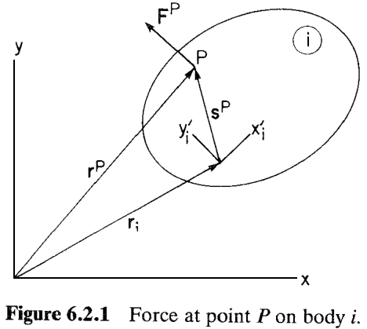
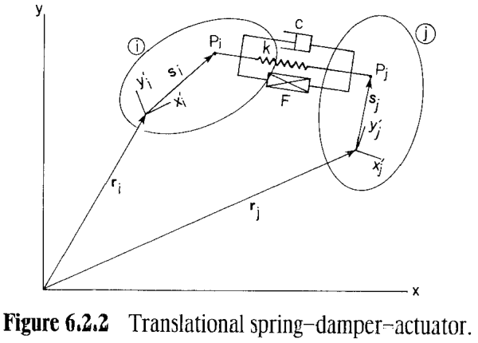
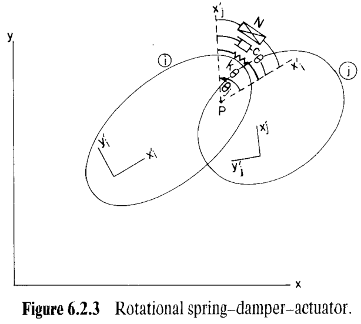

# 6.2 虚功与广义力（Virtual Work and Generalized Force）

> 来源：*Computer Aided Kinematics and Dynamics of Mechanical Systems, Vol. 1*，第 213–218 页。

---

## 引言：本节要解决什么

本节介绍了广义力的概念，并求出了在全局坐标系下，作用于刚体上点 $P$ 的广义力的表达式。

> 原书中，本节还会给出变分运动方程的紧凑形式 Eq 6.2.5，但由于和 6.1 节关系过于紧密而被我放到了 6.1 节

---

## 一、广义力

### 1. 二维平面下的广义力定义

现在有作用在刚体上的力 $\mathbf{F}$ 与力矩 $n$（注意，这里并不要求 $n$ 的参考点为质心），定义广义力 $\mathbf{Q}$（Generalized Force）：

$$
\mathbf{Q}=\begin{bmatrix}\mathbf{F}^{T}, & n\end{bmatrix}^{T}
$$

则刚体受到的虚功可以写为如下形式：

$$
\delta W=\delta\mathbf{r}^{T}\mathbf{F}+\delta\phi\, n
\equiv \delta\mathbf{q}^{T}\mathbf{Q}
\tag{6.2.1}
$$

### 2. 广义力的展开

显然力矩 $n$ 和力 $\mathbf{F}$ 是相关的。如下图，考虑作用于刚体 $i$ 上点 $P$ 的力 $\mathbf{F}^{P}$。

力 $\mathbf{F}^{P}$ 的虚功是力与作用点虚位移的点积：

$$
\delta W=\delta\mathbf{r}_i^{P\,T}\mathbf{F}^{P}
$$

其中，$\mathbf{r}_i^{P}$ 是点 $P$ 在惯性坐标系下的位置，对其取变分得到：

$$
\delta\mathbf{r}_i^{P}
=\delta\mathbf{r}_i+\delta(\mathbf{A}_i)\,\mathbf{s}'^{P}
$$

注意到 $\mathbf{A}_i$ 是 $\phi_i$ 的函数，并使用链式法则：

$$
\delta\mathbf{r}_i^{P}

=\delta\mathbf{r}_i+\frac{\partial \mathbf{A}_i}{\partial \phi_i}\,\delta\phi_i\,\mathbf{s}'^{P}
=\delta\mathbf{r}_i+\delta\phi_i\,\mathbf{B}_i\mathbf{s}'^{P}
$$

将上式代入虚功表达式得到：

$$
\delta W
=\bigl(\delta\mathbf{r}_i^{T}+\delta\phi_i\,\mathbf{s}'^{P\,T}\mathbf{B}_i^{T}\bigr)\mathbf{F}^{P}
=\delta\mathbf{r}_i^{T}\mathbf{F}^{P}+\delta\phi_i\,\mathbf{s}'^{P\,T}\mathbf{B}_i^{T}\mathbf{F}^{P}
$$

把上式与 $\delta W=\delta\mathbf{q}_i^{T}\mathbf{Q}=\delta\mathbf{r}_i^{T}(\,\cdot\,)+\delta\phi_i(\,\cdot\,)$ 对照，得到**在全局坐标系下，作用于刚体上点 $P$ 的广义力**为：

$$
\boxed{\;\mathbf{Q}=\begin{bmatrix}\mathbf{F}^{P}\\[4pt]\mathbf{s}'^{P\,T}\mathbf{B}_i^{T}\mathbf{F}^{P}\end{bmatrix}\;}
\tag{6.2.3}
$$

---

## 二、固连力（Body-fixed Force）的广义力

特别的，若力 $\mathbf{F}^{P}$ **随刚体 $i$ 一起运动**（例如固定在航天器上的火箭推进器），则它在刚体局部坐标系中是常量 $\mathbf{F}'^{P}$，在惯性坐标系下的表达为

$$
\mathbf{F}^{P}=\mathbf{A}_i\mathbf{F}'^{P}
$$

代入 Eq. 6.2.3，得到：

$$
\mathbf{Q}=\begin{bmatrix}\mathbf{A}_i\mathbf{F}'^{P}\\[4pt]\mathbf{s}'^{P\,T}\mathbf{B}_i^{T}\mathbf{A}_i\mathbf{F}'^{P}\end{bmatrix}
$$

根据 Eq 6.1.5 和 Eq 6.1.7 得到的 $\mathbf{A}_i$ 和 $\mathbf{B}_i$ 矩阵，容易得到（注意下面定义了 $\mathbf{R}$）：

$$
\mathbf{B}_i=\mathbf{A}_i * \begin{bmatrix}0 & -1\\[2pt] 1 & 0\end{bmatrix} \equiv \mathbf{A}_i\mathbf{R}
$$

由此得到：

$$
\mathbf{s}'^{P\,T}\mathbf{B}_i^{T}\mathbf{A}_i
=\mathbf{s}'^{P\,T}(\mathbf{A}_i\mathbf{R})^{T}\mathbf{A}_i
=(\mathbf{R}\,\mathbf{s}'^{P})^{T}
$$

**得到固连力的广义力：**

$$
\boxed{\;\mathbf{Q}=\begin{bmatrix}\mathbf{A}_i\\[4pt](\mathbf{R}\,\mathbf{s}'^{P})^{T}\end{bmatrix}\mathbf{F}'^{P}\;}
\tag{6.2.4}
$$

---

## 三、例题分析

### 1. 平动弹簧–阻尼–作动器（Translational Spring–Damper–Actuator）

机械系统中常见的力元件，是连接刚体 $i$ 上点 $P_i$ 与刚体 $j$ 上点 $P_j$ 的**柔顺机构（Compliant Connection）**（图 6.2.2），可以是弹簧、阻尼器或液压作动器，沿 $P_i P_j$ 连线方向施力，称为**平动弹簧–阻尼–作动器**。

由于该元件对两刚体施加**等大反向**的力，不再分别对每个刚体计算广义力，而是直接利用虚功定义更为方便。

### 元件向量与长度

从 $P_i$ 指向 $P_j$ 的向量：

$$
\mathbf{d}_{ij}=\mathbf{r}_j+\mathbf{A}_j\mathbf{s}'_j-\mathbf{r}_i-\mathbf{A}_i\mathbf{s}'_i
\tag{6.2.6}
$$

元件长度（的平方）由内积给出：

$$
\ell^{2}=\mathbf{d}_{ij}^{T}\mathbf{d}_{ij}
\tag{6.2.7}
$$

> $\ell$ 可正可负，不失一般性，这里约定 $\ell>0$。

#### 长度变化率 $\dot\ell$

**第 1 步：对 Eq. 6.2.7 两边求时间导数。** 这里需要注意到因为标量转置相等，所以 $\dot{\mathbf{d}}_{ij}^{T}\mathbf{d}_{ij}=\mathbf{d}_{ij}^{T}\dot{\mathbf{d}}_{ij}$，得到：

$$
2\ell\dot\ell=2\,\mathbf{d}_{ij}^{T}\dot{\mathbf{d}}_{ij}
$$

**第 2 步：对 Eq. 6.2.6 求时间导数。** 这里需要注意到 $\mathbf{s}'_i,\mathbf{s}'_j$ 是常量，求导为0，所以 $\dfrac{d}{dt}(\mathbf{A}_i\mathbf{s}'_i)=\dfrac{\partial\mathbf{A}_i}{\partial\phi_i}\dot\phi_i\,\mathbf{s}'_i=\mathbf{B}_i\mathbf{s}'_i\dot\phi_i$：

$$
\dot{\mathbf{d}}_{ij}=\dot{\mathbf{r}}_j+\mathbf{B}_j\mathbf{s}'_j\dot\phi_j-\dot{\mathbf{r}}_i-\mathbf{B}_i\mathbf{s}'_i\dot\phi_i
$$

**第 3 步：当 $\ell\neq 0$ 时，对第 1 步两边除以 $2\ell$，再代入 $\dot{\mathbf{d}}_{ij}$：**

$$
\dot\ell=\frac{1}{\ell}\,\mathbf{d}_{ij}^{T}\dot{\mathbf{d}}_{ij}
=\Bigl(\frac{\mathbf{d}_{ij}}{\ell}\Bigr)^{T}
\bigl(\dot{\mathbf{r}}_j+\mathbf{B}_j\mathbf{s}'_j\dot\phi_j-\dot{\mathbf{r}}_i-\mathbf{B}_i\mathbf{s}'_i\dot\phi_i\bigr)
\tag{6.2.8}
$$

#### 元件内力

规定**张力为正**（即把两刚体拉拢的力为正）。元件内力写为

$$
f=k(\ell-\ell_0)+c\dot\ell+F(\ell,\dot\ell,t)
\tag{6.2.10}
$$

其中 $k$ 为弹簧系数，$\ell_0$ 为弹簧自由长度，$c$ 为阻尼系数，$F$ 为一般作动器力（可依赖 $\ell$、$\dot\ell$ 或时间 $t$）。

#### 虚功

**虚功的符号约定**：正的 $\delta\ell$ 使两刚体分离，而 $f>0$ 对应张力（把刚体拉拢）。当 $f$ 与 $\delta\ell$ 同为正时，元件对刚体做**负功**。故

$$
\delta W=-f\,\delta\ell
\tag{6.2.11}
$$

**第 1 步：求 $\delta\ell$。** 对 Eq. 6.2.7 取微分（步骤与 $\dot\ell$ 推导相同，把"$d/dt$"换成"$\delta$"）：

$$
\delta\ell=\Bigl(\frac{\mathbf{d}_{ij}}{\ell}\Bigr)^{T}
\bigl(\delta\mathbf{r}_j+\mathbf{B}_j\mathbf{s}'_j\,\delta\phi_j-\delta\mathbf{r}_i-\mathbf{B}_i\mathbf{s}'_i\,\delta\phi_i\bigr)
\tag{6.2.12}
$$

**第 2 步：求  $\delta W$。**

$$
\delta W=-\frac{f}{\ell}\,\mathbf{d}_{ij}^{T}
\bigl(\delta\mathbf{r}_j+\mathbf{B}_j\mathbf{s}'_j\,\delta\phi_j-\delta\mathbf{r}_i-\mathbf{B}_i\mathbf{s}'_i\,\delta\phi_i\bigr)
\tag{6.2.13}
$$

#### 广义力

由定义，作用在刚体 $i$、$j$ 上的广义力就是 Eq. 6.2.13 中各广义坐标变分的系数。

**逐项收集系数。** 展开 Eq. 6.2.13：

$$
\delta W=-\frac{f}{\ell}\Bigl[
\underbrace{\mathbf{d}_{ij}^{T}\delta\mathbf{r}_j}_{\delta\mathbf{r}_j}
+\underbrace{\mathbf{d}_{ij}^{T}\mathbf{B}_j\mathbf{s}'_j\,\delta\phi_j}_{\delta\phi_j}
-\underbrace{\mathbf{d}_{ij}^{T}\delta\mathbf{r}_i}_{\delta\mathbf{r}_i}
-\underbrace{\mathbf{d}_{ij}^{T}\mathbf{B}_i\mathbf{s}'_i\,\delta\phi_i}_{\delta\phi_i}
\Bigr]
$$

故刚体 $i$ 、$j$ 的广义力：

$$
\mathbf{Q}_i=\frac{f}{\ell}\begin{bmatrix}\mathbf{d}_{ij}\\[4pt]\mathbf{d}_{ij}^{T}\mathbf{B}_i\mathbf{s}'_i\end{bmatrix}
\tag{6.2.14a}
$$

$$
\mathbf{Q}_j=-\frac{f}{\ell}\begin{bmatrix}\mathbf{d}_{ij}\\[4pt]\mathbf{d}_{ij}^{T}\mathbf{B}_j\mathbf{s}'_j\end{bmatrix}
\tag{6.2.14b}
$$

> Ronin 注：**【重要注解 6.2】** 这里值得注意的是，如果广义坐标的变分 $\delta\mathbf{r}_i$ 使用刚体 $i$ 的局部坐标系，是无法和使用全局坐标系的 $\mathbf{d}_{ij}$ 相乘的（更何况，$\mathbf{d}_{ij}$中同时包含了 $\mathbf{r}_i$ 和 $\mathbf{r}_j$）
> 因此，$\mathbf{r}_i$ 必须也使用全局坐标系。

### 2. 旋转弹簧–阻尼–作动器（Rotational Spring–Damper–Actuator）

考虑图 6.2.3 中的一对刚体：点 $P$ 处定义一个转动副（revolute joint），并有一个**扭转柔顺元件**作用在体固连轴 $x_i'$ 与 $x_j'$ 之间。该元件对刚体 $i$、$j$ 施加**等大反向**的力矩，称为**旋转弹簧–阻尼–作动器**。正力矩定义为：对刚体 $i$ 逆时针、对刚体 $j$ 顺时针作用。

#### 相对转角及其导数

从 $x_i'$ 轴到 $x_j'$ 轴的夹角 $\theta_{ij}$（逆时针为正）：

$$
\theta_{ij}=\phi_j-\phi_i
\tag{6.2.16}
$$

对时间求导：

$$
\dot\theta_{ij}=\dot\phi_j-\dot\phi_i
\tag{6.2.17}
$$

#### 元件力矩

作用在两刚体间的力矩：

$$
n=k_\theta(\theta_{ij}-\theta_0)+c_\theta\dot\theta_{ij}+N(\theta_{ij},\dot\theta_{ij},t)
\tag{6.2.18}
$$

其中 $k_\theta$ 为扭转弹簧系数，$\theta_0$ 为弹簧自由角，$c_\theta$ 为扭转阻尼系数，$N$ 为一般作动器力矩（可依赖 $\theta_{ij}$、$\dot\theta_{ij}$、时间 $t$）。

#### 虚功与广义力

**虚功的符号约定**：力矩 $n$ 的虚功是它与相对虚转动 $\delta\theta_{ij}$ 乘积的**负值**——因为当 $\theta_{ij}>0$ 时，正力矩使两轴靠拢，而正的 $\delta\theta_{ij}$ 使其分离：

$$
\delta W=-n\,\delta\theta_{ij}
\tag{6.2.19}
$$

**第 1 步：相对虚转动。** 由 Eq. 6.2.16 取变分：

$$
\delta\theta_{ij}=\delta\phi_j-\delta\phi_i
\tag{6.2.20}
$$

**第 2 步：代入 Eq. 6.2.19：**

$$
\delta W=-n(\delta\phi_j-\delta\phi_i)
\tag{6.2.21}
$$

**第 3 步：收集系数得广义力。** 把 Eq. 6.2.21 展开为 $\delta W=(+n)\,\delta\phi_i+(-n)\,\delta\phi_j$。由于扭转元件只产生力矩、不产生平动力，故 $\mathbf{r}_i,\mathbf{r}_j$ 方向的广义力分量为零，只有转角分量非零：

$$
\mathbf{Q}_i=\begin{bmatrix}0\\ 0\\ n\end{bmatrix},
\qquad
\mathbf{Q}_j=-\begin{bmatrix}0\\ 0\\ n\end{bmatrix}
\tag{6.2.22}
$$

> 同样体现等大反向：刚体 $i$ 受 $+n$、刚体 $j$ 受 $-n$。
