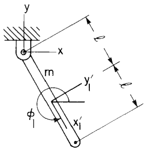
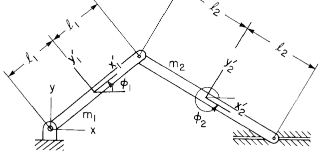

# 6.3 约束平面系统的运动方程

> 来源：*Computer Aided Kinematics and Dynamics of Mechanical Systems, Vol. 1*，第 6 章，6.3 节（书页 218–228）。

---

## 引言：本节要解决什么

- 第 6.1 节给出了单个刚体的变分运动方程，本节将其扩展到整个系统，得到了系统的变分方程组。
- 相比于单个刚体，整个系统中存在刚体之间的约束力，本节给出了**满足约束条件下的系统变分方程组**。
- 进一步，通过**拉格朗日乘子法**，得到了简化的**约束运动方程组**，此方程组中脱去了变分。
- 最后，讨论了求解约束运动方程组需要做的准备工作，包括如何验证解的唯一性，和如何补齐初始条件。

---

## 一、平面系统的变分运动方程

### 1. 系统变分方程

Eq. 6.2.5 给出了对于单个刚体的变分运动方程 $
\delta\mathbf{q}^{T}\bigl[\mathbf{M}\ddot{\mathbf{q}}-\mathbf{Q}\bigr]=0
$。而对于一个系统来说，该变分方程对每一个刚体都成立：

$$
\delta\mathbf{q}_i^T[\mathbf{M}_i\ddot{\mathbf{q}}_i - \mathbf{Q}_i] = 0 \tag{6.3.1}
$$

定义系统的构型向量 $\mathbf{q} = [\mathbf{q}_1^T, \mathbf{q}_2^T, \dots, \mathbf{q}_{nb}^T]^T$，质量矩阵 $\mathbf{M} = \operatorname{diag}(\mathbf{M}_1, \mathbf{M}_2, \dots, \mathbf{M}_{nb})$，广义力向量 $\mathbf{Q} = [\mathbf{Q}_1^T, \mathbf{Q}_2^T, \dots, \mathbf{Q}_{nb}^T]^T$，可以将所有刚体变分方程联立得到：

$$\delta\mathbf{q}^T[\mathbf{M}\ddot{\mathbf{q}} - \mathbf{Q}] = \sum_{i=1}^{nb}\delta\mathbf{q}_i^T[\mathbf{M}_i\ddot{\mathbf{q}}_i - \mathbf{Q}_i] = 0 \tag{6.3.1b}$$

从形式上看，上式与 Eq. 6.2.5 一样，区别在于几个变量的定义不同，性质也相同：
- 上式对任意的 $\delta\mathbf{q}$ 成立
- 每个刚体受到的广义力 $\mathbf{Q}_i$ 必须包含刚体受到的所有力
- 各个刚体受到合力矩的参考点、转动惯量的参考点均为该刚体的质心

> Ronin 注：在 Eq 6.3.2 中，求总虚功时，各个刚体可以独立选择自己的参考点来求取虚功，然后再相加——甚至可以选择自己的坐标系来求取虚功，然后再相加。
> 与之对应的，在经典刚体静力学中，同一刚体上受多个力，要统一参考点才能把力矩正确相加成合力矩。
> 这是因为，力是向量；而虚功是标量，且可以在 coordinate free 的情况下计算得到。容易证明其不受参考点——乃至参考坐标系——的变化而变化。

### 2. 带约束的系统变分运动方程

Eq 6.3.1 中，施加的广义力 $\mathbf{Q}$ 必须包含刚体受到的所有力——包括**约束力（Constraint Force）**和**外加力（Applied Force）**。其中"外加力"是指：除约束力之外，作用于系统上或刚体间的一切力——例如重力、弹簧-阻尼-作动器力等。

为区分二者，记上标 $A$ = applied，$C$ = constraint，则力、力矩、广义力均可以分为两块：

$$
\mathbf{F}_i = \mathbf{F}_i^A + \mathbf{F}_i^C, \qquad
n_i = n_i^A + n_i^C, \qquad
\mathbf{Q} = \mathbf{Q}^A + \mathbf{Q}^C
$$

代入 (6.3.1b) 得到：

$$\delta\mathbf{q}^T[\mathbf{M}\ddot{\mathbf{q}} - \mathbf{Q}^A] \;-\; \delta\mathbf{q}^T\mathbf{Q}^C = 0$$

虽然作用在**单个**物体上的约束力虚功 $\delta\mathbf{q}_i^T\mathbf{Q}_i^C$ 一般不为零。但由于约束力作用在被约束的两个物体上，等大、反向。可以想见，所有约束力的总虚功为零。

若约束力总虚功为零，则称这样的约束为理想约束。事实上，**假定系统满足理想约束，是分析力学的基本假设之一**。即：

$$\delta\mathbf{q}^T\mathbf{Q}^C=\sum_{i=1}^{nb}\delta\mathbf{q}_i^T\mathbf{Q}_i^C=0$$

此时，系统的变分运动方程变为：

$$\delta\mathbf{q}^T[\mathbf{M}\ddot{\mathbf{q}} - \mathbf{Q}^A] = \sum_{i=1}^{nb}\delta\mathbf{q}_i^T[\mathbf{M}_i\ddot{\mathbf{q}}_i - \mathbf{Q}_i^A] = 0 \tag{6.3.3}$$

### 3. 与约束相容的虚位移

Eq 6.2.5 的单刚体变分运动方程的推导过程中，证明了任意 $\delta\mathbf{q}_i$ 均能满足单刚体的约束。而 Eq 6.3.3 中，为了应用约束力总虚功为 0 的结论，系统的虚位移 $\delta\mathbf{q}$ 必须满足系统约束（或称为与约束相容，consistent with the constraints）：

$$\boldsymbol{\Phi}(\mathbf{q}, t) = \mathbf{0}$$

对上式取变分得到（虚位移是固定时间，所以 $\delta t = 0$），得到 $\delta\mathbf{q}$ 的约束为：

$$\boldsymbol{\Phi}_{\mathbf{q}}\,\delta\mathbf{q} = \mathbf{0} \tag{6.3.5}$$

### 4. 结论

**对于满足 $\boldsymbol{\Phi}_{\mathbf{q}}\,\delta\mathbf{q} = \mathbf{0}$ 的任意 $\delta\mathbf{q}$，都有**：

$$\delta\mathbf{q}^T[\mathbf{M}\ddot{\mathbf{q}} - \mathbf{Q}^A] = 0$$

---

## 二、基于拉格朗日乘子法，获得完整的约束运动方程组

### 1. 问题

Eq (6.3.3) 只对约束相容的 $\delta\mathbf{q}$ 成立，难以直接得到运动方程（因为 $\delta\mathbf{q}$ 不自由）。经典做法是引入拉格朗日乘子，把它转化为对**任意** $\delta\mathbf{q}$ 都成立的代数方程。

### 2. 拉格朗日乘子定理

> 设 $\mathbf{b}$ 为 $n$ 维常向量，$\mathbf{x}$ 为 $n$ 维变量向量，$\mathbf{A}$ 为 $m\times n$ 常矩阵。若
> $$\mathbf{b}^T\mathbf{x} = 0 \tag{6.3.12}$$
> 对所有满足
> $$\mathbf{A}\mathbf{x} = \mathbf{0} \tag{6.3.13}$$
> 的 $\mathbf{x}$ 成立，则存在 $m$ 维**拉格朗日乘子**向量 $\boldsymbol{\lambda}$，使
> $$\mathbf{b}^T\mathbf{x} + \boldsymbol{\lambda}^T\mathbf{A}\mathbf{x} = 0 \tag{6.3.14}$$
> 对**任意** $\mathbf{x}$ 成立。

### 3. 应用到动力学：运动方程的拉格朗日乘子形式

把定理对应到约束变分方程 Eq 6.3.3，以及约束条件 Eq 6.3.5，得到：存在乘子向量 $\boldsymbol{\lambda}$ 使下式对**任意** $\delta\mathbf{q}$ 成立：

$$[\mathbf{M}\ddot{\mathbf{q}}-\mathbf{Q}^A]^T\delta\mathbf{q} + \boldsymbol{\lambda}^T\boldsymbol{\Phi}_{\mathbf{q}}\delta\mathbf{q}
= [\mathbf{M}\ddot{\mathbf{q}} + \boldsymbol{\Phi}_{\mathbf{q}}^T\boldsymbol{\lambda} - \mathbf{Q}^A]^T\delta\mathbf{q} = 0$$

由于方程对任意 $\delta\mathbf{q}$ 成立，所以 $\delta\mathbf{q}$ 前的系数必须为零向量，得到**运动方程的拉格朗日乘子形式**：

$$\boxed{\;\mathbf{M}\ddot{\mathbf{q}} + \boldsymbol{\Phi}_{\mathbf{q}}^T\boldsymbol{\lambda} = \mathbf{Q}^A\;} \tag{6.3.16}$$

物理上，$\boldsymbol{\Phi}_{\mathbf{q}}^T\boldsymbol{\lambda}$ 这一项正是被前面"消去"的约束力以乘子形式重新显式出现（详见 6.6 节）。

### 4. 完整的约束运动方程组

将动力学的运动方程和第 3 章 Eq. 3.6.10、Eq. 3.6.11 放在一起，构成了系统**完整的约束运动方程**：

$$
\left\{
\begin{aligned}
\mathbf{M}\ddot{\mathbf{q}} + \boldsymbol{\Phi}_{\mathbf{q}}^T\boldsymbol{\lambda} &= \mathbf{Q}^A\\
\boldsymbol{\Phi}_{\mathbf{q}}\dot{\mathbf{q}} &= -\boldsymbol{\Phi}_t \equiv \boldsymbol{\nu}\\
\boldsymbol{\Phi}_{\mathbf{q}}\ddot{\mathbf{q}} &= -(\boldsymbol{\Phi}_{\mathbf{q}}\dot{\mathbf{q}})_{\mathbf{q}}\dot{\mathbf{q}} - 2\boldsymbol{\Phi}_{\mathbf{q}t}\dot{\mathbf{q}} - \boldsymbol{\Phi}_{tt} \equiv \boldsymbol{\gamma}
\end{aligned}
\right.
$$

### 5. 混合微分-代数方程

还有一个常用的方程组形式，是将拉格朗日乘子形式的运动方程，与加速度约束方程联立，得到一个**混合微分-代数方程组（Mixed System of Differential-Algebraic Equations / DAE）**：

$$\begin{bmatrix} \mathbf{M} & \boldsymbol{\Phi}_{\mathbf{q}}^T \\ \boldsymbol{\Phi}_{\mathbf{q}} & \mathbf{0} \end{bmatrix}
\begin{bmatrix} \ddot{\mathbf{q}} \\ \boldsymbol{\lambda} \end{bmatrix}
= \begin{bmatrix} \mathbf{Q}^A \\ \boldsymbol{\gamma} \end{bmatrix} \tag{6.3.18}$$

> Ronin 注：这段不知道有没有用，后续再看，不知道在说啥
> 这是一个**混合微分-代数方程组（DAE）**，方程中不包含乘子 $\boldsymbol{\lambda}$ 的任何导数。除 (6.3.18) 外，位置约束 (6.3.4) 和速度约束 (6.3.17a) 也必须始终满足。
> 实际计算时，给定当前 $\mathbf{q},\dot{\mathbf{q}}$ 即可组装 (6.3.18) 并解出 $\ddot{\mathbf{q}}$ 与 $\boldsymbol{\lambda}$，再积分推进。

## 三、求解约束动力学方程组前的准备工作

本章不会实际取求解约束动力学方程组，但是会进行一些准备工作。

### 1. 解的存在唯一性：约束动力学存在定理

在求解 Eq 6.1.18 之前，首先要确定唯一解的存在性。充要条件自然是其系数矩阵非奇异。这里再给出一个实用充分条件，方便进行快速判断。

> **约束动力学存在定理**：设 $\boldsymbol{\Phi}_{\mathbf{q}}$ 行满秩，且系统动能对任意非零、约束相容的虚速度为正，即
> $$\delta\dot{\mathbf{q}}^T\mathbf{M}\,\delta\dot{\mathbf{q}} > 0 \tag{6.3.21}$$
> 对所有满足
> $$\boldsymbol{\Phi}_{\mathbf{q}}\,\delta\dot{\mathbf{q}} = \mathbf{0} \tag{6.3.22}$$
> 的 $\delta\dot{\mathbf{q}}\neq\mathbf{0}$ 成立，则 (6.3.18) 的系数矩阵非奇异，$\ddot{\mathbf{q}}$ 与 $\boldsymbol{\lambda}$ 被唯一确定。

原书中有证明过程，由于不太重要，这里略过。

由本定理可以推论：**若质量矩阵正定（通常如此）且约束独立，则上述条件满足，Eq. 6.3.18 DAE 方程组有唯一解**。

### 2. 补足初始位置与速度

在之前的运动学分析中，在运动约束之外，还需要补充 DOF 个驱动约束；在当前的动力学分析中，运动过程中的 DOF 个自由度，可以由广义力来驱动补充，但是初始状态需要手动指定补全。

#### 补足初始位置条件

运动约束为：

$$\boldsymbol{\Phi}(\mathbf{q}, t) = \boldsymbol{\Phi}^K(\mathbf{q})= \mathbf{0}$$

需要手动附加的初始位置条件形式为：

$$\boldsymbol{\Phi}^I(\mathbf{q}(t_0), t_0) = \mathbf{0} \tag{6.3.26}$$

Eq 6.3.26 应该包含 DOF 个独立方程，且必须与运动约束相互独立，以唯一确定初始位置 $\mathbf{q}(t_0)$。

#### 补足初始速度条件

速度约束为：

$$
\boldsymbol{\Phi}_\mathbf{q}\,\dot{\mathbf{q}} = -\boldsymbol{\Phi}_t \equiv \boldsymbol{\nu}
$$

需要手动附加的初始速度条件为：

$$
\dot{q}_{i1}(t_0)=v_{i1}^I\\
\dot{q}_{i2}(t_0)=v_{i2}^I\\
...\\
\dot{q}_{ik}(t_0)=v_{ik}^I
$$

可以简写为：

$$\mathbf{B}^I\dot{\mathbf{q}}(t_0) = \mathbf{v}^I \tag{6.3.27}$$

Eq. 6.3.27 方程数同样等于 DOF，并和速度约束相互独立，以唯一确定初始速度 $\dot{\mathbf{q}}(t_0)$。

---

## 四、例题区

### 例 6.3.1：单摆：带约束的变分运动方程

> 图 6.3.1 为一根绕固定铰链摆动的均质杆（简单摆）。下面给出完整推导。

#### 变分运动方程

- 广义坐标 $\mathbf{q} = [x_1, y_1, \phi_1]^T$
- 广义外力只有重力（关节上的拉力属于约束力），因此 $\mathbf{Q}^A = [0,\, -mg,\, 0]^T$
- 参考表 6.1.1，单摆绕质心的极转动惯量为 $m\ell^2/3$，因此质量矩阵 $\mathbf{M} = \operatorname{diag}(m, m, m\ell^2/3)$。

汇总以上信息，得到：

$$\delta\mathbf{q}^T[\mathbf{M}\ddot{\mathbf{q}} - \mathbf{Q}^A]
= [\delta x_1, \delta y_1, \delta\phi_1]\begin{bmatrix} m\ddot{x}_1 \\ m\ddot{y}_1 + mg \\ (m\ell^2/3)\ddot\phi_1 \end{bmatrix} = 0 \tag{6.3.6}$$

#### 约束相容的条件

运动约束方程为：

$$\boldsymbol{\Phi}^K(\mathbf{q}) = \begin{bmatrix} x_1 - \ell\cos\phi_1 \\ y_1 - \ell\sin\phi_1 \end{bmatrix} = \mathbf{0} \tag{6.3.7}$$

求雅可比得到：

$$\boldsymbol{\Phi}_{\mathbf{q}}=\begin{bmatrix} 1 & 0 & \ell\sin\phi_1 \\ 0 & 1 & -\ell\cos\phi_1 \end{bmatrix}\tag{6.3.7b}$$

最终，得到与约束相容的虚位移，需要满足的条件：

$$\boldsymbol{\Phi}_{\mathbf{q}}\,\delta\mathbf{q}=\begin{bmatrix} 1 & 0 & \ell\sin\phi_1 \\ 0 & 1 & -\ell\cos\phi_1 \end{bmatrix}
\begin{bmatrix} \delta x_1 \\ \delta y_1 \\ \delta\phi_1 \end{bmatrix} = \mathbf{0} \tag{6.3.8}$$

综上所述，单摆的变分运动方程 (6.3.6) 须对所有满足 (6.3.8) 的 $\delta\mathbf{q}$ 成立。

---

### 例 6.3.2：两刚体曲柄滑块：带约束的变分运动方程

> 图 6.3.2 为两杆组成的曲柄滑块机构：杆 1 绕原点转动铰，杆 2 末端为水平滑块。

类似于上个例子，这里两个刚体各自选择了自己的质心作为力矩的参考点，得到各自受到的重力力矩为0。因此广义外力只包含重力：

$$\delta W = \delta\mathbf{r}_1^T\mathbf{F}_1 + \delta\mathbf{r}_2^T\mathbf{F}_2
= [\delta x_1, \delta y_1, \delta\phi_1, \delta x_2, \delta y_2, \delta\phi_2]
\begin{bmatrix} 0 \\ -m_1 g \\ 0 \\ 0 \\ -m_2 g \\ 0 \end{bmatrix}$$

$$\Rightarrow \mathbf{Q}^A = [0,\, -m_1 g,\, 0,\, 0,\, -m_2 g,\, 0]^T$$

每杆极转动惯量为 $m_1\ell_1^2/3$、$m_2\ell_2^2/3$。由 (6.3.3)：

$$\delta\mathbf{q}^T[\mathbf{M}\ddot{\mathbf{q}} - \mathbf{Q}^A]
= \begin{bmatrix}\delta x_1\\ \delta y_1\\ \delta\phi_1\\ \delta x_2\\ \delta y_2\\ \delta\phi_2\end{bmatrix}^T
\begin{bmatrix} m_1\ddot{x}_1 \\ m_1\ddot{y}_1 + m_1 g \\ (m_1\ell_1^2/3)\ddot\phi_1 \\ m_2\ddot{x}_2 \\ m_2\ddot{y}_2 + m_2 g \\ (m_2\ell_2^2/3)\ddot\phi_2 \end{bmatrix} = 0 \tag{6.3.9}$$

运动约束方程：

$$\boldsymbol{\Phi}^K(\mathbf{q}) = \begin{bmatrix}
x_1 - \ell_1\cos\phi_1 \\
y_1 - \ell_1\sin\phi_1 \\
x_2 - 2\ell_1\cos\phi_1 - \ell_2\cos\phi_2 \\
y_2 - 2\ell_1\sin\phi_1 - \ell_2\sin\phi_2 \\
2\ell_1\sin\phi_1 + 2\ell_2\sin\phi_2
\end{bmatrix} = \mathbf{0}$$

求雅可比，得相容虚位移条件 (6.3.5)：

$$\begin{bmatrix}
1 & 0 & \ell_1\sin\phi_1 & 0 & 0 & 0 \\
0 & 1 & -\ell_1\cos\phi_1 & 0 & 0 & 0 \\
0 & 0 & 2\ell_1\sin\phi_1 & 1 & 0 & \ell_2\sin\phi_2 \\
0 & 0 & -2\ell_1\cos\phi_1 & 0 & 1 & -\ell_2\cos\phi_2 \\
0 & 0 & 2\ell_1\cos\phi_1 & 0 & 0 & 2\ell_2\cos\phi_2
\end{bmatrix}
\begin{bmatrix}\delta x_1\\ \delta y_1\\ \delta\phi_1\\ \delta x_2\\ \delta y_2\\ \delta\phi_2\end{bmatrix} = \mathbf{0} \tag{6.3.11}$$

(6.3.9) 须对所有满足 (6.3.11) 的 $\delta\mathbf{q}$ 成立。

---

### 例 6.3.4：单摆：DAE

> 沿用例 6.3.1 的单摆。下面完整推导加速度方程并组装 DAE。

对 (6.3.7) 关于时间逐次求导。

**速度方程**：对约束方程 (6.3.7) 求导，并注意到 (6.3.7) 不显含时间，$\boldsymbol{\Phi}_t=\mathbf{0}$：

$$\boldsymbol{\Phi}_{\mathbf{q}}\dot{\mathbf{q}} = \begin{bmatrix} 1 & 0 & \ell\sin\phi_1 \\ 0 & 1 & -\ell\cos\phi_1 \end{bmatrix}
\begin{bmatrix}\dot{x}_1\\ \dot{y}_1\\ \dot\phi_1\end{bmatrix} = \mathbf{0} \equiv \boldsymbol{\nu}$$

整理得到：

$$\boldsymbol{\Phi}_{\mathbf{q}}\dot{\mathbf{q}} = \begin{bmatrix}\dot{x}_1 + \ell\sin\phi_1\,\dot\phi_1\\ \dot{y}_1 - \ell\cos\phi_1\,\dot\phi_1\end{bmatrix}=\mathbf{0}$$

**加速度方程**：

对速度方程求关于 $\mathbf{q}$ 的偏导，需要注意对 $\phi$ 求偏导时，$\dot\phi$ 被视作常量（已经被 $t$ 求导了），只有 $\sin\phi$ 被视作变量，其他变量也同理：

$$(\boldsymbol{\Phi}_{\mathbf{q}}\dot{\mathbf{q}})_{\mathbf{q}} = \begin{bmatrix} 0 & 0 & \ell\cos\phi_1\,\dot\phi_1 \\ 0 & 0 & \ell\sin\phi_1\,\dot\phi_1 \end{bmatrix}$$

将其代入到通用式 $\boldsymbol{\Phi}_{\mathbf{q}}\ddot{\mathbf{q}} = -(\boldsymbol{\Phi}_{\mathbf{q}}\dot{\mathbf{q}})_{\mathbf{q}}\dot{\mathbf{q}} - 2\boldsymbol{\Phi}_{\mathbf{q}t}\dot{\mathbf{q}} - \boldsymbol{\Phi}_{tt}\equiv\boldsymbol{\gamma}$，并注意到由于本例约束不显含 $t$，故 $\boldsymbol{\Phi}_{\mathbf{q}t}=\mathbf{0}$、$\boldsymbol{\Phi}_{tt}=\mathbf{0}$：

$$\boldsymbol{\Phi}_{\mathbf{q}}\ddot{\mathbf{q}} = -(\boldsymbol{\Phi}_{\mathbf{q}}\dot{\mathbf{q}})_{\mathbf{q}}\dot{\mathbf{q}} = -\begin{bmatrix} \ell\cos\phi_1\,\dot\phi_1^2 \\ \ell\sin\phi_1\,\dot\phi_1^2 \end{bmatrix} \equiv \boldsymbol{\gamma} \tag{6.3.19}$$

**DAE**：

根据定义，DAE 为：

$$\begin{bmatrix} \mathbf{M} & \boldsymbol{\Phi}_{\mathbf{q}}^T \\ \boldsymbol{\Phi}_{\mathbf{q}} & \mathbf{0} \end{bmatrix}
\begin{bmatrix} \ddot{\mathbf{q}} \\ \boldsymbol{\lambda} \end{bmatrix}
= \begin{bmatrix} \mathbf{Q}^A \\ \boldsymbol{\gamma} \end{bmatrix}$$

由 (6.3.6)、(6.3.19)，以及 Eq 6.3.7b 得到的雅可比代入，组装运动方程（$5\times5$ 系统，$\boldsymbol{\lambda}=[\lambda_1,\lambda_2]^T$）：

$$\begin{bmatrix}
m & 0 & 0 & 1 & 0 \\
0 & m & 0 & 0 & 1 \\
0 & 0 & m\ell^2/3 & \ell\sin\phi_1 & -\ell\cos\phi_1 \\
1 & 0 & \ell\sin\phi_1 & 0 & 0 \\
0 & 1 & -\ell\cos\phi_1 & 0 & 0
\end{bmatrix}
\begin{bmatrix}\ddot{x}_1\\ \ddot{y}_1\\ \ddot\phi_1\\ \lambda_1\\ \lambda_2\end{bmatrix}
=\begin{bmatrix} 0 \\ -mg \\ 0 \\ -\ell\cos\phi_1\,\dot\phi_1^2 \\ -\ell\sin\phi_1\,\dot\phi_1^2 \end{bmatrix} \tag{6.3.20}$$

---

### 例 6.3.6：单摆：附加初始条件

> 沿用例 6.3.1 的单摆。

#### 附加位置初始条件
如 Eq 6.3.7 所述，运动约束方程为：

$$\boldsymbol{\Phi}^K(\mathbf{q}) = \begin{bmatrix} x_1 - \ell\cos\phi_1 \\ y_1 - \ell\sin\phi_1 \end{bmatrix} = \mathbf{0}$$

广义坐标是三维的，因此 $DOF = 1$，增设初始位置条件（即 0 时刻，$\phi_1=3\pi/2$）：

$$\boldsymbol{\Phi}^I(\mathbf{q}(0), 0) = \phi_1(0) - \frac{3\pi}{2} = 0 \tag{6.3.28}$$

可以验证，(6.3.7) 在 $t=0$ 与 (6.3.28) 独立，可以唯一确定 $\mathbf{q}(0)$。

#### 附加速度初始条件

如例题 6.3.4 中推导，速度约束方程为：

$$\boldsymbol{\Phi}_{\mathbf{q}}\dot{\mathbf{q}} = \begin{bmatrix}\dot{x}_1 + \ell\sin\phi_1\,\dot\phi_1\\ \dot{y}_1 - \ell\cos\phi_1\,\dot\phi_1\end{bmatrix}=\mathbf{0}$$

$DOF = 1$，增设初始速度条件（即 0 时刻，角速度为 $2\pi$）：

$$\mathbf{B}^I\dot{\mathbf{q}}(0) = \dot\phi_1(0) - 2\pi = 0 \tag{6.3.29}$$

可以验证，两组方程联立，可以唯一确定 $\dot{\mathbf{q}}(0)$。
