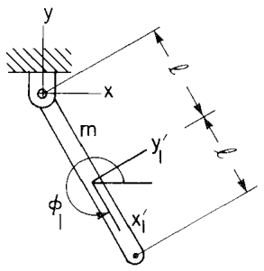

# 6.4 运动学驱动系统的逆动力学

> 来源：*Computer Aided Kinematics and Dynamics of Mechanical Systems, Vol. 1*，第 6 章，6.4 节（书页 229–230）。

## 引言：本节要解决什么

本节介绍了逆动力学的概念，以及求解方法。

---

## 一、什么是逆动力学

第 6.3 节得到的混合微分-代数方程（6.3.18）对**任意自由度**的约束系统都成立。

当系统运动约束和外力固定之后，再**加入 DOF 个指定的驱动约束**，由于此时整个系统是**运动学确定的（kinematically determined）**，雅可比 $\boldsymbol{\Phi}_{\mathbf{q}}$ 是**方阵且非奇异**：

$$\lvert\boldsymbol{\Phi}_{\mathbf{q}}(\mathbf{q},t)\rvert\neq 0 \tag{6.4.1}$$

因此可以使用 3.6 节的方法解出系统中个刚体受到的约束力 $\boldsymbol{\lambda}$。这就得到了**逆动力学（inverse dynamics）**，即：要让系统按规定的运动走（即指定的驱动约束），**关节里需要多大的反力/力矩**？

---

## 二、求解过程

假设已经引入了驱动约束（即希望的运动轨迹），$\boldsymbol{\Phi}_{\mathbf{q}}$ 是方阵且可逆，则对于 Eq 6.3.18：

$$\begin{bmatrix} \mathbf{M} & \boldsymbol{\Phi}_{\mathbf{q}}^T \\ \boldsymbol{\Phi}_{\mathbf{q}} & \mathbf{0} \end{bmatrix}
\begin{bmatrix} \ddot{\mathbf{q}} \\ \boldsymbol{\lambda} \end{bmatrix}
= \begin{bmatrix} \mathbf{Q}^A \\ \boldsymbol{\gamma} \end{bmatrix} \tag{6.3.18}$$

第二行两边左乘 $\boldsymbol{\Phi}_{\mathbf{q}}^{-1}$，就可以解出加速度：

$$\ddot{\mathbf{q}} = \boldsymbol{\Phi}_{\mathbf{q}}^{-1}\boldsymbol{\gamma} \tag{6.4.4}$$

然后将其代入到第一行，得到：

$$\boxed{\boldsymbol{\lambda} = \boldsymbol{\Phi}_{\mathbf{q}}^{-T}\bigl[\mathbf{Q}^A - \mathbf{M}\ddot{\mathbf{q}}\bigr]} \tag{6.4.5}$$

然后再用 6.6 节的反力公式把 $\boldsymbol{\lambda}$ 翻译成实际作动器需提供的力/力矩即可。

---

## 三、例 6.4.1：单摆的逆动力学

> 沿用例 6.3.1、6.3.4、6.3.6 的单摆，并附加驱动约束（driving constraint）
> $$\Phi^D = \phi_1 - \tfrac{3\pi}{2} - 2\pi t = 0$$
> 即令杆以角速度 $\dot\phi_1 = 2\pi$ 匀速旋转。

**运动方程的拉格朗日乘子形式**：

在上一节分析的运动约束 Eq 6.3.7 之外，加入驱动约束：

$$\boldsymbol{\Phi}^K(\mathbf{q}) = \begin{bmatrix} x_1 - \ell\cos\phi_1 \\ y_1 - \ell\sin\phi_1 \end{bmatrix} = \mathbf{0} \tag{6.3.7}$$
$$\boldsymbol{\Phi}^D = \phi_1 - \tfrac{3\pi}{2} - 2\pi t = 0$$

对 $\mathbf{q}=(x_1,y_1,\phi_1)$ 求偏导：
$$\boldsymbol{\Phi}_{\mathbf{q}} = \begin{bmatrix}
1 & 0 & \ell\sin\phi_1 \\
0 & 1 & -\ell\cos\phi_1 \\
0 & 0 & 1
\end{bmatrix}$$

系统受到的外力只有重力 $\mathbf{Q}^A=[0,-mg,0]^T$，因此得到 DAE 的第一部分：

$$\begin{bmatrix} m & 0 & 0\\ 0 & m & 0\\ 0 & 0 & \tfrac{m\ell^2}{3} \end{bmatrix}\!\begin{bmatrix}\ddot x_1\\ \ddot y_1\\ \ddot\phi_1\end{bmatrix} + \begin{bmatrix} 1 & 0 & 0\\ 0 & 1 & 0\\ \ell\sin\phi_1 & -\ell\cos\phi_1 & 1 \end{bmatrix}\!\begin{bmatrix}\lambda_1\\\lambda_2\\\lambda_3\end{bmatrix} = \begin{bmatrix} 0\\ -mg\\ 0\end{bmatrix} \tag{6.4.6}$$

**加速度方程**：

按 3.1.10 的通用公式 $\boldsymbol{\gamma} = -(\boldsymbol{\Phi}_\mathbf{q}\dot{\mathbf{q}})_\mathbf{q}\dot{\mathbf{q}} - 2\boldsymbol{\Phi}_{\mathbf{q}t}\dot{\mathbf{q}} - \boldsymbol{\Phi}_{tt}$ 。先算第一项：

$$
(\boldsymbol{\Phi}_\mathbf{q}\dot{\mathbf{q}})_\mathbf{q}\dot{\mathbf{q}}
= \left(
\begin{bmatrix}
1 & 0 & \ell\sin\phi_1 \\
0 & 1 & -\ell\cos\phi_1 \\
0 & 0 & 1
\end{bmatrix}
\begin{bmatrix}\dot x_1\\\dot y_1\\\dot\phi_1\end{bmatrix}
\right)_{\!\mathbf{q}}\dot{\mathbf{q}}
= \begin{bmatrix}\dot x_1+\ell\sin\phi_1\,\dot\phi_1\\ \dot y_1-\ell\cos\phi_1\,\dot\phi_1\\ \dot\phi_1\end{bmatrix}_{\!\mathbf{q}}\dot{\mathbf{q}}
= \begin{bmatrix}
0 & 0 & \ell\cos\phi_1\,\dot\phi_1 \\
0 & 0 & \ell\sin\phi_1\,\dot\phi_1 \\
0 & 0 & 0
\end{bmatrix}
\begin{bmatrix}\dot x_1\\\dot y_1\\\dot\phi_1\end{bmatrix}
= \begin{bmatrix}\ell\cos\phi_1\,\dot\phi_1^2\\ \ell\sin\phi_1\,\dot\phi_1^2\\ 0\end{bmatrix}
$$

由于 $\boldsymbol{\Phi}_\mathbf{q}$ 各元素都不显含 $t$，且只有驱动约束 $\Phi^D$ 线性含 $t$，故含时间偏导的两项全为零：$\boldsymbol{\Phi}_{\mathbf{q}t}=\mathbf{0}_{3\times3},\boldsymbol{\Phi}_{tt}=\mathbf{0}_{3\times1}$。因此得到加速度方程：

$$\begin{bmatrix}
1 & 0 & \ell\sin\phi_1 \\
0 & 1 & -\ell\cos\phi_1 \\
0 & 0 & 1
\end{bmatrix}\!\begin{bmatrix}\ddot x_1\\\ddot y_1\\\ddot\phi_1\end{bmatrix} = \boldsymbol{\gamma}
= \begin{bmatrix}-\ell\cos\phi_1\,\dot\phi_1^2\\ -\ell\sin\phi_1\,\dot\phi_1^2\\ 0\end{bmatrix} \tag{6.4.7}$$

**求拉格朗日乘子**

先解 (6.4.7) 得到加速度：

$$\begin{bmatrix}\ddot x_1\\\ddot y_1\\\ddot\phi_1\end{bmatrix} = \begin{bmatrix}-\ell\cos\phi_1\,\dot\phi_1^2\\ -\ell\sin\phi_1\,\dot\phi_1^2\\ 0\end{bmatrix} \tag{6.4.8}$$

再把 $\ddot{\mathbf{q}}$ 代回 (6.4.6) 求拉格朗日乘子：

$$\boxed{\begin{bmatrix}\lambda_1\\\lambda_2\\\lambda_3\end{bmatrix} = \begin{bmatrix} m\ell\cos\phi_1\,\dot\phi_1^2\\ -mg + m\ell\sin\phi_1\,\dot\phi_1^2\\ -mg\ell\cos\phi_1\end{bmatrix}} \tag{6.4.9}$$

### 物理解读

虽然一般情形下要用 6.6 节的反力公式把乘子翻译成关节力，但这里乘子的物理意义已可直读：

- $\lambda_1$：作用于摆质心的 **$x$ 方向向心力**（指向悬点的水平分量）。
- $\lambda_2$：**$y$ 方向向心力 减 重力**——即除重力外，悬点向上拉摆的竖直分量（既要提供竖直向心力，又要平衡 $-mg$）。
- $\lambda_3$：与驱动约束对应，等于 $-mg\ell\cos\phi_1$，即**重力关于悬点的力矩**——这正是要让杆以恒定 $\dot\phi_1$ 旋转所需的驱动力矩（重力试图减/加速摆，作动器须正好抵消其力矩贡献）。

> 验证：当 $\phi_1=\pi/2$（杆竖直向上）或 $3\pi/2$（向下）时 $\cos\phi_1=0$，重力沿杆方向、对悬点无力矩，故 $\lambda_3=0$。符合直觉。
