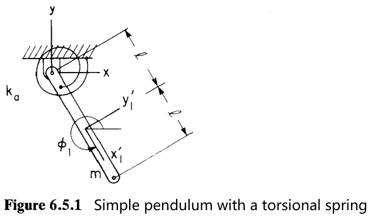
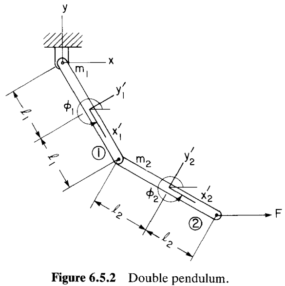

# 6.5 平衡条件（Equilibrium Conditions）

> 来源：*Computer Aided Kinematics and Dynamics of Mechanical Systems, Vol. 1*，第 6 章，6.5 节（书页 230–233）。

---

## 引言：本节要解决什么

本节给出了平衡的定义，并以此从运动方程推导得到**平衡方程（equilibrium equations）**（6.5.2）。

并进一步，介绍了在保守系统中，如何使用**总势能最小原理（principle of minimum total potential energy）** 来求解平衡方程。

---

## 一、平衡

**平衡（equilibrium）**的直观含义是：系统在外力作用下**保持静止**。静止意味着构型不随时间变化，因此速度与加速度都为零。

$$\ddot{\mathbf{q}} = \dot{\mathbf{q}} = \mathbf{0} \tag{6.5.1}$$

**稳定与非稳定平衡态**（来自百度百科）：
- **稳定平衡**：物体被移动离开它的平衡位置后，仍试图恢复其原来位置，从而恢复到原来的平衡状态。
- **不稳定平衡**：物体稍有偏离就不能恢复到原来的平衡状态，这种情况叫“不稳定平衡”。
- **亚稳平衡**：物体在外力作用下，稍有偏离尚可恢复，而偏离稍大就失掉平衡的状态，称为“亚稳平衡”。
- **随遇平衡**：物体在外界作用下，它的平衡状态不随时间和坐标的变化而改变，这种状态叫“随遇平衡”。如一个圆球体停在一个水平平面上的时候。

## 二、平衡方程

将平衡定义直接代入Eq 6.3.16 运动方程 $\mathbf{M}\ddot{\mathbf{q}} + \boldsymbol{\Phi}_{\mathbf{q}}^T\boldsymbol{\lambda} = \mathbf{Q}^A$，令 $\ddot{\mathbf{q}}=\mathbf{0}$，得到系统的**平衡方程（equilibrium equations）**：

$$\boxed{\boldsymbol{\Phi}_{\mathbf{q}}^T\boldsymbol{\lambda} = \mathbf{Q}^A} \tag{6.5.2}$$

---

## 三、利用总势能最小原理，求解保守系统中的平衡方程

### 1. 数值方法的局限性

理论上，将平衡方程和约束方程 $\boldsymbol{\Phi}(\mathbf{q},t)=\mathbf{0}$ 联立，就可以求得平衡态的拉格朗日乘子 $\boldsymbol{\lambda}$ 以及构型 $\mathbf{q}$，但有两点不足：

- **需要好初值**：使用 Newton–Raphson 迭代求解时，需要一个靠近平衡位置的良好初始估计。
- **无法区分稳定与不稳定**。

### 2. 平衡系统中的总势能最小原理

**总势能最小原理（principle of minimum total potential energy）**：系统处于**稳定平衡**当且仅当其总势能在该位置取到严格的局部极小。

这样，只要去**极小化**总势能，自动就落到稳定平衡上，天然排除了不稳定态。

### 3. 保守系统中的总势能

在保守系统中，**总势能（total potential energy, TPE）** 的定义如下：

$$TPE = SE - W(F) \tag{6.5.3}$$

其中：
- **保守系统**，指系统中所有力均为保守力（如重力、弹力、万有引力、电场力）。
- $-W(F)$ 表征系统**势能**。
  - $W(F)$ 是系统中所有力所做的功。
  - 由于对于保守力来说，势能变化等于保守力所做的功的负值
  - 因此 $-W(F)$ 就可以表征保守系统中所有力的势能。
- $SE$ 是柔性部件的**应变能（strain energy）**
  - 线性平移弹簧 $SE = \tfrac{1}{2}k(\ell - \ell_0)^2$
  - 线性扭转弹簧 $SE = \tfrac{1}{2}k_\theta(\theta - \theta_0)^2$

### 4. 广义力是总势能梯度的负值

若要找到总势能的极小值，则需要找到其梯度为零的位置。对保守系统，**广义力（generalized force）$\mathbf{Q}^A$ 正是总势能梯度的负值**：

$$\boxed{\dfrac{\partial TPE}{\partial \mathbf{q}} = -(\mathbf{Q}^A)^T} \tag{6.5.8}$$

（转置是因为 $\partial TPE/\partial\mathbf{q}$ 按约定是行向量，而 $\mathbf{Q}^A$ 是列向量。）

**证明如下**：

首先，广义力虚功 $\delta W = (\mathbf{Q}^A)^T\delta\mathbf{q}$。

其次，对保守力，其做的功等于势能的减少，$\delta W = -\delta(TPE) = -\dfrac{\partial TPE}{\partial\mathbf{q}}\,\delta\mathbf{q}$。

由于两式对任意虚位移 $\delta\mathbf{q}$ 相等，故 $(\mathbf{Q}^A)^T = -\dfrac{\partial TPE}{\partial\mathbf{q}}$，即 (6.5.8)。

### 5. 恒保守力的势能

包括力和力矩两个部分：设恒力 $\mathbf{F}^P$ 作用在物体上的点 $P$，恒力矩 $n$ 作用在物体上，则其势能为

$$-W(F) = -\bigl(x^P F^P_x + y^P F^P_y + n\phi\bigr) \tag{6.5.5}$$

其中 $(x^P,y^P)$ 是作用点 $P$ 的坐标，$\phi$ 是物体转角。功等于"力点乘位移 + 力矩乘转角"，势能取其负值。

---

## 例 6.5.1：带扭簧的单摆

> 一根质量 $m$、长 $2\ell$ 的单摆，悬点处装一扭转弹簧（torsional spring），弹簧常数 $k_\theta$，未变形角为 $\phi_0$。求平衡位置。

**系统的约束方程**为：

$$\boldsymbol{\Phi} = \begin{bmatrix} x_1 - \ell\cos\phi_1 \\ y_1 - \ell\sin\phi_1 \end{bmatrix} = \mathbf{0}$$

**系统的总势能**由两部分组成：扭簧的应变能 $\tfrac12 k_\theta(\phi_1-\phi_0)^2$ 与重力势能 $mgy_1$：

$$TPE = \tfrac{1}{2}k_\theta(\phi_1 - \phi_0)^2 + mgy_1 \tag{6.5.9}$$

代入约束方程中的第二式 $y_1 = \ell\sin\phi_1$，消去 $y_1$：

$$TPE = \tfrac{1}{2}k_\theta(\phi_1 - \phi_0)^2 + mg\ell\sin\phi_1$$

**求极小值**：现在 TPE 只是单变量 $\phi_1$ 的函数，可直接对其求极小：

$$\frac{\partial TPE}{\partial\phi_1} = k_\theta(\phi_1 - \phi_0) + mg\ell\cos\phi_1 = 0 \tag{6.5.11}$$

这是关于 $\phi_1$ 的**非线性方程**，需要用数值方法求解（这里不求，求解法见第 7 章）。

---

## 例 6.5.2：受水平力的双摆（double pendulum）

> 两根杆铰接成双摆：第一杆质量 $m_1$、长 $2\ell_1$，第二杆质量 $m_2$、长 $2\ell_2$。在第二杆的**末端**沿水平方向施加恒力 $F$。求平衡角 $\phi_1,\phi_2$。

**系统的总势能**为：

$$TPE = m_1 g\,\ell_1\sin\phi_1 + m_2 g\,(2\ell_1\sin\phi_1 + \ell_2\sin\phi_2) - F\,(2\ell_1\cos\phi_1 + 2\ell_2\cos\phi_2)$$

由总势能最小原理，**平衡时，两个偏导同时为零**：

$$\frac{\partial TPE}{\partial\phi_1} = \frac{\partial TPE}{\partial\phi_2} = 0$$

得到：

$$\frac{\partial TPE}{\partial\phi_1} = m_1 g\ell_1\cos\phi_1 + 2m_2 g\ell_1\cos\phi_1 + 2F\ell_1\sin\phi_1 = 0$$

$$\frac{\partial TPE}{\partial\phi_2} = m_2 g\ell_2\cos\phi_2 + 2F\ell_2\sin\phi_2 = 0$$

求解得到：

$$\phi_1 = \operatorname{Arctan}\!\left[-\frac{(m_1 + 2m_2)g}{2F}\right]$$

$$\phi_2 = \operatorname{Arctan}\!\left[-\frac{m_2 g}{2F}\right]$$
