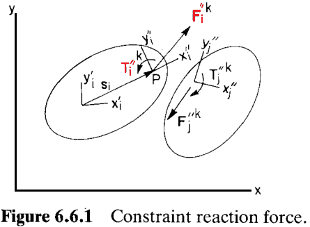
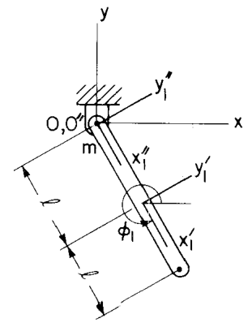

# 6.6 约束反力（Constraint Reaction Forces）

> 来源：*Computer Aided Kinematics and Dynamics of Mechanical Systems, Vol. 1*，第 6 章，6.6 节（书页 233–237）。

---

## 引言：本节要解决什么

本节推导出了任一运动约束的约束力、力矩，在关节坐标系下，和拉格朗日乘子 $\boldsymbol{\lambda}$ 的对应关系。

---

## 一、拉格朗日乘子与约束力的关系

在 6.3 节中提到，对于多刚体系统，存在乘子向量 $\boldsymbol{\lambda}$ 使下式 Eq 6.3.15 对**任意** $\delta\mathbf{q}$ 成立：

$$[\mathbf{M}\ddot{\mathbf{q}} + \boldsymbol{\Phi}_{\mathbf{q}}^T\boldsymbol{\lambda} - \mathbf{Q}^A]^T\delta\mathbf{q} = 0$$

现在我们仅考察其中物体 $i$ 与 $j$ 之间一个运动学约束或驱动约束，编号为 $k$；并且构造一组 $\delta\mathbf{q}$，其中 $\delta\mathbf{q}_i\neq\mathbf{0}$，其余元素均为 0。由于 Eq 6.3.15 对任意 $\delta\mathbf{q}$ 均成立，所以对构造的这组 $\delta\mathbf{q}$ 当然也成立。因此得到**只关乎物体 $i$ 和约束 $k$ 的变分运动方程**：

$$\delta\mathbf{q}_i^T\mathbf{M}_i\ddot{\mathbf{q}}_i + \sum_{\ell\neq k}\delta\mathbf{q}_i^T\boldsymbol{\Phi}_{\mathbf{q}_i}^{\ell T}\lambda^\ell + \delta\mathbf{q}_i^T\boldsymbol{\Phi}_{\mathbf{q}_i}^{kT}\lambda^k = \delta\mathbf{q}_i^T\mathbf{Q}_i^A \tag{6.6.1}$$

其中 $\boldsymbol{\Phi}_{\mathbf{q}_i}^{\ell}=\left[\frac{\partial\Phi^{\ell}}{\partial x_i},\ \frac{\partial\Phi^{\ell}}{\partial y_i},\ \frac{\partial\Phi^{\ell}}{\partial\phi_i}\right]$ 是雅可比矩阵中"约束 $\ell$ 那一行 × 物体 $i$ 那三列"构成的 $1\times3$ 行块；$\lambda^\ell$ 是拉格朗日乘子 $\boldsymbol{\lambda}$ 中对应约束 $\ell$ 的分量。式子中，约束 $k$ 被**单独列出**以便特殊处理。由上面讨论可知，（6.6.1）对**任意** $\delta\mathbf{q}_i$ 成立。

### 用等价力代替约束

现在把约束 $k$ 剪断，替换为**外力**形式的**约束力 $\mathbf{F}_i''^k$（constraint reaction force）**（示意见图 6.6.1）。则有：

$$-\delta\mathbf{q}_i^T\boldsymbol{\Phi}_{\mathbf{q}_i}^{kT}\lambda^k=\delta\mathbf{r}_i''^{PT}\mathbf{F}_i''^k + \delta\phi_i\,T_i''^k$$

代入广义坐标 $\mathbf{q}_i=[\mathbf{r}_i^T,\phi_i]^T$，并将约束 $k$ 的雅可比 $\boldsymbol{\Phi}_{\mathbf{q}_i}^{k}$ 分开成 $\boldsymbol{\Phi}_{\mathbf{r}_i}^{k}=\left[\frac{\partial\Phi^{k}}{\partial x_i},\ \frac{\partial\Phi^{k}}{\partial y_i}\right]$ 和 $\Phi_{\phi_i}^{k}$，得到：

$$-\delta\mathbf{r}_i^T\boldsymbol{\Phi}_{\mathbf{r}_i}^{kT}\lambda^k - \delta\phi_i\,\Phi_{\phi_i}^{k}\lambda^k = \delta\mathbf{r}_i''^{PT}\mathbf{F}_i''^k + \delta\phi_i\,T_i''^k \tag{6.6.2}$$

关于该公式更细致证明，见原书文献 35。

> 记号约定：上标 $''$（双撇）表示**固连在刚体上的关节坐标系（body-fixed joint frame） $x''\text{-}y''$** 。后续章节会详细介绍。
> 另外，式子中的 $\delta\mathbf{r}_i''^{P}$ 是 $P$ 点虚位移在关节坐标系下的值，和 $\delta\mathbf{r}_i^{P}$ 是同一虚位移的换基，即 $\delta\mathbf{r}_i^P = \mathbf{X}\,\delta\mathbf{r}_i''^P $

### 变换到统一坐标系

Eq 6.6.2 右端出现的是**关节点 $P$ 在关节坐标系中的虚位移** $\delta\mathbf{r}_i''^P$，而左端出现的是全局坐标系下的**质心虚位移** $\delta\mathbf{r}_i$ 与**虚转角** $\delta\phi_i$。要匹配系数、解出 $\mathbf{F}_i''^k$ 和 $T_i''^k$，必须先将坐标系统一。

定义常值变换矩阵 $\mathbf{C}_i$ 把 $x_i''\text{-}y_i''$ 系中的矢量变到 $x_i'\text{-}y_i'$ 系，再由 $\mathbf{A}_i$ 变到惯性坐标系。因此有：

$$\delta\mathbf{r}_i^P = \mathbf{A}_i\mathbf{C}_i\,\delta\mathbf{r}_i''^P$$

另一方面，由于 $\mathbf{r}_i^P = \mathbf{r}_i + \mathbf{A}_i\mathbf{s}_i'^P$，对其求变分并移项得到：

$$\delta\mathbf{r}_i = \delta\mathbf{r}_i^P - \mathbf{B}_i\mathbf{s}_i'^P\,\delta\phi_i = \mathbf{A}_i\mathbf{C}_i\,\delta\mathbf{r}_i''^P - \mathbf{B}_i\mathbf{s}_i'^P\,\delta\phi_i$$

### 得到约束力与约束力矩公式

把上面的式子代入（6.6.2）的左端：

$$-\delta\mathbf{r}_i''^{PT}\mathbf{C}_i^T\mathbf{A}_i^T\boldsymbol{\Phi}_{\mathbf{r}_i}^{kT}\boldsymbol{\lambda}^k - \delta\phi_i\bigl(\boldsymbol{\Phi}_{\phi_i}^{kT} - \mathbf{s}_i'^{PT}\mathbf{B}_i^T\boldsymbol{\Phi}_{\mathbf{r}_i}^{kT}\bigr)\boldsymbol{\lambda}^k = \delta\mathbf{r}_i''^{PT}\mathbf{F}_i''^k + \delta\phi_i\,T_i''^k$$

由于是从拉格朗日形式的变分运动方程一路等价推导而来，因此上市对任意 $\delta\mathbf{r}_i$ 和 $\delta\phi_i$ 都要成立，且虚位移 $\delta\mathbf{r}_i''^P$ 与虚转角 $\delta\phi_i$ 相互独立，因此两端对应系数必须分别相等，得到**拉格朗日乘子与约束力、力矩的关系**：

$$\boxed{\mathbf{F}_i''^k = -\mathbf{C}_i^T\mathbf{A}_i^T\boldsymbol{\Phi}_{\mathbf{r}_i}^{kT}\boldsymbol{\lambda}^k} \tag{6.6.8}$$

$$\boxed{T_i''^k = \bigl(\mathbf{s}_i'^{PT}\mathbf{B}_i^T\boldsymbol{\Phi}_{\mathbf{r}_i}^{kT} - \boldsymbol{\Phi}_{\phi_i}^{kT}\bigr)\boldsymbol{\lambda}^k} \tag{6.6.9}$$

---

## 二、例题

### 例 6.6.1：运动学驱动单摆的关节反力

> 取例 6.4.1 的运动学驱动单摆（转动关节把摆铰在地面点 $O$，并以驱动约束 $\phi_1=3\pi/2+2\pi t$ 强制其转动），几何见图 6.6.2。摆质量 $m$、质心距 $O$ 为 $\ell$。

#### 已知项

在例 6.4.1 中，已经求出雅可比的转置为：

$$ \boldsymbol{\Phi}_{\mathbf{q}}^T = \begin{bmatrix}
1 & 0 & 0 \\
0 & 1 & 0 \\
\ell\sin\phi_1 & -\ell\cos\phi_1 & 1
\end{bmatrix}$$

拉格朗日乘子向量为（$\boldsymbol{\lambda}^r$ 来自运动学约束，$\lambda^d$ 来自驱动约束）：

$$\boldsymbol{\lambda} = \begin{bmatrix}\boldsymbol{\lambda}^r\\ \lambda^d\end{bmatrix} = \begin{bmatrix} m\ell\cos\phi_1\,\dot\phi_1^2 \\ -mg + m\ell\sin\phi_1\,\dot\phi_1^2 \\ -mg\ell\cos\phi_1 \end{bmatrix}$$

#### 计算关节约束力

关节点即 $O$，其质心系 $x_1'\text{-}y_1'$ 与关节系 $x_1''\text{-}y_1''$ **平行**，故 $\mathbf{C}=\mathbf{I}$。

$\boldsymbol{\Phi}_{\mathbf{r}_i}^{kT}$ 是 $\boldsymbol{\Phi}_{\mathbf{q}}^T$ 中对应 $\boldsymbol{\lambda}$ 的前两个分量的 $\begin{bmatrix}1&0&0\\0&1&0\end{bmatrix}$。
由（6.6.8）：

$$\mathbf{F}'' = -\begin{bmatrix}\cos\phi_1 & \sin\phi_1\\ -\sin\phi_1 & \cos\phi_1\end{bmatrix}\begin{bmatrix}1&0&0\\0&1&0\end{bmatrix}\begin{bmatrix} m\ell\cos\phi_1\,\dot\phi_1^2 \\ -mg + m\ell\sin\phi_1\,\dot\phi_1^2 \\ -mg\ell\cos\phi_1 \end{bmatrix}= \begin{bmatrix} -m\ell\dot\phi_1^2 + mg\sin\phi_1 \\ mg\cos\phi_1 \end{bmatrix}$$

#### 计算关节约束力矩

质心在 $x_1'$ 轴上距 $O$ 为 $\ell$，故 $\mathbf{s}_1'^P=[-\ell,\,0]^T$。类似约束力部分，$\boldsymbol{\Phi}_{\phi_i}^{kT} = [\ell\sin\phi_1,\,-\ell\cos\phi_1,\,1]$。
由（6.6.9）：

$$T = \left\{[-\ell,\,0]\begin{bmatrix}-\sin\phi_1&\cos\phi_1\\-\cos\phi_1&-\sin\phi_1\end{bmatrix}\begin{bmatrix}1&0&0\\0&1&0\end{bmatrix} - [\ell\sin\phi_1,\,-\ell\cos\phi_1,\,1]\right\}\begin{bmatrix} m\cos\phi_1\,\dot\phi_1^2 \\ -mg + m\sin\phi_1\,\dot\phi_1^2 \\ -mg\ell\cos\phi_1 \end{bmatrix} = mg\ell\cos\phi_1$$

### 6.6.4 标准关节的反力公式

把（6.6.8）、（6.6.9）对第 3 章几种标准关节展开，可得一批可直接调用的公式。

#### 绝对 x 约束

用其雅可比（Eq. 3.2.5）代入：

$$\mathbf{F}_i''^{ax(i)} = -\mathbf{C}_i^T\mathbf{A}_i^T\begin{bmatrix}1\\0\end{bmatrix}\lambda^{ax(i)}$$

$$T_i''^{ax(i)} = \bigl[-x_i'^P\sin\phi_i - y_i'^P\cos\phi_i - (-x_i'^P\sin\phi_i - y_i'^P\cos\phi_i)\bigr]\lambda^{ax(i)} = 0$$

#### 转动关节

用其雅可比（Eq. 3.3.12）代入：

$$\mathbf{F}_i''^{r(i,j)} = -\mathbf{C}_i^T\mathbf{A}_i^T\boldsymbol{\lambda}^{r(i,j)}$$

$$T_i''^{rk(i,j)} = \bigl[\mathbf{s}_i'^{PT}\mathbf{B}_i^T(\mathbf{I}) - (\mathbf{s}_i'^{PT}\mathbf{B}_i^T)\bigr]\boldsymbol{\lambda}^{r(i,j)} = 0$$

#### 移动关节

用其雅可比（Eq. 3.3.14）代入：

$$\mathbf{F}_i''^{t(i,j)} = \lambda_1^{t(i,j)}\mathbf{C}_i^T\mathbf{A}_i^T\mathbf{R}\mathbf{v}_i$$

$$T_i''^{t(i,j)} = \bigl[(\mathbf{r}_j-\mathbf{r}_i)^T\mathbf{A}_i + \mathbf{s}_j'^{PT}\mathbf{A}_{ij}^T - \mathbf{s}_i'^{PT},\;\mathbf{v}_j'^T\mathbf{A}_{ij}^T\bigr]\mathbf{v}_i'\boldsymbol{\lambda}^{t(i,j)}$$
